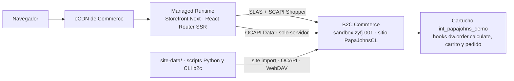

# Demo Papa Johns Chile · traspaso técnico

- **Actualizado:** 18-nov-2026 · **Demo:** viernes 20-nov-2026
- **Qué es:** la demo de e-commerce que Avatar (partner implementador de Salesforce) construyó para la preventa de Papa Johns Chile: una tienda en **Storefront Next** sobre **B2C Commerce** (sandbox `zyfj-001`, sitio `PapaJohnsCL`), publicada en **Managed Runtime (MRT)**.
- **Para quién:** el equipo técnico que recibe la carpeta. Empieza aquí; el detalle está en los documentos enlazados.
- **Alcance de la demo:** solo B2C Commerce. OMS, Marketing Cloud y MuleSoft forman parte de la propuesta, pero en la demo se explican con la arquitectura y no se integran.
- **La preventa (propuesta, alcance, documentos del cliente)** está en [PREVENTA.md](PREVENTA.md).

## 1. Estado en una mirada

| Qué | Estado |
|---|---|
| Sitio público (MRT) | ✅ Bundle 6 (commit `e4da058`, 07-nov): https://sfnextpiz1af0959c456da71a.zyfj-001.my.commercecloud.salesforce.com/cl/es-CL/ |
| Última validación de punta a punta | ✅ VAL-FINAL, 07-nov: **apta, 8,5/10** ([informe](demo/revisiones/VAL-FINAL.md)); pedido de prueba `00000111` |
| Rama de integración | `demo` en `e4da058`, al día con `origin/demo`. No hay commits después del 07-nov |
| Construido | Home por perfil, Menú, Ficha y hoja «Arma tu pizza» (extras, quitar ingredientes), mitades, Ofertas y constructor Super Dúo/Trío, Tienda y modalidad, Carrito, Checkout y confirmación de marca, Papa Puntos con canje, Mi cuenta, venta cruzada, 404 de marca |
| **No construido** | Seguimiento del pedido (SEG), Panel del presentador (PAN), Ingreso con código sin contraseña (ING). Sus extensiones (`pj-tracking`, `pj-presenter`, `pj-login`) están registradas pero vacías. Tampoco existen las rutas `/resource/pj-demo/*` del panel (CONTRATO §4.6) |
| Pendiente de la fase de pulido (F5) | Lighthouse y LCP, accesibilidad, regresión de los tres guiones, guion del presentador y plan B ([PLAN F5](demo/PLAN.md)) |
| Incidencias abiertas | [demo/BITACORA-INCIDENCIAS.md](demo/BITACORA-INCIDENCIAS.md): 5 decisiones pendientes y unas 40 incidencias, entre funcionales, de datos, visuales y deuda técnica |

> **18-nov: se borró el sandbox `zyfj-001`.** El sitio público y el backend de la demo ya no funcionan. La reconstrucción paso a paso (sandbox, Account Manager, SLAS, Business Manager, datos, Page Designer y MRT) está en [storefront/AMBIENTE.md](../AMBIENTE.md).

### 1.1 Antes del 20-nov: lo que no se debe abrir en la demo

- «Mis pedidos» del template falla con `getCustomerOrders` (BI-15).
- `/login`: sin «Enable Email Verification» en el sandbox es correo + contraseña, y conserva parte del template (BI-05, BI-29).
- «Repetir pedido» reemplaza el carrito y pierde las personalizaciones (BI-11, BI-34).
- No comparar velocidad con la competencia sin una medición de Lighthouse (BI-71).

## 2. Arquitectura



| Pieza | Dónde | Notas |
|---|---|---|
| Storefront | `storefront/` (template Storefront Next oct-2026, `2026.10.0`) | React 19 + React Router (SSR), Tailwind/shadcn, Vitest, Storybook. Las pantallas de la demo son **extensiones** `src/extensions/pj-*`; el core del template se toca solo con marcadores `@sfdc-extension-*` |
| Cartucho | `storefront/cartridges/int_papajohns_demo` | Hooks de SCAPI: precio de mitades (promedio), extras por tamaño (`c_pjExtraPrices`), validación de combos, pedido mínimo de delivery y colocación del pedido. Requiere el **feature switch de hooks de SCAPI** (activado el 07-nov) |
| Datos del sitio | `storefront/site-data/` | Reconstruye catálogo (271 productos), precios, inventario, 32 tiendas, promociones, cupones, clientes de demo y preferencias. Ver [site-data/README](../site-data/README.md) |
| Contenido | Page Designer (librería `PapaJohnsCLLibrary`) + OCAPI Data API | Los componentes de Page Designer de la Home usan `@Component` |
| Hosting | MRT con eCDN | El origen `…exp-delivery.com` responde 403 por diseño; se entra por el hostname de eCDN |

## 3. Repositorios, ramas y worktrees

- **Un solo repo:** `sfcc-sfra/storefront-next` (privado). El código está en la raíz del repo y esta documentación en `preventa/`. **`preventa/` no se compila ni se despliega:** está excluida de `tsconfig`, Biome y OxLint; el build solo toma `src/`, y los despliegues suben `build/` (MRT) y `cartridges/`.
- **Fuera del repo:** PDF, videos y los secretos (`preventa/.gitignore` y `.gitignore`). Qué era cada archivo, dónde está transcrito y su URL de origen: [FUENTES.md](FUENTES.md).
- **Al clonar:** copiar `dw.json` a la carpeta que contiene el repo (los scripts lo buscan hacia arriba) y `.env` a la raíz del repo. Ambos se documentan en [AMBIENTE.md](../AMBIENTE.md).
- **Rama de integración:** `demo`. Lo que se presenta y lo que se despliega sale de aquí.
- **Ramas por historia:** `hu/<CÓDIGO>` (HOM, MEN, PRO, OFE, TIE, CAR, CHK, CTA, DAT, INT, VIS, VEN), todas integradas en `demo`. `val/c1`, `val/c2` y `tmp/entradas` fueron ramas de validación; se pueden borrar.
- **Worktrees:** `storefront-wt/<CÓDIGO>` (uno por rama `hu/*`). Están todos integrados; se pueden quitar con `git worktree remove` cuando ya no se usen.
- **`package.json`:** `name` es `sfnext-pizza`, el nombre con que se despliega en MRT (commit `f9a7464`).

## 4. Puesta en marcha local

**Requisitos:** Node ≥ 24 (probado con 24.3.0), pnpm 10.30, Python 3 (scripts de `site-data/`; Pillow solo para `compose_combo_images.py`).

```bash
cd storefront
pnpm install          # el repo exige paquetes publicados hace ≥ 48 h (minimumReleaseAge 2880); no saltarse la política
pnpm dev              # http://localhost:5173/cl/es-CL/
```

- **Variables (`storefront/.env`, no versionado):** `SFCC_ORIGIN`, `COMMERCE_API_SLAS_SECRET`, `SFCC_OAUTH_CLIENT_ID`, `SFCC_OAUTH_CLIENT_SECRET` (OCAPI de servidor, nunca con prefijo `PUBLIC__`), `MRT_PROJECT`, `MRT_TARGET`, `HYBRID_PROXY_*`. Base en `.env.default`.
- **`dw.json` (carpeta que contiene el repo, fuera de él):** hostname, usuario, clave, `client-id` y `client-secret` del sandbox. Lo usan el CLI `b2c` y los scripts. **Contiene secretos: no se comparte ni se sube al repo.** Si WebDAV u OCAPI responden 401, la clave venció y hay que renovarla.
- **Perfiles de la demo:** `?perfil=valentina|diego|sofia` (cookie `pj_perfil`, 7 días); `?perfil=auto` vuelve a la regla. Hora forzada: `?hora=almuerzo|partido|celebracion|bajon|ahora`. Detalle en [CONTRATO §2](demo/CONTRATO.md).
- **Clientes de demo:** `sofia@`, `diego@`, `valentina@demo.pj.cl` (presentador), `val1..3@` (validadores) y `dev-<código>@` (constructores). Nunca dos personas o agentes con el mismo cliente: comparten el carrito. Detalle en [CONTRATO §3](demo/CONTRATO.md).
- **Puertos usados:** 5173 (`demo`), 5174–5186 (worktrees), 3017 (vista previa de producción). El 3000 lo ocupa otra app local.

### 4.1 Calidad antes de cada commit

```bash
pnpm typecheck && pnpm lint && pnpm test   # ~12.900 pruebas en verde al 07-nov
pnpm build                                  # obligatorio: pnpm dev no detecta imports de *.server en el cliente
```

Commits con el ID de la historia en el mensaje (`CAR-02: …`). Las pruebas existentes no se borran.

## 5. Sandbox y datos

> El sandbox `zyfj-001` se borró el 18-nov. Esta tabla describe cómo estaba; para recrearlo, ver [storefront/AMBIENTE.md](../AMBIENTE.md).

| Dato no obvio | Detalle |
|---|---|
| Instancia y sitio | `zyfj-001.dx.commercecloud.salesforce.com`, sitio `PapaJohnsCL`, locale `es-CL`, moneda CLP |
| Code version | La activa es **`SFRA_UPC_08_21_2026`**, aunque `dw.json` dice `develop`. Desplegar el cartucho con `-v SFRA_UPC_08_21_2026` |
| CLI | Desde `storefront/`: `pnpm b2c … --config ../dw.json --dotenv-file=` |
| Reconstruir el sitio | `site-data/rebuild.sh` (archivo del sitio, cartucho, import, reindex y clientes) y `python3 site-data/ocapi/verify.py` para comprobarlo (43/43 en DAT-02/03/04/11) |
| Contenido y datos | Por **OCAPI Data API** con las credenciales de `dw.json`. Cada cambio queda como script en `site-data/ocapi/` (`pj.py` es el cliente; `pj.site_import(carpeta)` importa sin el CLI) |
| Librería | `PapaJohnsCLLibrary`. Importar con otro ID crea una librería suelta y Page Designer no encuentra los tipos. Hay una librería huérfana `PapaJohnsCL` de una prueba |
| Caché de SCAPI | El storefront pide categorías con `personalized=none`, que queda en caché. Para verificar un import, consultar sin ese parámetro |
| Promociones | OCAPI Data no tiene la colección `/promotions` (usar `promotion_search`). En `promotions.xml` van todas las `<promotion>` antes de las asignaciones a campaña. Super Dúo/Trío = opción `pjCombo` de $0 + promociones `pj-super-duo` / `pj-super-trio` ([CONTRATO §7.1](demo/CONTRATO.md)) |
| Métodos de envío | Importarlos sin `default="false"` falla aunque el job diga OK: revisar el log del job por WebDAV (`pnpm b2c webdav get jobs/... --root logs`). Queda `ZZ_PRUEBA_DELIVERY_TRAMOS` (offline) por borrar en BM |
| Configuración activada a mano | Feature switch de hooks de SCAPI y scope `sfcc.shopper-context.rw` en el cliente SLAS (07-nov). **Falta:** «Enable Email Verification» (ingreso con código) y la llave de Google Places (hoy se usa un respaldo local) |

El modelo de datos completo (atributos `c_pj*` de producto, línea, canasta, pedido y cliente; promociones; tiendas; pedido canónico) está en [demo/CONTRATO.md](demo/CONTRATO.md) §4–§7.

## 6. Despliegue a MRT

```bash
cd storefront
pnpm build                       # sfnext push NO compila: sube build/ tal como está
npx sfnext preview -p 3017       # probar las rutas en la vista previa de producción
pnpm sfnext push --mrt-backend scapi --wait --message "<qué cambia>"
```

- El 07-nov el bundle 3 subió un `build/` viejo (502 en `/menu` y `/promos`). Por eso el build y la vista previa son obligatorios.
- La vista previa por http no guarda las cookies `Secure` (perfil y canasta): los flujos con sesión se prueban en `pnpm dev` o en el sitio público.
- En componentes con `@Component`, los tipos van en `import type` separado y los loaders se toman de `./loaders`, nunca de `*.server` directo.
- Si cambian los hooks, desplegar también el cartucho: `pnpm b2c code deploy cartridges -c int_papajohns_demo -v SFRA_UPC_08_21_2026 --config ../dw.json --dotenv-file=`.
- El push a GitHub lo ejecuta Raúl a mano: el modo automático de Claude lo bloquea.

## 7. Código de la demo

| Extensión | Qué contiene | Estado |
|---|---|---|
| `pj-shared` | Tokens, `PriceTag`, `Stars`, `PointsBadge`, `FoodImage`, `BottomSheet`, `AddedToast`, `BottomNav`, `FulfillmentChip`, `lib/profile.ts`, `lib/points.ts`, `lib/fulfillment.ts`, `lib/format.ts`. API visual en [VIS-API.md](demo/VIS-API.md) | ✅ |
| `pj-home` | Home por perfil y momento, componentes de Page Designer | ✅ |
| `pj-menu` | Menú (PLP) | ✅ |
| `pj-product` | Ficha, hoja «Arma tu pizza», mitades, fichas de combo y simples | ✅ |
| `pj-offers` | Promos y constructor Super Dúo/Trío | ✅ |
| `pj-store` | Tienda y modalidad (retiro/delivery), Locales | ✅ |
| `pj-cart` | Carrito objetivo (UX-3), canje, venta cruzada | ✅ |
| `pj-checkout` | Checkout y confirmación de marca | ✅ |
| `pj-account` | Mi cuenta y `/puntos` | ✅ |
| `pj-login`, `pj-tracking`, `pj-presenter` | Ingreso con código, seguimiento, panel | ⬜ vacías |

Reglas del código: una extensión por área, cada una con sus `locales/es-CL/translations.json`, rutas y `target-config.json`; `src/extensions/config.json` solo lo cambia el integrador. Estándar del template en [storefront/CLAUDE.md](../CLAUDE.md) y `storefront/docs/`.

**Deuda técnica conocida** (BI-80 a BI-84): hay 9 mecanismos para agregar al carrito, que deberían unificarse en `requestConfigure` → `usePjAdd()` → `/action/pj-cart` ([EVAL-agregar](demo/revisiones/EVAL-agregar.md)); hay helpers de imágenes duplicados, y faltan pruebas de las acciones PJ y pruebas e2e de los flujos de compra.

## 8. Cómo se construyó (método)

La demo se construyó con agentes de Claude Code coordinados por una sesión integradora (INT):

- **Historias:** [demo/historias/](demo/historias/README.md), una carpeta por área, con criterios de aceptación. Revisadas antes de construir por REV ([REV-0](demo/revisiones/REV-0-historias.md)).
- **Contrato compartido:** [demo/CONTRATO.md](demo/CONTRATO.md), con nombres, datos, supuestos S-D1 a S-D20 y piezas comunes. Si una historia y el contrato no coinciden, manda el contrato.
- **Flujo:** constructor en su worktree → validador distinto en Chrome sin ventana → integración en `demo` → revisión visual (UXD) al cerrar cada oleada. Detalle en [EQUIPO.md](demo/EQUIPO.md) y [ENCARGO-CONSTRUCTOR.md](demo/ENCARGO-CONSTRUCTOR.md).
- **Agentes del proyecto:** `.claude/agents/` contiene `pj-constructor` y `pj-validador` (Sonnet), `pj-ux` (Opus) y `revisor-objetivos`.
- **Capturas:** los informes de `demo/revisiones/` citan capturas por nombre (`UX-…`, `VAL-…`, `AUD-…`). Esas capturas ya no aplican y no están en el repo: los hallazgos se leen del texto de cada informe.
- **Bitácora de lo hecho:** [PLAN.md](demo/PLAN.md) (bitácora) e [INTEGRACION.md](demo/INTEGRACION.md) (histórico de hallazgos).

## 9. Diseño (fuente de verdad funcional)

- **Markdown por pantalla:** [disenos/README.md](disenos/README.md) y carpetas `01` a `13`. Las reglas de negocio de la demo están en [requerimientos-demo.md](disenos/requerimientos-demo.md) (R1–R6).
- **Lienzo** (referencia visual): https://claude.ai/artifact/WAK6JrPuHueQ1fozG9EXKk, con respaldo en `disenos/_canvas/`.
- **Marca:** Papa Sans y paleta oficial del playbook BGYS con reglas ADA ([playbook](datos/cliente/preventa/06-brand-playbook-bgys.md)). No se usan la Barlow ni los colores del lienzo.
- **Dirección visual:** [UX-1](demo/revisiones/UX-1-direccion-visual.md), [UX-2](demo/revisiones/UX-2-pulido.md), [UX-3 carrito](demo/revisiones/UX-3-carrito.md), [comparación con Melt](demo/revisiones/MELT-vs-PJ.md).

## 10. Mapa de `preventa/`

| Ruta | Qué es |
|---|---|
| `README.md` | Este traspaso |
| `PREVENTA.md` | Mapa de la preventa: propuesta, alcance, documentos del cliente (24-oct) |
| `FUENTES.md` | Originales que no están en el repo (PDF, videos) y su origen |
| `demo/` | Plan, equipo, contrato, historias, incidencias y revisiones de la construcción |
| `disenos/` | Diseño por pantalla y respaldo del lienzo |
| `propuesta/` | Propuesta comercial y técnica (vista unificada, matriz, OMS, MuleSoft, backoffice) |
| `datos/` | Kit y respuestas del cliente transcritas (`cliente/`), datos crudos de papajohns.cl (`raw/`) |
| `PapaJohns-Preventa/` | Originales del cliente (xlsx y html; los PDF están en FUENTES.md) |
| `capturas/`, `extraccion/`, `exploracion.md`, `critica-ux.md` | Investigación inicial y benchmark (histórico) |

Fuera del repo, en la máquina de trabajo: `dw.json` (secreto), `storefront-wt/` (worktrees de las ramas `hu/*`, todos integrados) y `.claude/agents/` (agentes `pj-constructor`, `pj-validador`, `pj-ux` y `revisor-objetivos` de la sesión de Claude Code).

## 11. Siguientes pasos sugeridos

1. Resolver las decisiones pendientes BI-01 a BI-05 de la [bitácora](demo/BITACORA-INCIDENCIAS.md), en especial qué cifra de «Ahorras» manda (BI-02) y si se activa la verificación por correo (BI-05).
2. Corregir las incidencias de severidad A que se ven en la demo: «Repetir pedido» (BI-11, BI-34), saldo de puntos tras canjear (BI-32) y «Body is unusable» al quitar una línea (BI-30).
3. Decidir si Seguimiento y el Panel del presentador se construyen o se muestran con el lienzo. Si se construyen: `pj-tracking`, `pj-presenter` y las rutas `/resource/pj-demo/*` según CONTRATO §4.4 y §4.6.
4. F5: Lighthouse móvil en Home, Menú y Ficha, regresión de los tres guiones, guion del presentador y plan B con capturas o video.
5. Reemplazar los correos de demo por los del presentador (insumo I7) y mantener el ambiente disponible al menos dos semanas después de la demo (T-59).
6. Limpieza: quitar los worktrees y las ramas `val/*` y `tmp/*`, y quitar `/pro-demo` de producción (BI-25).
