# Backoffice actual de Papa Johns Chile — lo que muestra el video

Revisado contra auditoría ([backoffice-video-auditoria.md](backoffice-video-auditoria.md)), 23-oct-2026. Lo que solo se dijo, sin verse en pantalla, va marcado "(se dice, no se ve)".

- **Fuente:** `Demo BackOffice-20261021_101031-Grabación de la reunión.mp4` (grabación de Teams, 1920×1080).
- **Fecha:** miércoles 21-oct-2026, de 10:10 a 10:53 aprox. (según el reloj de la pantalla compartida).
- **Duración:** 48:07. Contenido útil hasta 44:10; después la sala queda vacía y solo hay ruido ("Gracias" repetido por Whisper).
- **Ambiente mostrado:** `backoffice.stage.papajohns.cl` (staging). Lo dicen ellos: *"Este es el ambiente de pruebas, así que posiblemente vamos a ver cosas que no están en producción"* [05:20]. En [32:03] dicen además que staging *"no tiene las últimas liberaciones"*.
- **Presentación de apoyo:** una presentación web de 7 láminas (`papajohns-backoffice-demo.goldentiger1.chatgpt.site`) con el título "Backoffice que mueve la operación".
- **Transcripción:** Whisper large-v3-turbo, en [backoffice-video/transcripcion.txt](backoffice-video/transcripcion.txt). Tiene errores de reconocimiento ("Picab" = pickup, "Disfast Track" = DispatchTrack, "Verdaire/WordDire" = Uber Direct, "Pella/PIA" = PedidosYa, "Arma Turbiza" = Arma tu pizza, "Cintor" = Fintoc, confirmado por el banner "Paga con fintoc y participa por una moto" del front en 28:30). Las citas de este documento están corregidas solo en esos nombres.

## Participantes (nombres tomados de los rótulos de Teams)

| Nombre en pantalla | Rol (por lo que se dice o se ve) |
|---|---|
| Bastian Hidalgo ("Basti") | Papa Johns. Comparte la pantalla y conduce la demo. |
| Una persona de Papa Johns que no se identifica en pantalla | Co-presenta y comenta (negocio y digital). Habla de los KPI, del cross-selling y de la migración. *Inferencia:* puede ser alguien de e-commerce o digital de PJ. |
| Benjamin Noguera ("Benja") | Lado Salesforce. Explica la visión "all-in-one" (Marketing Cloud, OMS). *Inferencia* por el contenido de lo que dice. |
| Lucas Rojas – Salesforce | Salesforce. |
| Minn Navarrete – Salesforce | Salesforce. No aparece en los rótulos muestreados en la auditoría; no verificado. |
| "Lucas" (pregunta por integraciones) | Dice: *"estoy en integraciones, por eso"* [08:02]. No queda claro si es Lucas Rojas o "Lucas M…", otro participante. |
| "Lucho / Luciano" | Pregunta por los polígonos y por Uber Direct. Responde *"somos lo mismo"* cuando lo confunden con Benja [28:27]. *Inferencia:* es del lado Salesforce o partner. |
| Mateo Silva | Pregunta si los tramos de delivery vienen de una solución de loyalty [40:38]. |
| Tiago Montezuma, Claudia Quezada, Francisca Arenas, Matías…, "Salesforce Sala" (sala con varias personas) | Asistentes. No se identifica su rol. |

Al inicio [00:00] se menciona el acuerdo de confidencialidad ("MDA", probablemente NDA) firmado con Salesforce y con el partner. En [12:54] se dice que la propuesta se presenta "el 29".

---

## Recorrido por tramo de tiempo

| Tramo | Pantalla o módulo | Qué se hace y qué se explica |
|---|---|---|
| 00:00–00:57 | Lámina 1, "Backoffice que mueve la operación" (desde 00:05) | Se recuerda la confidencialidad y la agenda. Se verán tres casos cotidianos y no el backoffice entero. |
| 00:58–02:40 | Lámina 2 en pantalla (la conversación sigue) | PJ: *"las acciones más recurrentes… para que un producto se pueda comercializar en nuestro sitio web, en los agregadores, en el call center y en el tótem"* [01:16]. En el audio se oye "en el todo"; "tótem" es probable, pero no se oye con claridad. El objetivo es que el partner pueda proponer *"este back office para monitoreo y control"*. |
| 02:40–03:09 | Láminas 2–4 (la 2 sigue hasta 02:47, la 3 desde 02:48, la 4 un instante en 03:03) | Las decisiones se ordenan en tres grupos: **01 Promociones** (qué ofrecer: productos, precio y condiciones), **02 Tienda** (cómo atiende: horarios, despacho y tiempos) y **03 Control** (qué cambia y qué medir: disponibilidad, parámetros y experiencia). Regla de la lámina 3: *"La oferta aparece donde corresponde. Su alcance depende del canal, despacho y vigencia."* |
| 03:09–05:20 | Menú lateral y **Ofertas → Promociones** (`/offers`) | Se recorre el menú. Las promociones están ligadas a menús y los menús a tiendas, según la tipología de la tienda: chica, mall o regular, cada una con un surtido distinto [03:24–03:58]. Hay pestañas Combos / Promos / PapaPartner. Se explican el canal de venta (web, app, tótem…) y el canal de entrega (delivery, pickup o ambos), la vigencia y el precio distinto por tipo de despacho [04:09–05:12]. 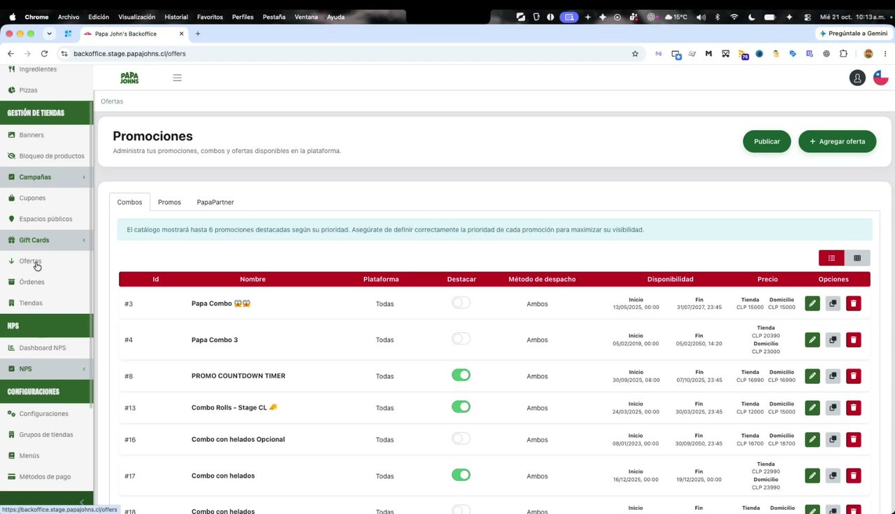 |
| 05:20–06:17 | Editar combo (`/offers/combos/3`) | Requisito fuerte: los cambios del backoffice tienen que verse de inmediato. *"Cualquier cambio que se haga en este backoffice se ve de forma inmediata en el productivo, en el front… para nosotros eso es casi que mandatorio… y no sea una actualización cada X tiempo"* [05:38–06:02]. *"No tiene una capa de caché… esto es in situ, esto es real"* [06:05]. |
| 06:17–13:00 | Misma pantalla (conversación) | Lucas (integraciones) pregunta qué tecnología hay detrás y cómo conectarse [06:33]. PJ responde que esperan un backoffice nuevo, no que el partner reuse el suyo: *"En la licitación tienen que considerar incluso un panel de control… Pero nuevo"* [07:06]. También piden migrar todo: *"la base de datos completa de clientes, las promociones activas, las órdenes, los usuarios… tiene que haber una migración integral"* [07:27]. Aclaran que no piden copiar la pantalla: *"Si ustedes proponen el back office de Salesforce… perfecto. Si van a hacer una aplicación… React, Vue… también está bien"* [09:14]. Benja (Salesforce) explica las vistas unificadas por rol, ve la gestión de tiendas como "Commerce + Order Management" [11:14] y deja campañas y cupones en Marketing Cloud [12:04]. |
| 13:00–18:40 | Editar combo: recorrido completo | Nombres y descripciones por modalidad: los campos son "Nombre" y "Nombre para domicilio" (no hay un campo "para retiro"; el nombre base sirve para retiro). Arriba hay un bloque "Info para card B (Experimento octubre)", y "Mostrar Badge" solo existe dentro de ese bloque. Siguen plataforma, precios por despacho, ingredientes gratis, ocultar o pausar, temporizador y franjas horarias para potenciar horas "valle" [14:05–14:29]. Después vienen los grupos de productos (pasos del combo), el tipo y la variante (masa y tamaño), la limitación de ingredientes en Arma tu pizza, la **pizza de reemplazo**, la asignación a tiendas o grupos con su canal y las imágenes por canal. PJ: *"armar una promoción no es trivial… es una de nuestras columnas en términos de estrategia de comercio"* [17:02]. Pasos obligatorios más un paso **opcional de cross-selling con precio exclusivo dentro del combo** [17:13–17:53]. KPI: *"llegamos a una tasa de cross-selling… cercano al 30%… hoy en torno al 25-30, entonces ustedes tienen que igualarlo e incluso superarlo"* [18:15–18:22]. Piden que la demo incluya Arma tu pizza: *"es nuestro producto diferenciador, es el producto más vendido"* [15:39]. 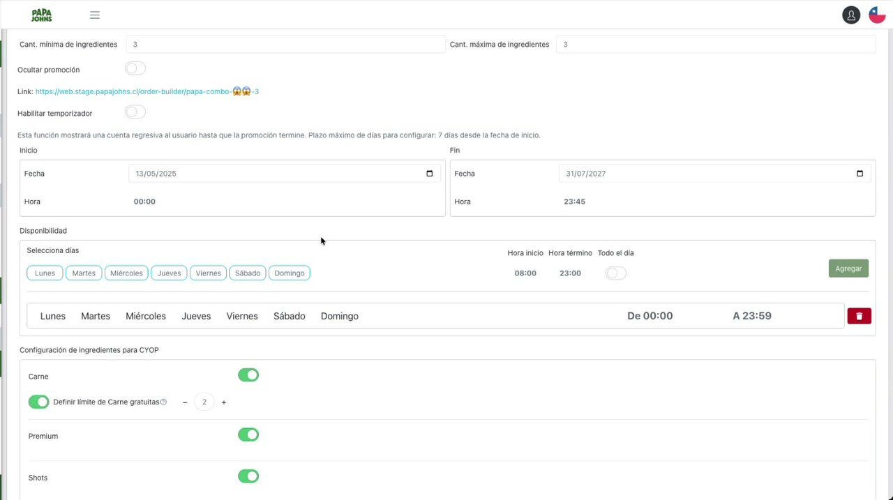 |
| 18:40–19:30 | Lámina 4, "La configuración local cambia la atención" | Cada tienda tiene condiciones propias: horario, modalidad, tiempos estimados. Están incorporando tiempos dinámicos [19:02]. Agregan sobre promociones: *"nosotros damos el orden de las promociones… en un tiempo establecido, tenemos cronómetros, se cambia, se apaga"* [19:14]. |
| 19:30–22:20 | **Tiendas** (`/stores`) | El listado muestra el estado por modalidad (íconos de delivery y retiro en verde o rojo), el tipo de cierre ("Por horario"), las incidencias, el estimado de entrega y el de retiro. El panel lateral de **Promociones asociadas** se abre desde la columna Incidencias. Muestra contadores (7 publicadas, 6 disponibles, 1 no disponible) y, por promo, el estado, el canal (APP, WEB, TOTEM) y el detalle. "N elementos bloqueados" aparece en promos que siguen **Disponibles**. Solo #220 está No disponible, con "Grupo requerido no disponible en el menú" [20:15]. Algarrobal (#93) tiene las dos modalidades cerradas por horario, aunque la frase de 19:44 suena a cierre solo de pickup. *"Esto es algo nuevo y fue súper valorado… si nos dicen el Tótem no está vendiendo tal promoción… podemos ir a las tiendas y revisar"* [20:04–20:38]. El ID de tienda sirve para asignar tiendas al perfil de un **gerente de mercado**, que *"solamente pueda ver esa tienda"* [21:04–21:46]. Se ven el botón "Filtros" y flechas de orden en "Estimado entrega" y "Estimado retiro", pero no se usan. El orden por tiempo de entrega y los filtros de tiendas cerradas (total, solo delivery, solo pickup) se dicen, no se ven [21:51–22:05]. 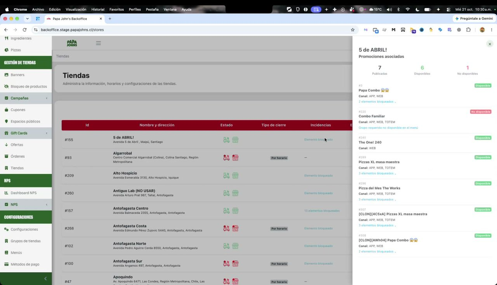 |
| 22:20–28:07 | **Editar tienda** (`/stores/155`, "5 de ABRIL!") | Se ven los datos básicos y los menús asociados (PJ, Tótem PJ, PedidosYa). Modo de pedido: domicilio, retiro o cerrar, *"pero no todos los operadores… pueden… están relacionados con tipos de perfiles"* [23:00]. Sigue la última milla: en pantalla se ve el proveedor "PedidosYa Envíos" (el desplegable no se abre) y "Habilitar Last mile: FarEye" en OFF. Lo de *"Uber Direct, a través de DispatchTrack"* se dice, no se ve [23:24]. Después vienen los espacios públicos: uno dice *"esto no lo estamos usando"*, y otro explica que sirven para que la tienda gane protagonismo *"en una zona que sea pública, un strip center, un parque, un mall"* [23:38–23:56]. Luego, los IDs de integración (*"PedidosYa, Aloha, que es como el OMS, Uber Eats, Zendesk"*, según la re-transcripción del tramo 23:50–24:30), los medios de pago por tienda y los tiempos estimados (*"van a desaparecer porque después van a ser tiempos dinámicos"*; *"es la promesa de entrega que va a ver el cliente"* [24:33–24:53]). Luego viene la geolocalización. Que el **polígono de reparto y las zonas de exclusión** los dibuja servicio al cliente en Google Maps se dice, no se ve [25:02–25:55]: la tienda 155 no tiene zonas de reparto ni de exclusión, y el mapa solo muestra un pin. El solapamiento con tiendas colindantes también se dice, no se ve: el toggle queda en OFF [26:02–26:28]. Hacia 28:04 se pulsa "Agregar" en Zonas de reparto. Aparece un **hexágono editable por defecto** con "Nombre de la zona (requerido)", un toggle de activación y "Eliminar esta zona", y solo entonces se habilita el "Agregar" de las zonas de exclusión. Luciano pregunta cómo consume el front el polígono. Respuesta: *"esa dirección va a la API de Papa Johns y después… a través de la API de Google Maps cuáles son las tiendas que están dentro de ese polígono"* [26:55–27:13]. 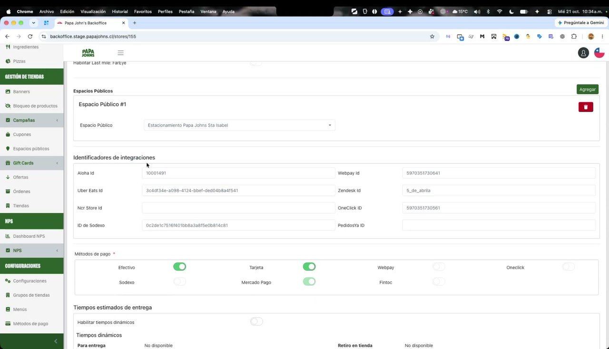 |
| 28:08–29:27 | **Front `papajohns.cl` (producción) con DevTools** | Modal "¿Cómo quieres pedir hoy?" con Delivery o Retiro en punto. Con la dirección inicial aparece la tienda de prueba "[LAB] Laboratorio Chile PROD v19 – Tienda abierta" en producción. La dirección se autocompleta y aparecen la tienda asignada, "Cuanto antes (30 min aprox.)" y "Más tarde, elige una hora". En retiro se listan 3 tiendas cercanas con su promesa o "Programar pedido". En DevTools se ven `GET https://api.papajohns.cl/v1/pickup_places/near_me?latitude=…&longitude=…&quantity_near_stores=3`, con `Cache-Control: max-age=0, private, must-revalidate`, `ETag` y `Access-Control-Max-Age: 7200` [28:57]. También aparece la llamada `delivery?latitude=…`, pero su ruta completa no se ve. 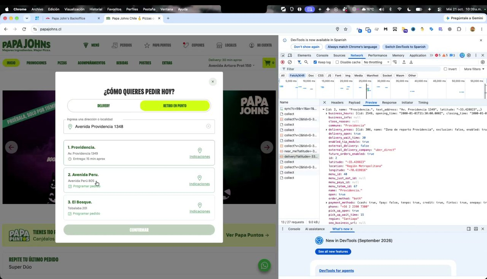 |
| 29:28–30:40 | Editar tienda: horarios | Horarios de tienda y de entrega por día, con varias franjas (*"abrir en la mañana… y volver a abrir en la noche"*). Ninguna franja cruza la medianoche: la madrugada se carga como franja 00:00–01:00 del día siguiente. Los horarios de entrega no copian los de tienda. El guardado se hace con los botones "Limpiar" y "Actualizar". Hay descripciones para SEO y publicación en el buscador de locales. Teléfono y demás datos se reflejan en el sitio y la app. Flujo: *"guardar y ahí ya podemos poner publicar la tienda"* [30:22]. 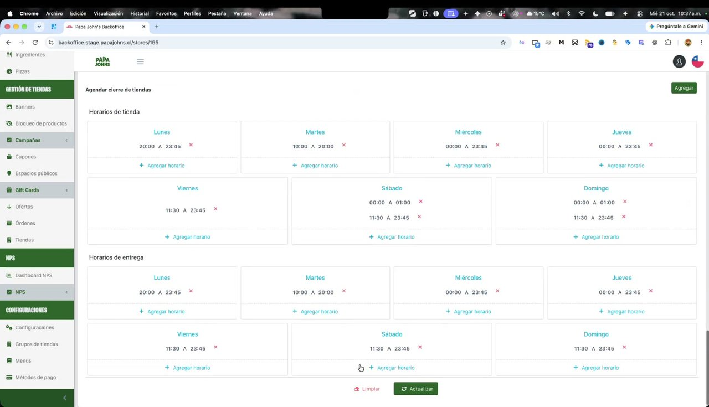 |
| 30:40–31:30 | Lámina 5, "La operación cambia; el commerce debe responder" | Bloqueos por tienda (producto, ingrediente, variante), montos y pagos (límites de compra y orden visible de medios de pago), grupos de tiendas y NPS. |
| 31:30–32:50 | **Bloqueo de productos** (`/disabled`, "Productos Deshabilitados") | Se bloquea por tienda (el campo "Tienda" es obligatorio) eligiendo tipo, nombre y variante. El tipo admite **Pizza, Complemento, Ingrediente, Promociones y Combos** [32:17]. El listado pide elegir una tienda para mostrar sus bloqueos. Bloquear en todas las tiendas se dice, no se ve [31:41]. El modal se cierra sin agregar nada. *"Se me acabaron la XL… bloqueo la variante XL y automáticamente se me bloquea en todas las especialidades"*: esta función estaría en producción y no en staging [32:07–32:20]. Diferenciador: *"evitamos que las tiendas bloqueen alguna especialidad, porque… podemos ofrecer un producto e incluso un ingrediente sustituto. Entonces también eso necesitamos que ustedes puedan resolverlo"* [32:24–32:41]. 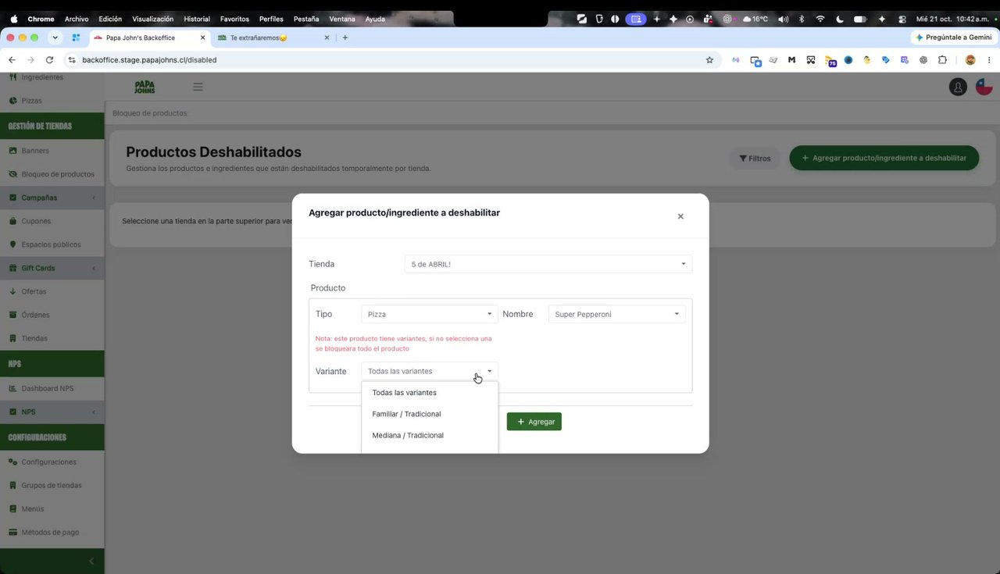 |
| 32:50–34:00 | **Métodos de pago** (`/payment-methods`) | Orden de los medios de pago por modalidad, con un corte de "visibles primero" y "Ver más opciones de pago". El motivo es comercial: *"hay acuerdos comerciales con los distintos actores… hoy tenemos preferencia con Fintoc, mañana con Webpay"* [33:07–33:20]. La pantalla dice *"Aquí solo puedes configurar el orden. Para editar o desactivar métodos, ve a Tiendas > Editar tienda"*. Sin embargo, en 34:57, ya con el dashboard NPS en pantalla, dicen *"acá ya lo podemos ver de forma masiva… incluso podemos quitar, apagar o prender alguno"*. Es una contradicción que queda en Preguntas abiertas. Al cargar la página se ve durante 1 s una lista provisional de 7 métodos con límite 4. 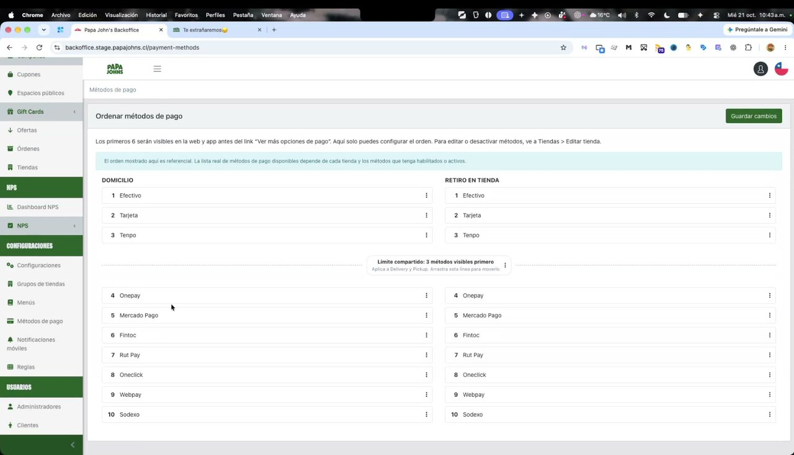 |
| 34:00–35:10 | **Dashboard NPS** | *"Súper importante para la operación, porque define cómo está funcionando cada tienda"*. Se puede abrir por tienda, por grupo o en total. Lo llaman *"esta torre de control"* para el negocio y los gerentes de mercado [34:01–34:46]. 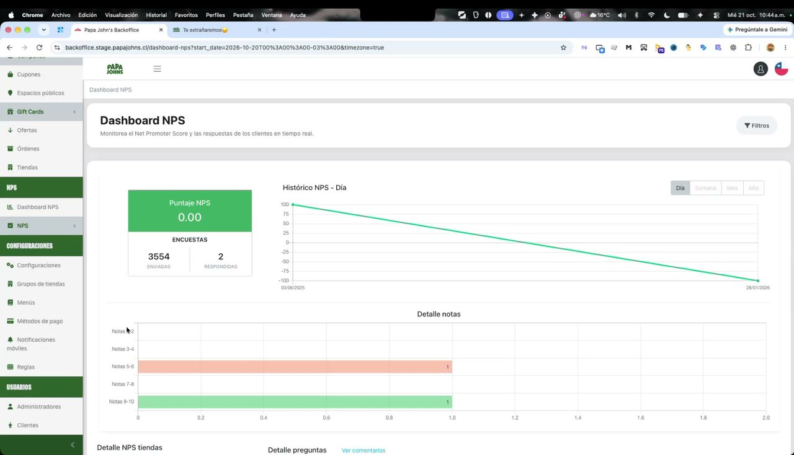 |
| 35:10–36:00 | **Configuraciones** (`/settings`) | Desactivar servicios (API Core, de usuarios, de órdenes). Montos mínimos y máximos de compra por modalidad, y el campo "Precio mínimo con puntos" (2.000). Lo dicho es *"el precio mínimo para poder **tener** puntos con temas loyalty"*: no queda claro si es para acumular o para pagar con puntos (ver Preguntas abiertas). Siguen pedido anticipado, ETA, delivery fijo o gratis, cupón por abandono, códigos de invitación y app móvil. 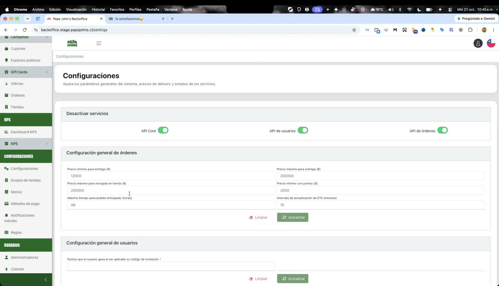 |
| 36:00–37:37 | **Grupos de tiendas** (`/stores-groups/28`, "Piloto Delivery Fee") | Cobro de envío único o **por tramos de monto**, aplicado a un grupo de tiendas. Al abrir el grupo, los tramos están en OFF y rige el cobro fijo de 990. El presentador activa los tramos en vivo hacia 36:33 ("Reemplazado por delivery por tramos"); no se ve si guarda. Cobro fijo y tramos son excluyentes. *"Tenemos que tener siempre la capacidad de que algo sea para una tienda, para un grupo de tiendas, para un menú completo, o para todas, o para ninguna"* [36:30–36:41]. El objetivo de los tramos es el incentivo de ticket: *"agrega un poco más y tu delivery en vez de costar 2 mil va a costar mil"* [36:48–37:15]. En pantalla, el tramo 2 va de 10.000 a 14.999; de palabra se dice "14 mil 990". 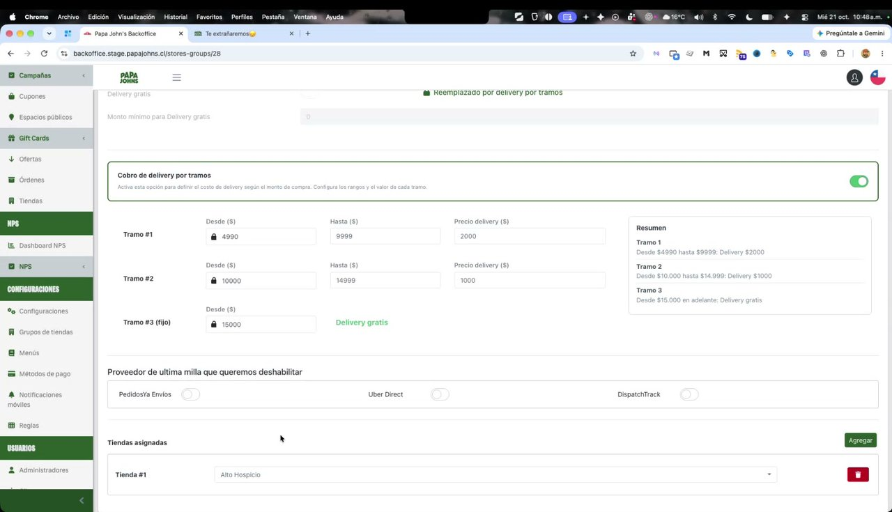 |
| 37:37–41:59 | Misma pantalla (preguntas) | Luciano cuenta que pidió por la app y lo entregó Uber [37:44]. PJ: hay integración directa con Uber Direct por API, y además DispatchTrack, su proveedor de última milla, despacha vía su propia integración con Uber Direct [38:55–39:44]. En pedidos de agregadores: *"tengo cero visibilidad del dato del cliente… solo los datos de la orden"*, y Uber avisa solo al entregar [39:44–40:29]. Mateo pregunta si los tramos son de loyalty. Respuesta: no, *"depende solamente del total de la orden"*, se calcula en el checkout y no se traspasa al agregador [40:38–41:57]. |
| 42:00–44:10 | Láminas 6–7 y cierre | Lámina 6, "¿Cómo llegan estas reglas al commerce?": alcance global o por tienda (*"¿cómo se representa cada nivel y los grupos de locales?"*), condiciones de oferta, disponibilidad y compra. Pregunta abierta: *"¿cómo mantenemos coherencia entre lo que configura la operación y lo que ve el cliente?"*. Lámina 7: "Configurar, responder y aprender". Objetivo: *"que el nuevo commerce cubra los casos reales de cada tienda"*. PJ cierra: los casos son referencia *"para definir… cómo va a ser el nuevo centro de comando"* [43:05]. Salesforce felicita: *"Rodrigo… estaba orgulloso de las capacidades"* [43:39]. |
| 44:10–48:07 | Sala vacía | Sin contenido. |

---

## Inventario de módulos y funciones

Menú lateral completo visto en pantalla (03:12 y 32:59):

- **Productos:** Complementos, Ingredientes, Pizzas.
- **Gestión de tiendas:** Banners, Bloqueo de productos, Campañas (submenú), Cupones, Espacios públicos, Gift Cards (submenú), Ofertas, Órdenes, Tiendas.
- **NPS:** Dashboard NPS, NPS (submenú).
- **Configuraciones:** Configuraciones, Grupos de tiendas, Menús, Métodos de pago, Notificaciones móviles, Reglas.
- **Usuarios:** Administradores, Clientes.

En la cabecera hay una bandera de Chile. *Inferencia:* hay selector de país o mercado.

Leyenda de la columna "Usuarios": **(D)** se dice en el video, **(V)** se ve en pantalla, **(I)** inferencia.

| Módulo | Funciones vistas | Usuarios | Datos | Sistemas relacionados |
|---|---|---|---|---|
| **Ofertas / Promociones** (Combos, Promos, PapaPartner) | Listado con Id, nombre, plataforma, destacar, método de despacho, vigencia (inicio y fin), precio tienda y domicilio, editar, clonar y eliminar. Vista de lista o grilla. Botones **Publicar** y **Agregar oferta**. Aviso: *"El catálogo mostrará hasta 6 promociones destacadas según su prioridad"*. | Comercial o digital (D: *"desde el lado comercial o desde el lado digital"*) | Promociones, precios por modalidad, vigencias | Web, app, tótem, agregadores, call center (D) |
| **Editar combo** | Botones "Clonar Combo" y "Volver"; el guardado es con "Limpiar" y "Actualizar". Textos base y por domicilio: Nombre / Nombre para domicilio, Descripción / Descripción para domicilio, "Texto desplegable alternativo" y su versión delivery. No hay un campo "para retiro". **Card B** en el bloque "Info para card B (Experimento octubre)", que repite los textos y es el único lugar con "Mostrar Badge". SEO: nombre, descripción y "Mostrar en página de promociones de SEO". **Id cupón de cortesía** (76). **Personalizable**. **Id agrupador** (8). Posición. Método de despacho (Ambos). Plataforma (Todas). Precio en tienda y precio domicilio. **Ingredientes gratis** (4). Cantidad mínima y máxima de ingredientes (3/3). Ocultar promoción. Link al `order-builder`. **Temporizador** (cuenta regresiva, máx. 7 días desde el inicio). Inicio y fin con fecha y hora. **Disponibilidad por días y franja horaria** o todo el día. **Configuración de ingredientes para CYOP**: Carne (con "Definir límite de Carne gratuitas" = 2), Premium, Shots, Vegetal. **Grupos de productos** (pasos), cada uno con Opcional, nombre y productos. Cada producto tiene tipo (Pizza, Complemento…), producto (Super Pepperoni, The Works SUPER, Pollo BBQ, Arma tu pizza, Pizza por mitades), variante (p. ej. "Extra grande / Tradicional"), "(Solo Crea/Arma tu pizza) Limitar ingredientes", **precio delta**, posición y **"Usar como pizza de reemplazo"**. **Grupo de menús y/o tiendas** con tipo (Tienda…), nombre (p. ej. "Lab Aloha STAGE (Aloha 19)", Las Condes, Antofagasta Centro) y **canal** (OLO, Todos). **Imágenes por canal**: web 1542×594 webp, app 500×500 webp, versiones delivery de ambas, **PeYa** 1440×1080, **PapaPuntos** 654×784, **Tótem** (encabezado 1080×416, foto en card de menú 150×182, card selector 120×120). | Comercial o digital (D) | Ver la columna anterior | Tótem, PedidosYa, PapaPuntos (loyalty), cupones (V) |
| **Tiendas** (listado) | Estado por modalidad, tipo de cierre (Por horario), **incidencias** ("Elemento bloqueado", "13 elementos bloqueados"), estimado de entrega y retiro, flechas de orden y botón "Filtros" (las opciones de filtro, cerradas total o por modalidad, se dicen, no se ven), Publicar, Agregar tienda, clonar, vista de lista o grilla. **Panel de promociones asociadas por tienda (diagnóstico de vendibilidad)**: contadores de publicadas, disponibles y no disponibles; por promo, el estado (Disponible / No disponible), el canal (APP, WEB, TOTEM) y un detalle desplegable. Una promo con "N elementos bloqueados" puede seguir **Disponible**. La que queda No disponible muestra "Grupo requerido no disponible en el menú". | Operación, gerentes de mercado (D) | Estado operativo y diagnóstico de vendibilidad | Tótem, web, app |
| **Editar tienda** (pestañas Configuración y Promociones; Clonar tienda) | Nombre, teléfono. **Menú PJ, Menú Tótem PJ y Menú PedidosYa asociados**. Mostrar en página de locales, descripción, URL de Google My Business. **Modo de pedido**: Domicilio, Retiro en tienda, Cerrar tienda (según perfil). **Delivery última milla**: activo y proveedor (se ve "PedidosYa Envíos"; las demás opciones del desplegable no se ven). "Habilitar Last mile: FarEye" en OFF. **Espacios públicos** (p. ej. "Estacionamiento Papa Johns Sta Isabel"): dicen que no se usa, aunque explican su propósito (strip center, parque, mall), y la API de retiro devuelve `public_spaces`. **Identificadores de integraciones**: Aloha Id, Uber Eats Id, NCR Store Id, ID de Sodexo, Webpay Id, Zendesk Id, OneClick ID, PedidosYa ID. **Métodos de pago por tienda**: Efectivo, Tarjeta, Webpay, Oneclick, Sodexo, Mercado Pago, Fintoc. **Tiempos estimados**: habilitar tiempos dinámicos; tiempos personalizados (entrega 30, retiro 15); "Tiempo constante de ETA" (12); excepciones de tiempos periódicas y específicas. **Geolocalización**: dirección, comuna, región, lat/long, "Localidad para SEO". **Zonas de reparto y zonas de exclusión** sobre Google Maps. Al agregar una zona se crea un hexágono editable con nombre obligatorio, toggle de activación y "Eliminar esta zona". La exclusión solo se habilita si existe una zona de reparto. El dibujo a mano, la exclusión y el solapamiento se dicen, no se ven. Toggle "Ver zonas colindantes" (máximo dentro de un radio de 8 km), sin activar. **Agendar cierre de tiendas**. **Horarios de tienda y horarios de entrega** por día, con varias franjas; ninguna cruza la medianoche, y la madrugada es una franja del día siguiente. El guardado es con "Limpiar" y "Actualizar". | Operación; servicio al cliente dibuja los polígonos (D); perfiles con permisos distintos (D) | Datos maestros de tienda | Aloha, NCR, Uber Eats, PedidosYa, Sodexo, Webpay/Oneclick, Zendesk, FarEye, DispatchTrack, Uber Direct, Google Maps, Google My Business (V/D) |
| **Bloqueo de productos** ("Productos Deshabilitados") | Agregar un elemento a deshabilitar por tienda (campo "Tienda" obligatorio): tipo (**Pizza, Complemento, Ingrediente, Promociones, Combos**), nombre y variante (Todas, Familiar/Tradicional, Mediana/Tradicional; complementos, p. ej. "coca cola 591 ml"). Nota: *"si no selecciona una se bloqueará todo el producto"*. El listado se ve por tienda ("Seleccione una tienda…") y tiene filtros. El bloqueo en todas las tiendas (se dice, no se ve) y el bloqueo por tamaño en todas las especialidades (se dice, no se ve; en producción). | Tiendas u operación (I); *"evitamos que las tiendas bloqueen alguna especialidad"* (D) | Disponibilidad temporal por tienda | Alimenta las incidencias de Tiendas (V) |
| **Métodos de pago** (orden) | Orden por Domicilio y por Retiro en tienda con drag & drop. Corte "Límite compartido: 3 métodos visibles primero (aplica a Delivery y Pickup)". Guardar cambios. Medios: Efectivo, Tarjeta, Tenpo, Onepay, Mercado Pago, Fintoc, Rut Pay, Oneclick, Webpay, Sodexo. Según la pantalla, la activación se hace en Tiendas > Editar tienda. Según lo dicho en 34:57, también se puede prender y apagar de forma masiva desde aquí (se dice, no se ve; el menú "⋮" de cada fila no se abre). El catálogo no es uniforme: la tienda tiene 7 toggles, sin Tenpo, Onepay ni Rut Pay; aquí hay 10; la API trae `fpay`, `tenpo`, `onepay` y `credit`. | Comercial (I, por los acuerdos comerciales) | Orden y visibilidad | Pasarelas (V) |
| **Dashboard NPS** | Puntaje NPS, encuestas enviadas y respondidas (3554/2 en stage), histórico por día, semana, mes y año, detalle de notas (0–10 por rangos), **NPS por tienda**, detalle por pregunta (Sí/No: "¿Recibiste el pedido completo?", "¿…en el tiempo comprometido?"; satisfacción: atención del personal, estado del local, sabor), "Ver comentarios". Botón "Filtros" (no se abre) y `start_date` en la URL. Apertura por tienda, grupo o total (se dice, no se ve). | Negocio, gerentes de mercado (D) | Encuestas post-compra (I) | No se dice qué herramienta envía las encuestas |
| **Configuraciones** (generales) | **Desactivar servicios**: API Core, API de usuarios, API de órdenes. **Órdenes**: precio mínimo para entrega (12.000), máximo para entrega (200.000), máximo para recogida (200.000), **precio mínimo con puntos** (2.000; ¿para acumular o para pagar? Ver Preguntas abiertas), **máximo tiempo para pedido anticipado** (48 h), **intervalo de actualización de ETA** (15 min). **Usuarios**: "Puntos que el usuario gana al ser aplicado su código de invitación" (los gana quien invita). **Principales**: precio fijo de delivery, monto mínimo para delivery gratis, límite de tiempo máximo de entrega (40 min), **cupón de descuento por abandono de sitio**, **códigos de invitación** (25 % de descuento), **App móvil**: modal de cupones, forzar update de la app. | TI y digital (I) | Parámetros globales | API propia de PJ (V) |
| **Grupos de tiendas** | Listado (p. ej. "Piloto Delivery Fee", 1 tienda; "Tiendas Delivery", 2). Editar: nombre, precio mínimo para entrega (4.990), **cobro fijo de delivery** (990, delivery gratis, monto mínimo), **cobro de delivery por tramos** (4.990–9.999 → $2.000; 10.000–14.999 → $1.000; desde 15.000 → gratis, con resumen). Es excluyente con el cobro fijo. El "Desde" de cada tramo está bloqueado, y el del tramo 1 es igual al precio mínimo del grupo. En stage estaba en OFF y se activó en vivo. Además: listado paginado, vista de lista o grilla, guardado con "Guardar", **proveedores de última milla a deshabilitar** (PedidosYa Envíos, Uber Direct, DispatchTrack), tiendas asignadas. | Comercial u operación (I) | Reglas masivas por grupo | Última milla (V) |
| **Menús** | Solo se menciona: la tienda tiene un menú según su tipología (chica, mall, regular) y hay menús distintos para Tótem y PedidosYa. | — | — | — |
| **Usuarios y perfiles** | Hay muchos perfiles (operación, gerentes de mercado, comercial, digital, tecnología). Las tiendas visibles se asignan por ID de tienda y algunas acciones (cerrar tienda) se restringen por perfil (D). Menú Administradores y Clientes (V, no se abre). | TI (I) | — | — |
| No mostrados | Complementos, Ingredientes, Pizzas, Banners, Campañas, Cupones, Gift Cards, Órdenes, Notificaciones móviles, Reglas, Clientes, NPS (submenú). Aparecen en el menú, pero no se abren. | — | — | — |

### API y front observados

- Front de producción `papajohns.cl`, con menú (Menú, Pedidos, Papa Puntos, Cupones, Locales, Mi cuenta) y categorías (Inicio, Promociones, Pizzas, Acompañamientos, Bebidas, Postres, Extras). Tiene banner "Papa Puntos: tienes 110 Papa Puntos, canjéalos por…", "Repite tu último pedido" y botón de WhatsApp.
- El front muestra en producción una tienda de prueba, "[LAB] Laboratorio Chile PROD v19" [28:20]. Al salir de la pestaña, su título cambia a "No te vayas! 😢" o "Te extrañaremos 😅". *Inferencia:* está ligado al cupón por abandono.
- `api.papajohns.cl/v1/pickup_places/near_me?…&quantity_near_stores=3`, con `Cache-Control: max-age=0, private, must-revalidate`, `ETag` y `Access-Control-Max-Age: 7200`. Responde desde `18.164.21.95`; *inferencia:* CloudFront (Lucas preguntó *"esto es lo que tienen en AWS montado"* [06:46]). La respuesta trae `pickup_stores` y `public_spaces`. Hay una segunda llamada, `delivery?latitude=…`, cuyo prefijo de ruta no se ve. Su respuesta (una tienda) incluye `close_reason`, `delivery_open`, `pick_up_open`, `business_hours`, `delivery_areas` (`{id, name, exclusion, enabled}`), `delivery_wait_time`, `pick_up_wait_time`, `enabled_tip_module` (**propinas**), `external_delivery`, `external_delivery_company: "uber_direct"`, `future_orders_enabled`, `menu_id`, `menu_totem_id`, `menu_peya_id`, `menu_just_eat_id`, `order_method: "both"`, `payment_methods {cash, fpay, tenpo, credit, fintoc, onepay…}` y `seo_business_url`.
- El combo enlaza a `web.stage.papajohns.cl/order-builder/papa-combo-…-3`. *Inferencia:* la ruta del armado de combos en el front se llama "order-builder".

---

## Reglas de negocio mencionadas o vistas

**Alcance y jerarquía**
- Hay 5 niveles de alcance: tienda, grupo de tiendas, menú completo, todas o ninguna (D [36:32]).
- Promoción → menú → tienda. Cada tienda tiene un menú según su tipología: chica, mall o regular (D [03:24–03:58]).
- Hay menús separados para el canal propio, el tótem y PedidosYa en cada tienda (V). En la API también aparece `menu_just_eat_id`.

**Promociones y combos**
- Hay dos ejes de canal: el **canal de venta** (web, app, tótem…, campo "Plataforma") y el **canal de entrega** (delivery, pickup o ambos, campo "Método de despacho"). Puede haber promociones exclusivas por cualquiera de los dos (D [04:25–04:54]).
- El precio se diferencia por modalidad: precio en tienda o retiro y precio domicilio. Los nombres y descripciones tienen una versión base y una "para domicilio" (V).
- Vigencia con fecha y hora de inicio y fin, más disponibilidad por días de la semana y franja horaria, para potenciar horas "valle" (D [14:05–14:29]).
- El temporizador o cuenta regresiva en el front puede durar como máximo 7 días desde el inicio (V).
- Hay como máximo **6 promociones destacadas** en el catálogo, por prioridad. El orden lo define el negocio y puede programarse ("cronómetros") (V/D [19:14]).
- La promoción se puede ocultar o pausar sin borrarla (D).
- El combo se arma por **pasos o grupos**: pizza → acompañamiento → bebida o postre. Los grupos son obligatorios u opcionales. El grupo opcional de **cross-selling tiene precio exclusivo distinto al del catálogo** (D [17:13–17:53]).
- Cada producto de un grupo tiene variante (masa y tamaño), **precio delta** y posición (V).
- Arma tu pizza (CYOP) se configura con ingredientes gratis, mínimo y máximo de ingredientes, categorías habilitadas (Carne, Premium, Shots, Vegetal) y **límite de carnes gratuitas**. También se puede limitar qué ingredientes se muestran (D/V [15:45]).
- **Pizza de reemplazo**: se muestra automáticamente si una opción de la promo deja de estar disponible, por ejemplo por un ingrediente bloqueado (D/V [16:02]).
- La promoción puede tener un **cupón de cortesía** asociado y un **Id agrupador** (V). *Inferencia:* el agrupador junta variantes de una misma promo.
- Hay "Pizza por mitades" como producto seleccionable (V).
- Cada promoción tiene imágenes específicas por canal: web, app, delivery, PeYa, PapaPuntos y tótem (V).

**Tiendas, horarios y cobertura**
- La tienda tiene modo de pedido domicilio, retiro o cerrada. El cierre puede ser por horario o agendado. Solo algunos perfiles pueden cerrar tiendas (D/V).
- Hay **horarios de tienda y horarios de entrega** separados, con varias franjas por día, y no tienen por qué coincidir. Ninguna franja cruza la medianoche: la apertura nocturna se carga como franja 00:00–01:00 del día siguiente (V).
- La promesa de entrega o retiro se configura por tienda (30 y 15 min) y es la que ve el cliente. Va a ser reemplazada por **tiempos dinámicos** (D). Hay excepciones de tiempos periódicas y específicas (V). La ETA se refresca cada 15 min y la entrega tiene un tope de 40 min (V).
- La cobertura se define con **polígonos en Google Maps** más **zonas de exclusión** (zonas peligrosas). Que los dibuja servicio al cliente se dice, no se ve. Una zona nueva nace como hexágono editable con nombre obligatorio, y la exclusión requiere que exista una zona de reparto (V). Se puede ver el solapamiento con tiendas colindantes en un radio de 8 km (texto visible; la función se dice, no se ve).
- La API de PJ resuelve las tiendas que cubren la dirección del cliente. Si hay varias, el cliente elige con su promesa de entrega a la vista. En retiro se muestran las 3 más cercanas por lat/long (D/V).
- Se pueden hacer pedidos programados o anticipados ("Más tarde, elige una hora", "Programar pedido"), con un máximo de 48 h (V).

**Disponibilidad**
- Se bloquean por tienda pizzas, complementos, ingredientes, **promociones y combos**, por variante. Si no se elige variante, se bloquea el producto completo (V). El bloqueo para todas las tiendas se dice, no se ve.
- El bloqueo por tamaño (p. ej. XL) se propaga a todas las especialidades (se dice, no se ve; en producción).
- Política: las tiendas no deberían bloquear especialidades completas, se ofrece un producto o ingrediente **sustituto** (D [32:24–32:41]).
- El sistema muestra por tienda qué promociones no son vendibles y por qué (V/D). Tener elementos bloqueados **no** vuelve no vendible una promo: sigue Disponible, presumiblemente con otras opciones o con la pizza de reemplazo. La deja No disponible que falte un **grupo requerido** en el menú (V, 20:15).

**Montos, pagos y delivery**
- Monto mínimo y máximo de compra por modalidad (12.000 / 200.000 / 200.000) y "Precio mínimo con puntos" (2.000) (V). Lo dicho apunta a acumular puntos, no a pagar con ellos (pregunta abierta).
- El costo de delivery es fijo, gratis desde un monto, o **por tramos de monto del pedido**. Fijo y tramos son excluyentes, y el primer tramo arranca en el precio mínimo de entrega del grupo (V). Se configura por grupo de tiendas y se calcula en el checkout. No es loyalty y no se traspasa al agregador (D/V).
- En un grupo de tiendas, el precio mínimo para entrega (4.990) difiere del global (12.000). *Inferencia:* el grupo pisa al global.
- Los medios de pago se habilitan por tienda y se ordenan por modalidad, con un número limitado de medios "visibles primero" según los acuerdos comerciales (D/V). Además se espera prenderlos y apagarlos de forma masiva (se dice, no se ve; contradice el texto de la pantalla).
- Hay módulo de **propinas** (`enabled_tip_module`, en la API) (V).
- Hay cupón por abandono de sitio, códigos de invitación (25 % de descuento y puntos para quien invita) y modal de cupones en la app (V).

**Última milla**
- Por tienda se ven el proveedor "PedidosYa Envíos" y el toggle FarEye (V). Uber Direct y DispatchTrack, que a su vez usa Uber Direct, se dicen y aparecen en la API (`external_delivery_company: "uber_direct"`). Que sean opciones del desplegable de la tienda no se ve. En el grupo de tiendas se pueden deshabilitar PedidosYa Envíos, Uber Direct y DispatchTrack (V).
- En pedidos de agregadores (Uber Eats, PedidosYa) PJ no ve los datos del cliente, solo los de la orden, y recibe el aviso de entrega (D [39:44–40:29]).

---

## Dolores, limitaciones y expectativas

**Expectativas explícitas para el nuevo e-commerce**
1. **Publicación inmediata, sin caché ni sincronización periódica.** *"Necesitamos que eso se vea de inmediato en el sitio y no sea una actualización cada X tiempo"* [05:59]. Lo califican de "casi mandatorio".
2. **Un backoffice o panel de control nuevo** dentro de la propuesta. Les vale el de Salesforce o una app a medida, pero debe cubrir estas capacidades [07:06, 09:14]. Lo llaman "centro de comando" y "torre de control".
3. **Migración integral**: clientes, promociones activas, órdenes y usuarios [07:27].
4. **Igualar o superar el cross-selling del 25–30 %** que hoy logran con el paso opcional del combo [18:15].
5. **Que la demo incluya Arma tu pizza**, su producto más vendido y diferenciador [15:39].
6. Mantener la limitación de ingredientes visibles, la pizza de reemplazo y los **sustitutos** de producto o ingrediente [15:57, 32:41].
7. Que cualquier regla pueda aplicarse a una tienda, un grupo, un menú, todas o ninguna [36:32].
8. Diferenciar por canal de venta y por canal de entrega [04:49].
9. Pregunta que dejan planteada: *"¿qué necesita recibir el e-commerce con estas configuraciones para que cada cliente vea una opción válida en su tienda, canal y momento?"* y *"¿cómo mantenemos coherencia entre lo que configura la operación y lo que ve el cliente?"* [42:12, lámina 6].

**Dolores o limitaciones del sistema actual (dichos o visibles)**
- Armar una promoción *"no es trivial, tiene varios pasos"* [17:02].
- Los tiempos estimados son manuales y en proceso de reemplazo por tiempos dinámicos [24:33].
- Sin visibilidad del cliente en pedidos de agregadores y sin seguimiento intermedio con Uber; solo reciben el evento de entrega [39:44–40:29].
- Staging no está al día con producción [32:03].
- Defectos visibles en staging:
  - el selector de variante muestra **"Familiar / undefined"** (32:22);
  - la pantalla de métodos de pago dice *"Los primeros 6 serán visibles"*, pero el separador indica **"3 métodos visibles primero"**;
  - la ruta de grupos de tiendas aparece como `storesGroupsUpdate` en el breadcrumb;
  - el catálogo de medios de pago no es uniforme entre la tienda (7), el orden (10) y la API;
  - la tienda de Maipú tiene "Localidad para SEO: Arica y Parinacota".
- En el front de producción aparece una tienda de prueba ("[LAB] Laboratorio Chile PROD v19"). La migración debe filtrar o marcar las tiendas de prueba.
- El dashboard NPS de stage muestra 3.554 encuestas enviadas y 2 respondidas. Son datos de prueba y no conviene leerlos como tasa real.
- Promociones con emojis en el nombre y en la URL del order-builder (`papa-combo-😱😱-3`). *Inferencia:* hay que contemplar slugs y SEO con caracteres especiales en la migración.

**Lo que valoran del sistema actual**
- El panel de incidencias por tienda ("fue súper valorado") [20:08].
- Tener al servicio al cliente dibujando las zonas de reparto [25:43].

---

## Preguntas abiertas

1. **"Publicar" frente a "inmediato":** son dos pasos. Los formularios guardan con "Actualizar", "Guardar" o "Guardar cambios", y los listados de Promociones y Tiendas tienen un botón **Publicar** aparte. Se habla de *"guardar… y ahí ya podemos publicar"*. ¿El "inmediato" es desde que se publica? ¿Publicar hace un deploy o invalida una caché? Afecta directamente el diseño de la caché de SFCC.
2. **Fuente de verdad del catálogo y los precios:** ¿productos, variantes y precios nacen en Aloha/NCR o en este backoffice? En el video no se dice. Aloha se nombra "como el OMS".
3. **Qué sistema consume cada ID de integración** (Aloha, NCR, Sodexo, Zendesk, OneClick, Webpay) y en qué sentido fluyen los datos.
4. **Menús** (canal propio, tótem, PedidosYa, Just Eat): ¿quién los mantiene? ¿Los menús de agregadores se publican desde aquí hacia PedidosYa?
5. **Canal "OLO"** en la asignación de promociones a tiendas: ¿es el canal web y app propio? *Inferencia:* Online Ordering.
6. **Tiempos dinámicos:** ¿con qué lógica se calculan y desde qué sistema? Están "incorporándose".
7. **Sustitutos de producto o ingrediente:** ¿dónde se configuran? No se mostró la pantalla.
8. **Módulos no mostrados:** Campañas, Cupones, Gift Cards, Banners, Órdenes, Reglas, Notificaciones móviles, Clientes, Productos (Pizzas, Ingredientes, Complementos). ¿Qué hacen y quién los usa?
9. **Perfiles y roles:** falta el listado completo de perfiles y permisos. Solo se vieron ejemplos: el gerente de mercado ve sus tiendas y algunos perfiles pueden cerrar tiendas.
10. **Encuestas NPS:** ¿qué herramienta las envía y en qué momento? ¿Se integran con Zendesk?
11. **PapaPartner** (pestaña de Ofertas): ¿qué tipo de promoción es? *Inferencia:* alianzas o convenios.
12. **Experimento "card B":** ¿tienen A/B testing propio en el front? ¿Debe replicarse?
13. **Prioridad entre la regla global y la del grupo de tiendas** (montos mínimos, delivery) cuando ambas existen.
14. **Uber Direct directo frente a vía DispatchTrack:** ¿qué tiendas usan cada uno y quién decide?
15. **Espacios públicos:** dicen que no se usa, pero explican su propósito (strip center, parque, mall) y la API devuelve `public_spaces`. ¿Se descarta o se migra?
16. **"Precio mínimo con puntos" (2.000):** ¿es el mínimo para **acumular** puntos (lo que se dice: "para poder tener puntos") o para **pagar** con ellos (lo que sugiere la etiqueta)?
17. **Medios de pago, activación masiva o por tienda:** la pantalla dice que solo se ordena y que se activa en Editar tienda, pero dicen que desde ahí se puede "quitar, apagar o prender" en masa [34:57]. ¿Qué esperan del nuevo backoffice? ¿Y cuál es el catálogo único de medios (7 en la tienda, 10 en el orden, más en la API)?
18. **Bloqueo en todas las tiendas:** se dice, pero en pantalla la tienda es obligatoria. ¿Existe la opción "todas" o se hace por grupo?
19. **Filtros de tiendas cerradas** (total, solo delivery, solo pickup): se dicen, pero el panel no se abrió. ¿Qué otros filtros hay?
20. **Delivery por tramos:** en stage el grupo tenía tramos en OFF y cobro fijo de 990. ¿Qué grupos usan tramos en producción?
21. **Horarios que cruzan la medianoche:** hoy se cargan como franja del día siguiente. ¿Se mantiene ese modelo?
22. **Proveedor de última milla por tienda:** ¿qué opciones tiene el desplegable (Uber Direct, DispatchTrack)?
23. **Tiendas de prueba en producción** ("[LAB] Laboratorio Chile PROD v19"): ¿se migran o se excluyen?

---

## Capturas clave

| # | Captura | Qué muestra |
|---|---|---|
| 1 |  | Listado de promociones: pestañas Combos/Promos/PapaPartner, plataforma, destacar, despacho, vigencia, precio tienda y domicilio. |
| 2 | 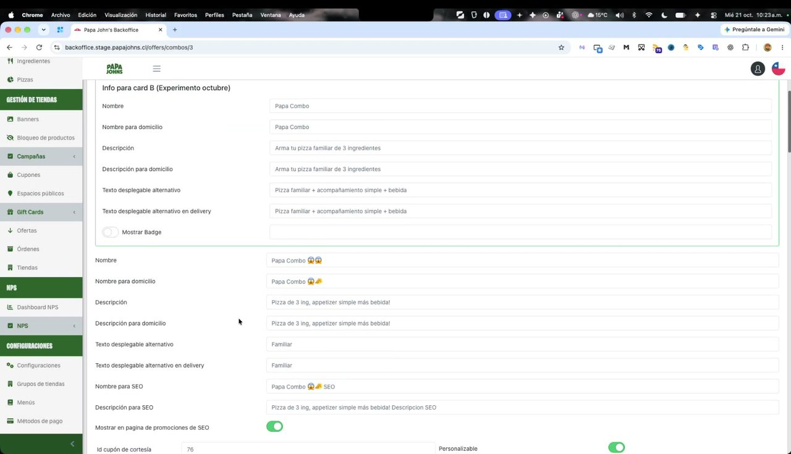 | Combo: textos por modalidad, card B (experimento), SEO. |
| 3 | 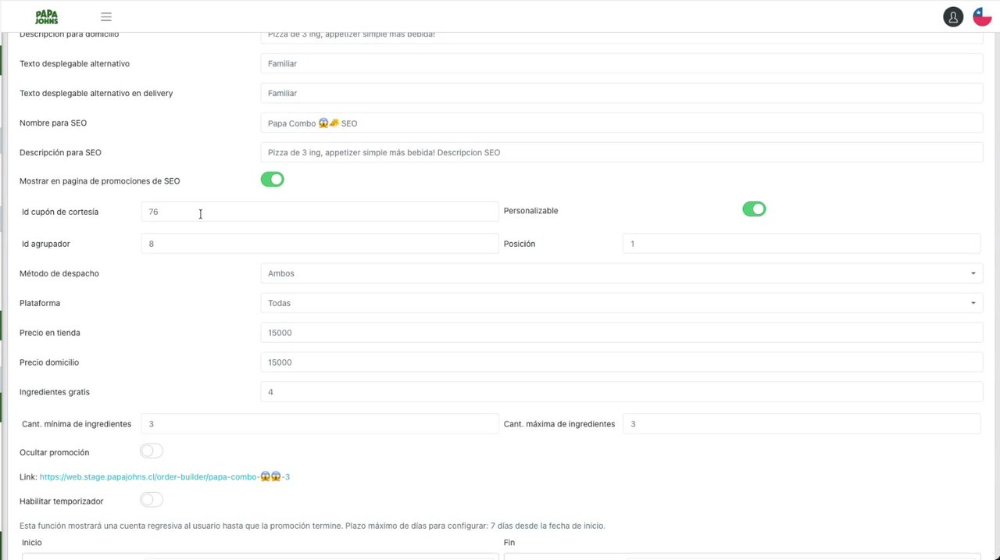 | Combo: cupón de cortesía, agrupador, posición, despacho, plataforma, precios, ingredientes gratis, mínimo y máximo. |
| 4 |  | Combo: temporizador, vigencia, días y franjas, ingredientes CYOP y límite de carnes. |
| 5 | 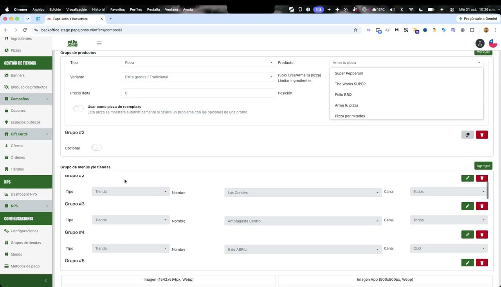 | Combo: grupos de productos, variante, precio delta, pizza de reemplazo, tiendas y canal. |
| 6 | 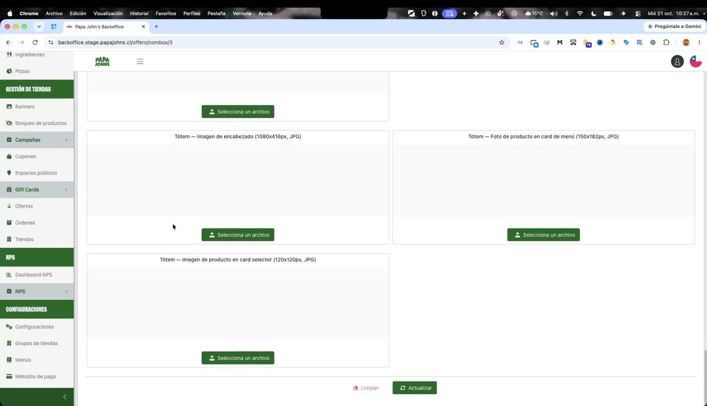 | Combo: imágenes específicas para tótem. |
| 7 |  | Tiendas con panel de promociones asociadas e incidencias por canal. |
| 8 | 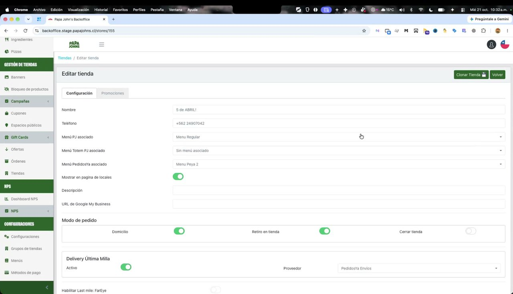 | Tienda: menús PJ, Tótem y PedidosYa, modo de pedido, última milla. |
| 9 |  | Tienda: IDs de integración (Aloha, NCR, Uber Eats, Sodexo, Webpay, Zendesk, OneClick, PedidosYa) y medios de pago. |
| 10 | 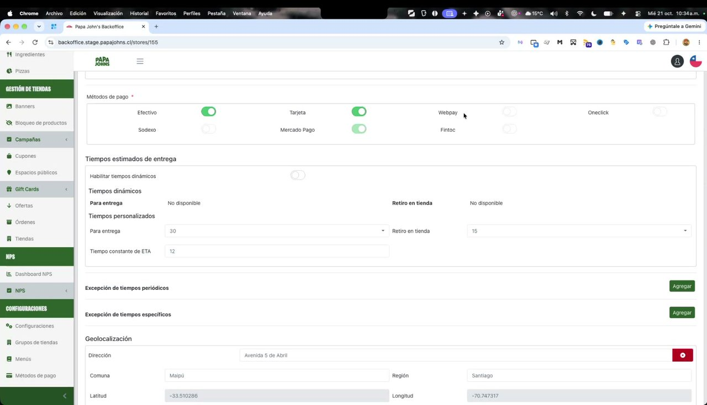 | Tienda: tiempos de entrega, excepciones, geolocalización. |
| 11 |  | Tienda: horarios de tienda y de entrega con varias franjas. |
| 12 |  | Front de producción: retiro en punto con 3 tiendas cercanas y respuesta de la API de tiendas. |
| 13 |  | Bloqueo de producto por tienda y variante. |
| 14 |  | Orden de métodos de pago por modalidad. |
| 15 |  | Dashboard NPS. |
| 16 |  | Configuraciones generales: servicios, montos, pedido anticipado, ETA. |
| 17 |  | Grupo de tiendas: delivery por tramos (activados en vivo) y proveedores de última milla. |

**Evidencia de la auditoría** (en [backoffice-video/auditoria/](backoffice-video/auditoria/)):

| Archivo | Qué muestra |
|---|---|
| 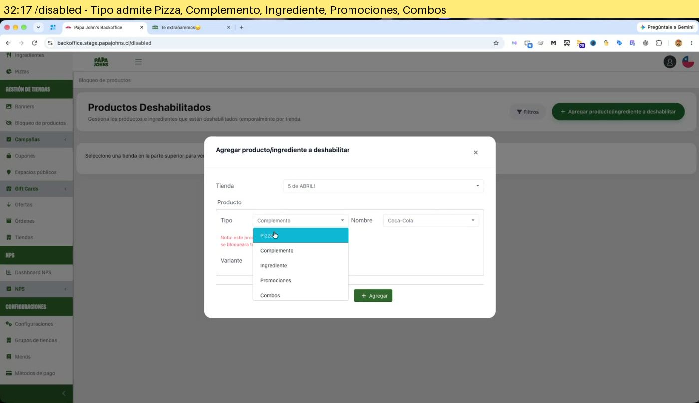 | 32:17. Tipo de bloqueo: Pizza, Complemento, Ingrediente, Promociones, Combos. |
| 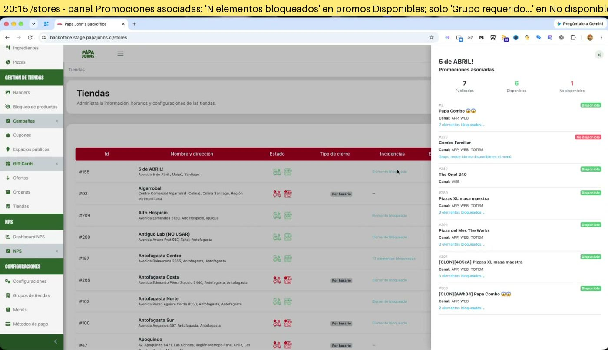 | 20:15. Panel de incidencias: elementos bloqueados en promos que siguen Disponibles. |
| 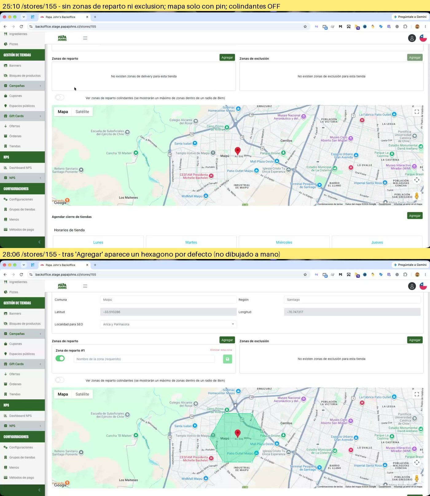 | 25:10 y 28:06. Tienda sin zonas; hexágono por defecto al agregar una zona. |
| 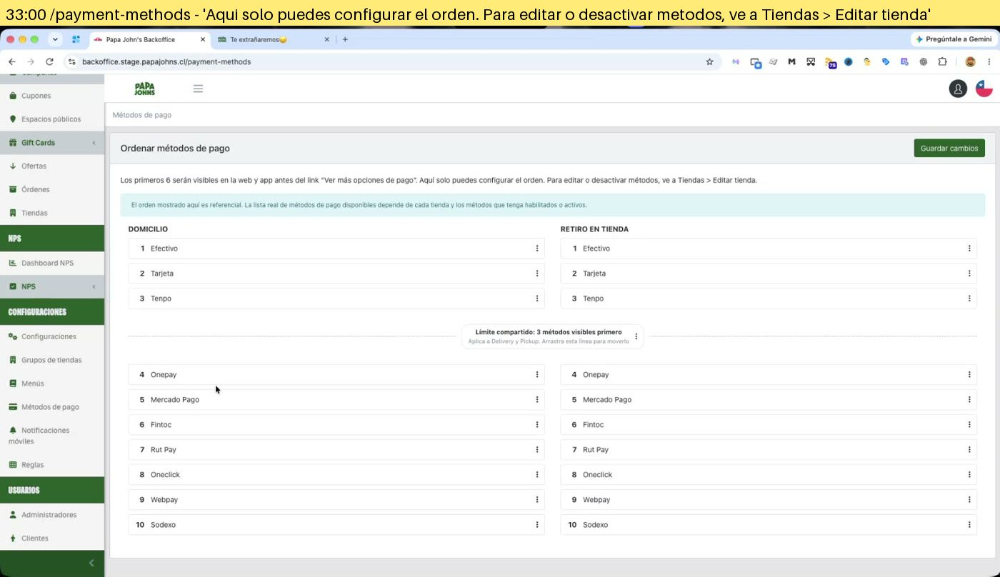 | 33:00. "Aquí solo puedes configurar el orden…" |
| 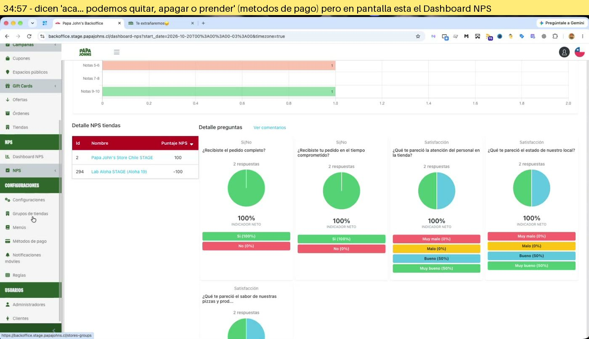 | 34:57. Dashboard NPS en pantalla mientras hablan de activar medios de pago en masa. |
| 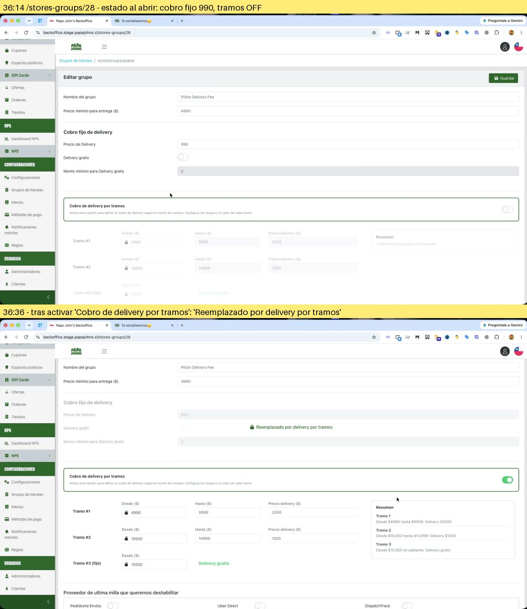 | 36:14 y 36:36. Tramos en OFF y luego activados en vivo. |
| 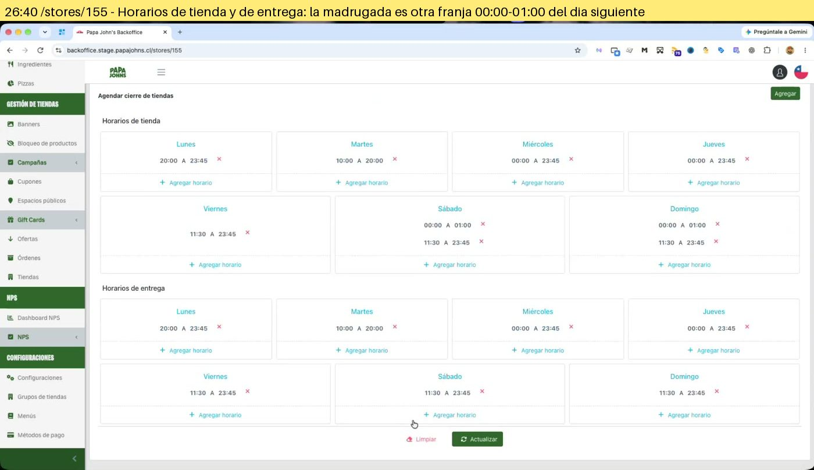 | 26:40. La madrugada como franja 00:00–01:00 del día siguiente. |
| 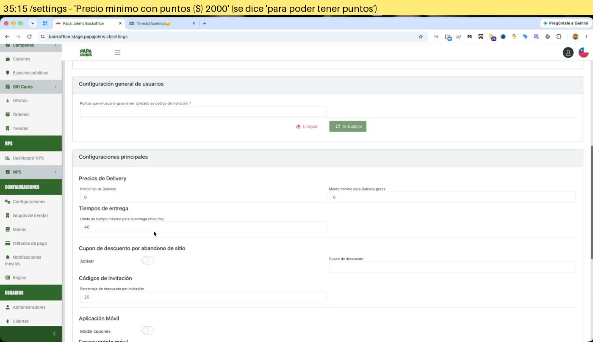 | 35:15. "Precio mínimo con puntos". |
