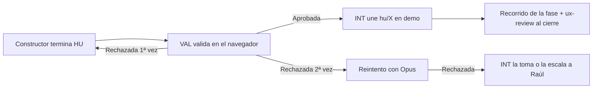

# Equipo de agentes · demo Papa Johns Chile

- **Fecha:** 06-nov-2026 · **Demo:** viernes 20-nov-2026
- **Qué es:** cómo se divide la construcción de la demo entre agentes, qué es dueño cada uno, en qué orden trabajan y cómo se valida lo que entregan.
- **Documentos que lo acompañan:**
  - [PLAN.md](PLAN.md): fases, calendario y estado.
  - [CONTRATO.md](CONTRATO.md): datos y piezas compartidas que todos usan con los mismos nombres.
  - [historias/](historias/README.md): historias de usuario con criterios de aceptación, una carpeta por agente.
- **Alcance:** solo B2C Commerce con Storefront Next. OMS y Marketing Cloud son de la segunda etapa.

## 1. Los agentes

Cada agente es dueño de un área del diseño. Nadie toca lo que es de otro: si necesita algo de otra área, lo pide en su informe y el integrador lo reparte.

| Código | Agente | Diseños que construye | Pantallas del lienzo | Oleada | Modelo |
|---|---|---|---|---|---|
| **INT** | Integrador (sesión principal) | Base visual, layout (encabezado, barra inferior, franja), componentes compartidos, registro de extensiones; une el trabajo y lleva el plan | — | 0 y siempre | — |
| **DAT** | Datos y Commerce | Catálogo (opciones, grupos, atributos), combos, promociones, gift card, tiendas, clientes de demo, hooks del cartucho, scripts OCAPI | — | 0 → 3 | Opus |
| **HOM** | Home | 01 | `Home*`, `Home-Desktop*` | 1 y 3 | Sonnet |
| **MEN** | Menú (PLP) | 02 (menú) y producto simple | `Menu`, `Menu-Desktop`, `Simple-Add` | 1 | Sonnet |
| **PRO** | Producto | 04 (hoja, «Hazlo combo», ficha) y armador de mitades (02 p3) | `Sheet-Pizza`, `Complementa`, `PDP-Mobile`, `PDP-Desktop`, `Mitades` | 1 | Opus |
| **OFE** | Ofertas | 10 | `Ofertas`, `Ofertas-Desktop`, `Combo`, `Combo-Trio`, `Combo-NoDisponible`, `Oferta-Vencida` | 1 | Sonnet |
| **TIE** | Tienda y modalidad | 05 | `Tienda`, `Tienda-Delivery` | 1 | Sonnet |
| **CAR** | Carrito | 06, canje de puntos (09 p3), «Tu pedido» de escritorio | `Pedido`, `Pedido-Mitades`, `Carrito-Desktop`, `Puntos-Canje` | 2 | Sonnet |
| **ING** | Ingreso con código | 11 (ingreso) | `Login`, `Login-Desktop` | 2 | Sonnet |
| **CHK** | Checkout y confirmación | 07 y 08 (confirmación) | `Checkout`, `Checkout-Delivery`, `Checkout-Sofia`, `Checkout-Desktop*`, `Checkout-Rechazo`, `Confirmacion*` | 2 | Opus |
| **SEG** | Seguimiento | 08 (seguimiento), franja fija, tarjeta de pedido en curso | `Confirmacion*` (estados), `Menu-EnCurso` | 3 | Sonnet |
| **CTA** | Mi cuenta y Papa Puntos | 11 (Mi cuenta) y 09 | `Cuenta`, `Puntos`, `Puntos-Cuenta` | 3 | Sonnet |
| **PAN** | Panel del presentador | 12 (panel, reducido a Commerce) | `Panel-Demo` | 3 | Sonnet |
| **VAL** | Validador | Comprueba cada historia en el navegador contra sus criterios y el lienzo | — | Al cerrar cada historia | Sonnet (`sfcc-test-runner`) |
| **UXD** | Director de experiencia y diseño visual | Revisa lo construido como lo haría un director de arte de una app de delivery: si da hambre, si «entra por los ojos», el uso del color y la fotografía dentro de la marca oficial (S-D18), el tono de los textos y la comparación con la competencia. Entrega la dirección visual y una lista de cambios priorizada que se convierte en historias de pulido | — | Al cerrar cada oleada (la primera vez, en la oleada 1) | Opus (skill `ux-review`) |
| **REV** | Revisor de objetivos y diseño | **Antes de construir:** revisa que las historias cumplan los objetivos de la demo y el diseño revisado (lienzo + MD), sin desviaciones ni alcance de más. **Al cerrar cada oleada:** revisa lo construido contra los mismos objetivos | — | Antes de cada oleada y al cerrarla | Opus (`.claude/agents/revisor-objetivos.md`) |

**Por qué Opus en DAT, PRO y CHK:** tocan precio, carrito, pago u orden (opciones con precio, mitades, promociones, medios de pago). Si un validador rechaza dos veces una historia de un agente Sonnet, el reintento va con Opus.

## 2. Oleadas

```mermaid
flowchart LR
  subgraph O0[Oleada 0 · lu 9]
    INT0[INT · base visual y layout]
    DAT0[DAT · catálogo, clientes, promociones]
  end
  subgraph O1[Oleada 1 · ma 10 – ju 12]
    HOM1[HOM · Home antes]
    MEN[MEN · Menú]
    PRO[PRO · Producto y mitades]
    OFE[OFE · Ofertas]
    TIE[TIE · Tienda]
  end
  subgraph O2[Oleada 2 · lu 16 – ma 17]
    CAR[CAR · Carrito]
    ING[ING · Ingreso]
    CHK[CHK · Checkout]
  end
  subgraph O3[Oleada 3 · mi 18]
    SEG[SEG · Seguimiento]
    CTA[CTA · Cuenta y puntos]
    PAN[PAN · Panel]
    HOM3[HOM · Home en curso y después]
  end
  O0 --> O1 --> P1[Pulido vi 13] --> O2 --> O3 --> P5[Pulido y ensayo ju 19]
```

- **Oleada 0 va en secuencia** y nadie más arranca hasta que esté lista: sin la base visual, el layout y el contrato de datos, los agentes de la oleada 1 se pisan o inventan nombres.
- **DAT trabaja en todas las oleadas** y es el **único que escribe en el sandbox** (importaciones, OCAPI, despliegue del cartucho). Va adelantado una oleada: los datos de la oleada 2 los deja listos durante la oleada 1.
- **Agentes vivos a la vez:** como máximo 5 constructores + 3 validadores.

## 3. Quién es dueño de qué (para no pisarse)

| Ruta | Dueño |
|---|---|
| `src/theme/**`, `src/routes/_app.tsx`, `src/components/header/**`, `src/components/footer/**`, `src/extensions/config.json` | INT |
| `src/extensions/pj-shared/**` (componentes y utilidades compartidas, ver [CONTRATO §5](CONTRATO.md)) | INT |
| `src/extensions/pj-home/**` | HOM |
| `src/extensions/pj-menu/**` | MEN |
| `src/extensions/pj-product/**` | PRO |
| `src/extensions/pj-offers/**` | OFE |
| `src/extensions/pj-store/**` | TIE |
| `src/extensions/pj-cart/**` y los cambios marcados en `src/components/cart/**` | CAR |
| `src/extensions/pj-login/**` y los cambios marcados en `src/components/login/**` | ING |
| `src/extensions/pj-checkout/**` y los cambios marcados en `src/components/checkout/**`, `_app.order-confirmation.*` | CHK |
| `src/extensions/pj-tracking/**` | SEG |
| `src/extensions/pj-account/**` y los cambios marcados en `_app.account.*` | CTA |
| `src/extensions/pj-presenter/**` | PAN |
| `site-data/**`, `cartridges/**`, `.env*`, el sandbox | DAT |
| `demo/**` (plan, contrato, historias, evidencia) | INT |

**Reglas:**
- **Una extensión por área.** INT registra las 12 extensiones vacías en la oleada 0, así nadie más toca `src/extensions/config.json`. Cada extensión trae sus propios `locales/es-CL/translations.json`, rutas y `target-config.json`.
- **Cambios al core del template** solo en archivos que son del agente y con los marcadores `@sfdc-extension-*`.
- **Si a un agente le falta un dato**, no lo crea en el sandbox: usa el valor de ejemplo de [CONTRATO.md](CONTRATO.md), lo deja en un archivo `mock` de su extensión y lo reporta como **solicitud a DAT**.
- **Si le falta un componente compartido**, lo crea dentro de su propia extensión y lo reporta como **candidato a `pj-shared`**. INT decide si lo mueve.

## 4. Cómo trabaja cada agente

### 4.1 Ambiente

- Repo: `storefront/` (git). INT mantiene la rama de integración `demo`.
- **Un worktree por agente**: `storefront-wt/<código>` en la rama `hu/<código>`, creado por INT desde `demo` antes de lanzarlo.
- **Servidor de desarrollo en un puerto propio:** INT 5173, HOM 5174, MEN 5175, PRO 5176, OFE 5177, TIE 5178, CAR 5179, ING 5180, CHK 5181, SEG 5182, CTA 5183, PAN 5184.
- **Navegador:** solo Chrome **sin ventana** (pedido de Raúl, 06-nov). Hay tres instancias (`-headless`, `-headless-2`, `-headless-3`): como máximo 3 agentes prueban en el navegador a la vez, e INT asigna cada una. Los demás verifican con pruebas y `curl`, y VAL revisa en el navegador después. Nunca se usan `chrome-devtools`, `-2` ni `-3`, que abren ventana.
- **Clientes de prueba:** cada agente usa los suyos ([CONTRATO §3](CONTRATO.md)). Nunca dos agentes con el mismo cliente, porque comparten el carrito.

### 4.2 El encargo que recibe cada constructor

INT lanza a cada agente con este encargo fijo y le cambia solo el código y la lista de historias:

1. Leer `storefront/CLAUDE.md` (el estándar de Storefront Next), `demo/CONTRATO.md` y sus historias en `demo/historias/<código>.md`.
2. Por cada historia:
   - Leer el diseño (`disenos/<NN>/README.md`).
   - Abrir en el navegador la pantalla del lienzo (`disenos/_canvas/<Pantalla>.dc.html`) a 390 px y 1440 px.
   - Construir.
   - Revisar contra cada criterio.
3. Antes de cada commit, en verde: `pnpm typecheck`, `pnpm lint`, y `pnpm test` de lo que tocó. Las pruebas existentes no se borran ni se reemplazan.
4. Un commit por historia en la rama `hu/<código>`, con el ID en el mensaje (`HOM-02: …`), sin trailer de coautoría.
5. Informe final:
   - Historias hechas, con la evidencia de cada criterio.
   - Solicitudes a DAT.
   - Candidatos a `pj-shared`.
   - Lo que quedó pendiente y por qué.

### 4.3 Construir → validar → integrar

- **VAL es siempre un agente distinto del que construyó.** Recibe solo la historia, sus criterios, la pantalla del lienzo y la URL. No recibe la opinión del constructor.
- **VAL aprueba o rechaza criterio por criterio**, con captura, y compara contra el lienzo en móvil y escritorio. Si rechaza, dice qué falla y dónde.
- **INT une a `demo`** solo lo aprobado, resuelve conflictos, corre la suite completa y actualiza `PLAN.md` (estado y bitácora).
- **Al cerrar cada oleada**, INT recorre los guiones de esa fase y corre el skill `ux-review` contra el lienzo. Los hallazgos se convierten en historias de pulido.

### 4.4 Guardián de los objetivos (REV)

VAL comprueba que **lo construido cumple la historia**. REV comprueba algo distinto: que **la historia y lo construido sirven a los objetivos de la demo** y respetan el diseño ya revisado.

| Cuándo | Qué revisa REV | Resultado |
|---|---|---|
| **Antes de cada oleada** | Las historias de la oleada contra los objetivos ([historias/README](historias/README.md)), el lienzo (`disenos/_canvas/`), los MD de diseño, las revisiones ya hechas (UX v2, kit v2) y el contrato | `demo/revisiones/REV-<oleada>-historias.md`: por historia, ✅ alineada · ⚠️ ajustar (qué y por qué) · ❌ fuera de objetivo; más lo que el diseño pide y ninguna historia cubre |
| **Al cerrar cada oleada** | Lo construido en la rama `demo`, recorrido en el navegador, contra los mismos objetivos: ¿da hambre?, ¿se cumple la promesa del anuncio?, ¿los guiones fluyen?, ¿hay algo que no estaba en el diseño? | `demo/revisiones/REV-<oleada>-cierre.md` con los desvíos priorizados |

- **REV no construye ni corrige.** INT aplica sus ajustes a las historias antes de lanzar la oleada, y lo que REV marca ❌ se saca o se escala a Raúl.
- **Los cambios al diseño los decide Raúl.** Si REV detecta que un supuesto del contrato se aparta del lienzo (por ejemplo, S-D1 por el Halloween vencido), lo marca para su decisión.

## 5. Escalamiento

| Situación | Qué se hace |
|---|---|
| Falta un dato o una promoción | Mock en la extensión + solicitud a DAT; no bloquea |
| Dos agentes necesitan cambiar el mismo archivo | Lo cambia el dueño; el otro lo pide en su informe |
| El diseño es ambiguo o contradice el contrato | Se aplica la regla del contrato y se anota como supuesto en el informe |
| Algo del diseño no se puede hacer en Commerce sin OMS ni Marketing Cloud | Se simula como dice la historia; si la historia no lo dice, se reporta a INT |
| `dw.json` responde 401 | Se detiene DAT y se avisa a Raúl |
