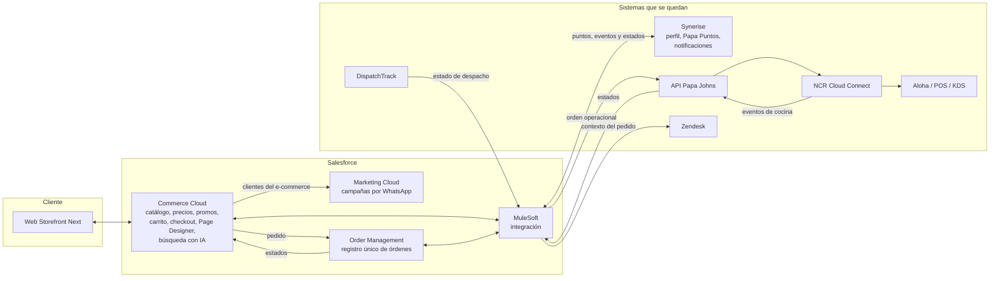
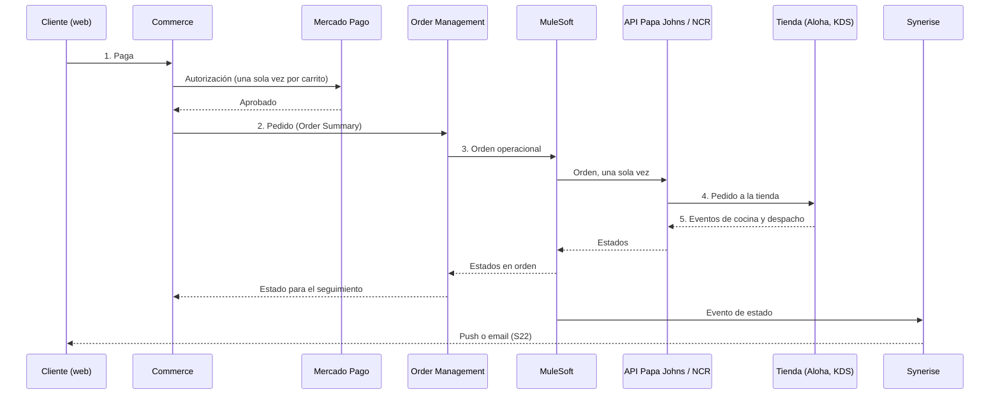

# 00 · Qué recomendamos para Papa Johns Chile

- **Estado:** borrador v1.3, 24-oct-2026
- **Base:** kit del cliente ([transcripción completa](../../datos/cliente/kit-pj/README.md); cumplimiento en el [checklist](../checklist-kit.md)), Melt y PJ Chile (`exploracion.md`, `critica-ux.md`), Domino's EE.UU. y Papa Johns EE.UU. (`datos/raw/informe-dpzus.md`, `datos/raw/informe-pjus.md`)
- **Alcance de la propuesta (fase 1, 24-oct-2026):** B2C Commerce (Storefront Next, con búsqueda con IA de Cimulate), Order Management (registra y sincroniza las órdenes de todos los canales), Marketing Cloud Engagement (solo campañas por WhatsApp con link) y MuleSoft (integra Commerce y OMS con los sistemas de Papa Johns). Synerise (perfil, Papa Puntos y notificaciones), Zendesk, Aloha/NCR, API PJ, DispatchTrack, el DWH y el backoffice operativo se quedan. Loyalty Management no entra en la fase 1. El detalle está en la [vista unificada](../../propuesta/solucion-vista-unificada.md) (§3 y supuestos §11); este documento fija la postura de **diseño y de la demo**

Este documento fija la postura. Cada diseño de `disenos/` sale de aquí; si un diseño contradice un principio, se corrige uno de los dos y se anota.

## 1. La idea en una frase

**Lo que les gusta de Melt, la operación que ya tiene Papa John's y lo que hacen bien los líderes de EE.UU., sobre una plataforma que reconoce al cliente y que administra el propio equipo de marketing.**

El kit lo resume como pasar de «Aquí está nuestro menú. Elige.» a «Entiendo qué necesitas. Déjame ayudarte a resolverlo.» Para eso no basta un storefront nuevo: hace falta que el storefront, la comunicación, los puntos y el pedido conozcan a la misma persona.

## 2. Principios

| # | Principio | De dónde viene | Qué evita |
|---|---|---|---|
| 1 | **Ver antes de elegir tienda.** Menú, fichas y precios visibles sin tienda; la tienda se pide al agregar y el pedido se conserva | Domino's EE.UU. | El muro de dirección de PJ Chile; Melt que deja al cliente en la portada |
| 2 | **Un toque para lo típico, todo configurable para quien quiere.** Valores preseleccionados y configurador completo (mitades, cantidad por ingrediente) | PJ EE.UU. y PJ Chile | Los 3 pasos obligatorios de Melt |
| 3 | **Precio siempre visible y en vivo.** Precio comparable en el listado, antes/ahora en texto, total en el botón. En la ficha el precio está a la vista, pero no es lo primero: primero la foto y la descripción (principio 9) | Melt (antes/ahora); nadie lo hace completo | Domino's oculta precios hasta el carrito; PJ Chile mezcla tamaños |
| 4 | **La promesa del anuncio se cumple.** Cada oferta tiene URL propia que sobrevive a la elección de tienda | Domino's EE.UU. | Deep links que dan 404 (PJ EE.UU.) o caen en una portada genérica |
| 5 | **Puntos en cada paso.** «Ganas N Papa Puntos» en la ficha, el carrito y el checkout; alta dentro del checkout | Domino's EE.UU. (alta en checkout) | PJ Chile solo avisa la pérdida al final |
| 6 | **La experiencia cambia según quién es.** Sofía, Diego y Valentina ven otro orden, otro mensaje y otra oferta | Kit del cliente | Un 50% genérico para todos |
| 7 | **Rápido y accesible de verdad.** Menos de 2,5 s por paso, sin zoom bloqueado, contraste y objetivos táctiles correctos | Kit (carga < 2,5 s) | Los LCP de 11–13 s de los líderes; la accesibilidad 73 de PJ Chile |
| 8 | **Marketing administra sin desarrollador.** Portada, banners, ofertas, textos y orden del menú desde Business Manager y Page Designer | Pedido explícito del cliente | Banners con texto incrustado en la imagen |
| 9 | **Que dé hambre antes que precio.** La comida entra por los ojos: foto en primer plano, video corto y zoom en el hero y la ficha, movimiento en los momentos clave (agregar, sumar puntos, avanzar el pedido) y prueba social (reseñas, «pedida N veces esta semana»). Todo sin pasar de 2,5 s (principio 7) | Kit, sección 00 «El desafío» y sección 07 | Un ecommerce funcional que muestra pizzas; una POC que se ve como una evolución del sitio actual |

### 2.1 El desafío del kit y cómo lo resolvemos

El kit abre con «No queremos un sitio que muestre pizzas. Queremos uno que provoque hambre» y pide que la POC **sorprenda**. Esta tabla responde cada pilar del desafío; el estado ítem por ítem está en el [checklist](../checklist-kit.md), sección 00.

| Pilar del kit | Qué proponemos | Dónde | Estado al 17-oct |
|---|---|---|---|
| 01 · Hacer que entre por los ojos | Fotos a sangre y en primer plano, acento cálido, textos que se saborean, ingredientes con foto. **Nuevo:** video corto del queso estirándose en el hero y la ficha, zoom sobre la foto, preparación en la ficha | 01, 02, 04 | En parte: falta video, zoom y movimiento; fotografía definitiva pendiente (C6, C7) |
| 02 · Que el sitio entienda el momento | Home por perfil (Sofía, Diego, Valentina). **Nuevo:** ocasiones por momento (almuerzo a mediodía, partido según calendario, bajón de noche, celebración) con bloques programados en Page Designer | 01, 10, 12 | En parte: perfiles y tamaño de grupo sí; ocasiones por momento no (D34) |
| 03 · Hacer tremendamente fácil decidir | «Para 2», «Más pedida», «Tu favorita», «Hazlo combo», precio total en el botón, un toque para agregar, mitades con fotos. **Nuevo:** disponibilidad real en la tienda elegida | 02, 04, 06, 10 | Casi completo: falta disponibilidad real (casos 2 y 6) |
| 04 · Crear una experiencia que se recuerde | Papa Puntos en cada paso, Repetir, seguimiento siempre visible, opinión y próxima mejor acción. **Nuevo:** reseñas y señales de popularidad en ficha y tarjetas; microinteracciones; ficha con destacados y preguntas frecuentes (referente Target) | 01, 04, 08, 09, 11 | En parte: falta prueba social y microinteracciones (C8, D36, D37) |
| Mandato: «la POC debe sorprendernos» | Lo que no existe hoy en papajohns.cl ni en Melt: la tienda cambia según quién llega y a qué hora, la pizza se mueve, y el presentador gatilla mensajes reales en vivo (12) | 01, 12 | En parte |

### 2.2 Qué es real y qué se simula en la demo

Es una demo: el objetivo es que Papa Johns vea un partner que entiende su negocio, no construir el proyecto. Cada pedido del kit tiene un tratamiento (Diseñar, Simular, Explicar, Proyecto o Real) en el [checklist](../checklist-kit.md), y lo que se calcula o simula está en los [requerimientos de construcción](../requerimientos-demo.md).

| Producto | En la demo | Cómo |
|---|---|---|
| Commerce Cloud (Storefront Next) | **Real** | Sandbox PapaJohnsCL |
| Marketing Cloud | **Real** | Mensajes gatillados en vivo que llegan al celular del presentador ([12](../12-marketing/README.md)). En la propuesta, Marketing Cloud solo envía **campañas por WhatsApp con link** (reactivación, lanzamiento, recompra, ocasión); las notificaciones de estado y el carrito abandonado los sigue enviando Synerise (S22) |
| Order Management | **Real** | El pedido entra a OMS; se avanza, se cancela un producto con reembolso parcial y se compensa con puntos desde su consola ([13](../13-operacion/README.md)). En la propuesta, OMS **registra y sincroniza**; cancelaciones, reembolsos y la consola de incidencias son una fase futura |
| Papa Puntos | **Simulado** | La demo calcula ganar, canjear y saldo con las reglas reales del programa; se presenta como integración con Synerise vía MuleSoft |
| Aloha, NCR Cloud Connect, API Papa Johns, DispatchTrack | **Simulado** | El presentador hace de tienda y de despacho en OMS. En la propuesta, MuleSoft los conecta con Commerce y OMS |
| Synerise, Zendesk | **Explicar** | Arquitectura (sección 3) y decisión 1 |
| App, agregadores, Call Center, Tótem, WhatsApp | **Explicar + 1 momento** | Lámina «una API, todos los canales»; en vivo, el mensaje de carrito abandonado abre el mismo carrito en el celular |

## 3. Arquitectura de la propuesta

Commerce y OMS se conectan directo porque los dos son Salesforce; MuleSoft es el único que habla con los sistemas de Papa Johns. Marketing Cloud envía la campaña por WhatsApp y el link abre la web o la app.

**Recorrido de la orden** (como lo describe el kit, con OMS como registro único). En la demo, los pasos 3 a 5 los simula el presentador desde la consola de OMS.

## 4. Qué hace cada producto

### Commerce Cloud (Storefront Next): la tienda

- Catálogo con variantes (tamaño y masa), opciones (ingredientes) y precio por tienda.
- Motor de promociones: combos, % por medio de pago y día, solo retiro, cupones de un solo uso, vigencia y calendario.
- Página de producto y de oferta con URL propia; SEO y datos estructurados.
- Page Designer: portada, banners y bloques administrables, con visibilidad por grupo de clientes.
- Grupos de clientes para separar a Sofía, Diego y Valentina (cuenta, historial, origen de la visita).
- Recomendaciones (Einstein) para «Completa tu pedido».
- Checkout de una página, invitado, autocompletado de direcciones con Google Places.
- Historial de pedidos y «Repetir pedido».

### Marketing Cloud: campañas por WhatsApp con link

En la propuesta, Marketing Cloud Engagement envía **campañas por WhatsApp con un botón** que abre la web o la app, donde el cliente compra (vista unificada §4, supuestos S10 a S13). La audiencia son los clientes del e-commerce con opt-in.

- **Reactivación de Valentina:** «Te extrañamos: 20 % en tu pizza de siempre», con link a la URL de la oferta (principio 4).
- **Recompra de Sofía:** «¿Repetimos tu pedido del viernes?», con link a «Repetir pedido».
- **Lanzamiento y ocasión para Diego:** «Nueva Arma tu Combo» o «Hoy juega Chile», con link a la landing o al combo.
- **Siguen en Synerise (S22):** carrito abandonado, bienvenida, confirmación y estado del pedido.

### Papa Puntos (Synerise)

- Reglas actuales: 1 punto por cada $1.000, canje por productos. El programa sigue en Synerise; Commerce muestra el saldo y canjea en el checkout vía MuleSoft. Loyalty Management no entra en la fase 1.
- Ideas de diseño para el futuro del programa: niveles, puntos por acciones (alta, cumpleaños, reseña), caducidad visible («tus puntos vencen en N días»).
- **En la demo:** se simula. El saldo y los puntos a ganar se calculan en el storefront con datos de ejemplo, y se muestra el diseño completo. Se presenta como integración, sin afirmar que corre en vivo.

### Order Management: todas las órdenes en un solo lugar

- Un solo registro de las órdenes de todos los canales (Web, App, Tótem, Call Center y agregadores).
- Envío de la orden operacional, vía MuleSoft, a la API Papa Johns (que la lleva a NCR Cloud Connect y Aloha), una sola vez, y recepción de estados desde la tienda y DispatchTrack.
- Seguimiento para el cliente («¿Dónde está mi pedido?») con el estado real.
- Contexto del pedido para el SAC en Zendesk, vía MuleSoft.
- **Fase futura:** cancelaciones, reembolsos parciales y compensaciones con puntos, y la consola de incidencias por tienda.
- **En la demo:** instancia real. El pedido pagado aparece en OMS y desde su consola se avanza, se cancela un producto y se reembolsa, para mostrar hacia dónde crece; la tienda y DispatchTrack se simulan ([13](../13-operacion/README.md)).

### MuleSoft: la integración

- Conecta Commerce y OMS con el backoffice, la API PJ / Aloha, Synerise, DispatchTrack, Zendesk y el DWH: 16 APIs entregadas en cuatro etapas (Vender, Operar, Medir, Agregadores). Detalle en el [alcance de MuleSoft](../../propuesta/mulesoft/alcance-mulesoft.md).
- **En la demo:** no se muestra en vivo; se explica con la lámina de arquitectura.

## 5. Recomendación por perfil

| Momento | Sofía · heavy user | Diego · switcher | Valentina · lleva 2 años sin comprar |
|---|---|---|---|
| Entrada | Se reconoce por sesión o enlace de campaña: «Hola Sofía» | Llega desde un anuncio a la oferta exacta | Llega desde un WhatsApp de reactivación o una búsqueda |
| Portada | Repetir último pedido, favoritos, saldo de puntos | Ocasiones: para 2, para 4, partido, bajón | Más pedidas, novedades, beneficios del canal propio |
| Menú | Ordenado por su historial | Promos arriba, luego más vendidos | Etiquetas «Ideal para 2», «Más pedida», «Novedad» |
| Carrito | Dirección, tienda y pago habituales; canje de puntos | «Por $1.500 más agrega bebida», «Te faltan $X para…» | Costos y tiempos claros; sin sorpresas |
| Checkout | Un toque con su medio de pago | Invitado rápido | Invitado, alta de puntos opcional con lo que gana |
| Después | Puntos acreditados y recompra por WhatsApp (MC) | Bienvenida (Synerise) y campañas de lanzamiento por WhatsApp (MC) | Estado del pedido (OMS; aviso por Synerise) y encuesta |
| Producto que lo resuelve | Commerce + Synerise (puntos, vía MuleSoft) + MC | Commerce (promos, URL de oferta) + MC | Commerce + MC + OMS |

## 6. Recomendación por recorrido

Cada fila se convierte en un diseño de `disenos/`.

| # | Recorrido | Qué recomendamos | Qué no copiamos |
|---|---|---|---|
| 01 | Home | Hero en texto real con precio antes/ahora y botón que abre el producto; «Empieza tu pedido» (Delivery, Retiro); bloques por perfil desde Page Designer | Banner con texto incrustado (PJ Chile); hero que lleva a un listado (Melt); pedir modalidad si ya está elegida (Domino's) |
| 02 | Categorías | Barra inferior tipo app (Inicio, Menú, Promos, Pedido, Cuenta); pestañas fijas por categoría; buscador | Botones flotantes que tapan contenido; sitio móvil separado (Melt) |
| 03 | Listado | Tarjeta compacta con precio comparable (mismo tamaño o «desde») y «Agregar» | Precios de tamaños distintos lado a lado (PJ Chile) |
| 04 | Agregar al carro | Hoja con valores preseleccionados y paso de complementos; ficha con URL y «Completa tu pedido» ([ver diseño](../04-agregar-al-carro/README.md)) | Redirigir tras agregar (Domino's, Melt) |
| 05 | Tienda y modalidad | Panel sobre la misma pantalla, pedido al agregar; ubicación, distancia, horario, estado y pedido programado; Google Places para delivery | Muro de dirección antes del menú |
| 06 | Carrito | Foto, modalidad, configuración visible, una mejora sugerida que respeta lo elegido, puntos a ganar, cupón | Dos modales de upsell obligatorios (Domino's) |
| 07 | Checkout | Una página, invitado, validación al salir del campo, autocompletado, pago a la vista con el más usado preseleccionado, alta de puntos | Errores en rojo al cargar (PJ Chile); pago oculto tras pasos (Melt) |
| 08 | Seguimiento | Estado del pedido sin cuenta, enlazado desde el menú principal | — |
| 09 | Papa Puntos | Página que explica el programa en 3 reglas y una calculadora; saldo y vencimiento | «Learn more» que manda al login (PJ EE.UU.) |
| 10 | Ofertas | Una URL por oferta; constructor de combo por pasos con contador; aviso claro si no aplica en la tienda | Ofertas bloqueadas hasta iniciar sesión (PJ EE.UU.) |

## 7. Capacidades: cómo se obtienen

El kit pide marcar cada capacidad como estándar, configuración, integración, desarrollo o roadmap. Esta es la primera clasificación; se ajusta con el equipo técnico.

| Capacidad | Producto | Tipo | ¿En la demo? |
|---|---|---|---|
| Catálogo con variantes, opciones y precio por tienda | Commerce | Configuración | Sí |
| Hoja «Arma tu pizza» y paso de complementos | Commerce | Desarrollo | Sí |
| Pizza por mitades y cantidad por ingrediente | Commerce | Desarrollo | Diseño |
| Promociones, combos y cupones únicos | Commerce | Estándar + configuración | Sí |
| URL propia por oferta que sobrevive a la tienda | Commerce | Desarrollo | Sí |
| Portada y banners administrables | Commerce (Page Designer) | Estándar + desarrollo de componentes | Sí |
| Contenido distinto por perfil | Commerce (grupos de clientes) | Configuración | Sí |
| Recomendaciones «Completa tu pedido» | Commerce (Einstein) | Estándar + configuración | Sí, con datos de ejemplo |
| Tienda y modalidad sin perder el carrito | Commerce | Desarrollo | Sí |
| Autocompletado de direcciones | Commerce + Google Places | Estándar + configuración | Sí |
| Checkout de una página e invitado | Commerce | Estándar | Sí |
| Repetir pedido | Commerce | Desarrollo | Sí |
| Búsqueda con IA | Commerce (Cimulate) | Estándar + configuración | Según el ambiente de Cimulate para la demo (P30) |
| Carrito abandonado | Synerise (S22), con eventos de Commerce vía MuleSoft | Integración | Sí (en la demo, gatillado desde Marketing Cloud) |
| Campañas por WhatsApp: reactivación, lanzamiento, recompra y ocasión | Marketing Cloud | Configuración + integración (exportación desde Commerce) | Sí (una en vivo, según la instancia con WhatsApp para la demo, P31) |
| Papa Puntos: ganar, canjear, vencer | Synerise vía MuleSoft | Integración | Simulado |
| Pedido en OMS (registro único) | OMS | Integración (conector B2C Commerce ↔ OMS) | Sí, real |
| Envío del pedido al POS | OMS + MuleSoft + API Papa Johns + NCR + Aloha | Integración | Simulado |
| Seguimiento del pedido | OMS + MuleSoft + DispatchTrack | Integración | Sí: estados reales de OMS; despacho simulado |
| Cancelaciones y reembolsos | OMS | Estándar + configuración | Sí, real (cancelación parcial). En la propuesta, fase futura |
| Pruebas A/B del hero o del upsell | Commerce (Shopper Context + grupos de clientes) + GA4 | Desarrollo único; luego configuración (S14) | Diseño |
| Video en hero y ficha, zoom de la foto | Commerce (Page Designer) | Desarrollo de componentes | Sí (si el cliente entrega video, C7) |
| Microinteracciones (agregar, puntos, seguimiento) | Commerce (Storefront Next) | Desarrollo | Sí |
| Ocasiones por momento (almuerzo, partido, bajón) | Commerce (Page Designer con programación y grupos de clientes) | Configuración + desarrollo de componentes | Sí |
| Señales de popularidad («la más pedida») | Commerce (datos de venta por producto) | Configuración | Sí |
| Estrellas con la calificación del NPS | Commerce + MuleSoft (desde la encuesta NPS actual) | Integración + desarrollo | Sí, con datos de ejemplo (D36) |
| Reseñas con texto | Proveedor de reseñas (opcional, licencia del cliente) | Tercero + integración | Sí, con datos de ejemplo (D36); en la propuesta, opcional (S15) |

## 8. Decisiones abiertas

Todas quedaron decididas el 24-oct-2026 (vista unificada §3, §4 y §11).

1. **Synerise.** ~~¿Reemplazo, demo o convivencia?~~ **Se queda** como CRM, CDP, Papa Puntos y notificaciones (S2, S22). Marketing Cloud solo envía campañas por WhatsApp con link a los clientes del e-commerce (S10, S11).
2. **Edición de Marketing Cloud.** ~~¿Engagement o Next?~~ **Engagement**, con WhatsApp por Unified Messaging (S12). Marketing Cloud Next requiere Data 360, que no entra en la fase 1.
3. **Papa Puntos.** ~~¿Loyalty Management o integración?~~ **Se integra** con Synerise vía MuleSoft; Loyalty Management no entra en la fase 1.
4. **OMS.** ~~¿Fase 2 o roadmap?~~ **Entra en la fase 1** para registrar y sincronizar las órdenes de todos los canales; en la demo, instancia real (sección 2.2 y [13](../13-operacion/README.md)). Cancelaciones, reembolsos y consola de incidencias son fase futura.
5. **Pruebas A/B.** ~~¿Con qué herramienta?~~ **Shopper Context con grupos de clientes y medición en GA4** (S14); una herramienta de terceros queda como opcional.
6. **Data Cloud.** No entra en la fase 1. La personalización usa grupos de clientes de Commerce con los atributos de Synerise (S5).
7. **Omnicanalidad.** Web, App, Tótem y Call Center consumen la misma API de Commerce (SCAPI); los agregadores siguen por la API PJ y llegan a OMS vía MuleSoft. La app nueva es un servicio opcional (S4); el call center mantiene su herramienta (S16). En la demo se diseña la web y el resto se explica con arquitectura (A10).
8. **Recorrido de la orden.** ~~¿OMS entrega a la API Papa Johns o la reemplaza?~~ **Entrega**: OMS → MuleSoft → API Papa Johns → NCR → Aloha; la API PJ se mantiene (sección 3).

## 9. Siguientes pasos

1. ~~Validar este documento (principios y decisiones de la sección 8).~~ Decisiones cerradas el 24-oct-2026.
2. Ajustar el diseño 04 a los principios 1 y 2: tienda al agregar, cantidad por ingrediente y mitades.
3. Diseñar en orden: 01 Home por perfil, 05 Tienda y modalidad, 06 Carrito, 07 Checkout.
4. Definir la campaña de Marketing Cloud que se mostrará en vivo. Para alinearla con la propuesta, una campaña por WhatsApp con link (reactivación o recompra) en lugar del carrito abandonado.
5. Cerrar las brechas del desafío (principio 9): video y zoom en hero y ficha, microinteracciones, reseñas y popularidad, ocasiones por momento y disponibilidad real. Prioridades en el [checklist](../checklist-kit.md).

## Historial

| Fecha | Cambio |
|---|---|
| 16-oct-2026 | v1: principios, arquitectura, rol de Commerce, Marketing Cloud, Loyalty y OMS, recomendación por perfil y por recorrido, capacidades |
| 24-oct-2026 | v1.3: alineado con la propuesta de fase 1 (vista unificada v3.0): alcance con MuleSoft y sin Loyalty Management; 2.2 separa demo y propuesta; arquitectura y secuencia con MuleSoft y Synerise; Marketing Cloud solo campañas por WhatsApp; OMS registra y sincroniza; capacidades de A/B (S14) y reseñas (S15); decisiones de la sección 8 cerradas |
| 17-oct-2026 | v1.2: sección 2.2 (real y simulado en la demo), OMS real en la demo, arquitectura con API Papa Johns y NCR Cloud Connect, secuencia de la orden |
| 17-oct-2026 | v1.1: principio 9 «Que dé hambre antes que precio», sección 2.1 con el desafío del kit, cuatro capacidades nuevas (video, microinteracciones, ocasiones, reseñas) y decisiones 7 y 8 (omnicanalidad, recorrido de la orden) |

## Decisiones posteriores que cambian la propuesta

| Fecha | Decisión | Dónde |
|---|---|---|
| 16-oct-2026 | Medios de pago de la demo: solo Mercado Pago (Bricks) y efectivo; boleta o factura con RUT | 07 Checkout |
| 16-oct-2026 | La demo se cuenta con clientes registrados; invitado y estados de borde quedan para el proyecto | 11 Cuenta, revisión por procesos |
| 17-oct-2026 | El pedido en curso se ve desde la Home y en una franja fija en todas las pantallas | 01 Home v3 |
| 17-oct-2026 | Mensajes y eventos de marketing se gatillan en vivo desde un panel del presentador | 12 Marketing |
| 17-oct-2026 | Por conversar con el cliente: el kit nombra a Synerise como CRM (X5), pide invitado para Valentina (D30), más medios de pago (D31) y comedor (D32) | Revisión contra el kit |
| 17-oct-2026 | El desafío del kit pasa a ser principio (9): video, movimiento, prueba social y ocasiones por momento entran a los diseños 01, 04 y 10 | Checklist contra el kit |
| 17-oct-2026 | La demo busca mostrar buen partner, no cubrir todo el kit. OMS con instancia real; Loyalty, Aloha y DispatchTrack simulados; reglas de cálculo en `requerimientos-demo.md` | 2.2, 13 Operación |
| 24-oct-2026 | Propuesta de fase 1: B2C Commerce (con Cimulate), Order Management (registra y sincroniza), Marketing Cloud (solo WhatsApp con link) y MuleSoft. Synerise, Zendesk, Aloha y el backoffice operativo se quedan; Business Manager toma la oferta digital | [Vista unificada](../../propuesta/solucion-vista-unificada.md) §3, [diapositivas](../../propuesta/propuestas-diapositivas.md) |
