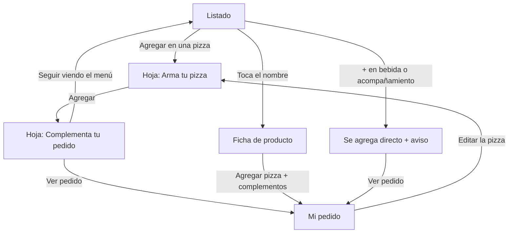

# 04 · Agregar al carro (hoja y ficha)

- **Lienzo:** https://claude.ai/artifact/WAK6JrPuHueQ1fozG9EXKk, página «04 Agregar al carro» (privado hasta compartirlo)
- **Fuente del lienzo:** `../_canvas/`
- **Estado:** borrador v1, 16-oct-2026

## Objetivo

Que el botón Agregar permita al cliente especificar todo lo que necesita para cargar el carro, sin salir de donde está, y que compre de una vez: pizza más acompañamientos, bebida y postre. Aplica igual desde el listado (hoja) y desde la ficha de producto.

### Alineación con el cliente

| Pide o mide el cliente | Cómo lo resuelve este diseño |
|---|---|
| «Que se parezca a Melt» | Hoja que sube sobre el listado; «Incluida» y «+$» junto a cada opción |
| Corregir lo que falla en Melt (`critica-ux.md`) | Valores preseleccionados: un toque para agregar, en vez de 3 pasos; confirmación visible al agregar; no saca al cliente del producto |
| Cross-selling en 35% de los pedidos (kit del cliente) | Paso «Complementa tu pedido» y sección en la ficha |
| Reducir incertidumbre de quien no conoce la carta (perfil Valentina) | «Para 3–4 personas», ingredientes y precio a la vista; Papa Puntos que gana |
| Puntos visibles desde el producto (`critica-ux.md`) | «Ganas N Papa Puntos» en la hoja, la ficha y el pedido |

## Cambios v2 (tras la [revisión de UX v1](../revision-ux-v1.md))

| Cambio | Recomendación |
|---|---|
| Hoja «Arma tu pizza»: foto más grande y cercana, texto que se saborea, **ingredientes con foto** (la API del cliente las tiene) | R1, R4, R5 |
| Paso 3 pasa de «Complementa tu pedido» a **«Hazlo combo»**: una oferta principal (palitos + bebida 1,5 L con ahorro visible) y debajo, por separado, postre y otros | R6 |
| Ficha (móvil y escritorio): foto en primer plano, texto sensorial, ingredientes con foto y precio de oferta en rojo | R1, R4, R5 |
| **Dos momentos de venta cruzada como máximo**: «Hazlo combo» solo después de la **primera** pizza del pedido, y una mejora en el carrito. La ficha conserva «Completa tu pedido» | R7 |

**Regla de precio de «Hazlo combo»:** el precio y el ahorro los calcula el motor de promociones a partir de los combos vigentes (por ejemplo, Papa Combo Palitos). En el diseño: +$6.990, ahorras $2.490 (**ejemplo**, ver pregunta D16).

**Pizza por mitades:** se arma desde el listado o desde «½ Mitad» en cada especialidad, con el armador del diseño [02](../02-menu/README.md) (pantalla 3). La pregunta D10 queda resuelta para mitades; la cantidad por ingrediente (normal o extra) sigue abierta.

## Recorrido

## Pantallas

| # | Pantalla (archivo) | Qué resuelve |
|---|---|---|
| 1 | Menú: botón Agregar (`Main.dc.html`) | Lista compacta con precio Familiar, etiqueta «Más vendida» y botón Agregar |
| 2 | Hoja: arma tu pizza (`Sheet-Pizza.dc.html`) | Tamaño, masa, quitar ingredientes, agregar extras, cantidad; precio y puntos en vivo |
| 3 | Hoja: hazlo combo (`Complementa.dc.html`) | Confirma lo agregado con «Editar»; oferta principal «Hazlo combo» (palitos + bebida 1,5 L con ahorro y sabor de bebida); debajo, otros productos por separado |
| 4 | Mi pedido (`Pedido.dc.html`) | Línea con la configuración de la pizza, mejora a borde de queso sin cambiar la masa en silencio, puntos y total |
| 5 | Ficha de producto móvil (`PDP-Mobile.dc.html`) | URL propia, descripción editorial, configurador, «Completa tu pedido», mitades, nutrición; barra fija con el total |
| 6 | Ficha de producto escritorio (`PDP-Desktop.dc.html`) | Lo mismo en dos columnas: foto a la izquierda, configurador a la derecha |
| 7 | Bebidas y extras sin hoja (`Simple-Add.dc.html`) | «+» se vuelve contador; tamaño de bebida en la tarjeta; aviso con total y «Ver pedido» |

## Reglas de negocio

1. **El botón Agregar depende del tipo de producto, no del nombre:**
   - Con tamaño, masa o ingredientes configurables (pizza) → abre la hoja «Arma tu pizza».
   - Con un solo atributo (tamaño de bebida) → se elige en la tarjeta y se agrega directo.
   - Sin opciones → se agrega directo con un aviso.
2. **Preselección:** la hoja abre con lo más pedido (Familiar + Tradicional). Todo lo gratuito es opcional; nada obliga a elegir antes de agregar.
3. **Precio en vivo:** el botón muestra el total (base del tamaño + recargo de masa + extras × precio por tamaño) × cantidad.
4. **Quitar ingredientes** no cambia el precio y se muestra como «Sin cebolla».
5. **Extras** cuestan según el tamaño (ingrediente normal: Mediana $1.450, Familiar $1.940, Extra grande $2.290).
6. **Después de agregar una pizza** la hoja ofrece complementos; el cliente puede seguir comprando sin pasar por ellos.
7. **En la ficha**, los complementos marcados se agregan junto con la pizza en un solo botón.
8. **Puntos:** 1 Papa Punto por cada $1.000.
9. **La mejora sugerida en el pedido** respeta la configuración elegida y dice exactamente qué cambia.

## Modelo en Commerce Cloud (propuesta)

| Concepto | Cómo se modela |
|---|---|
| Tipo de producto | Atributo `c_productKind` (`pizza`, `side`, `drink`, `dessert`) o tipo de producto (maestro con variantes / simple) |
| Tamaño y masa | Variantes del producto maestro (atributos de variación `size` y `crust`), cada una con su precio |
| Ingredientes extra | Opciones de producto con precio por tamaño (o extras como líneas hijas) |
| Ingredientes quitados | Atributo personalizado en la línea del pedido (ej. `c_removedIngredients`) |
| Complementos sugeridos | Recomendaciones de producto (Einstein o relaciones manuales del catálogo) |
| Descripción editorial | Contenido administrable por cliente (Page Designer / atributos de contenido) |

Pendiente validar con el equipo técnico si los extras van como opciones o como líneas separadas (afecta el envío al POS Aloha).

## Supuestos por confirmar

- Precio por tamaño de Pollo BBQ: Mediana $13.000, Familiar $16.900, Extra grande $21.900 (inferido de la API).
- Delgada y Masa Maestra sin recargo; borde de queso +$3.490.
- Coca-Cola: 350 ml $1.790, 1,5 L $3.490, 3 L $4.490 (tamaños inferidos).
- Trozos y personas por tamaño (8/8/10; 2–3, 3–4, 4–5).
- Descripción editorial y tabla nutricional: marcadores en el lienzo.

## Decisiones abiertas

- ¿Pizza por mitades dentro de la hoja o solo en la ficha?
- ¿Cuántos complementos mostrar y con qué criterio (más vendidos, por perfil, por hora)?
- ¿Elegir tienda antes o al agregar? Hoy el diseño asume tienda ya elegida.

## v3 · Ficha que da hambre antes que precio (17-oct-2026)

Responde al principio 9 de la [propuesta](../00-propuesta/README.md) y a la sección 00 del kit (referente Target: calificaciones, destacados, disponibilidad, alternativas de entrega, preguntas y recomendaciones alrededor del producto).

| Elemento | Qué hace | Requerimiento |
|---|---|---|
| Video y zoom | La foto se mueve lento como un video corto (en el proyecto, MP4 de 6 s con póster); botón de pausa y lupa que amplía el detalle | [R4.7](../requerimientos-demo.md) |
| Orden | Foto → nombre → ★ → descripción → destacados; el precio aparece en el tamaño y el botón, no antes del antojo | D35 |
| Prueba social | «Pedida 320 veces esta semana», ★ 4,7 · 1.240 opiniones, distribución y dos opiniones con «Compra verificada». Marcado «Datos de ejemplo» | R4.4, D36 |
| Destacados | Para cuántos (según tamaño), lista en 15 min en la tienda, disponible hoy, puntos que ganas | R4.5 |
| Disponibilidad real | Champiñón agotado en El Bosque: chip bloqueado y sugerencia de sustituto (ficha y hoja) | R4.6, caso 6 |
| Preguntas frecuentes | Porciones, picante, mitades, nutrición | — |
| Microinteracción al agregar | La pizza vuela al carro, el contador salta, aviso «¡Agregada! +16 Papa Puntos por acreditar» con «Deshacer»; el botón pasa a «Ver mi pedido» | R1.1, D37 |

## Historial

| Fecha | Cambio |
|---|---|
| 16-oct-2026 | v1: 7 pantallas (hoja, complementos, pedido, ficha móvil y escritorio, producto simple) |
| 16-oct-2026 | v2: hoja con foto cercana, texto sensorial e ingredientes con foto; paso 3 «Hazlo combo»; máximo dos momentos de venta cruzada |
| 16-oct-2026 | v2.1: ficha móvil y escritorio con la misma dirección visual; carrito pasa a [06](../06-carrito/README.md) |
| 16-oct-2026 | Revisión por procesos: la hoja pasa por Tienda si no hay tienda elegida; «Volver al menú» lleva al Menú v3; `Main` retirado; la ficha móvil lleva al armador de mitades; la ficha de escritorio queda en escritorio |
| 16-oct-2026 | `Carrito-Desktop`: «Mi pedido» del escritorio como panel lateral con «Convertir en combo» y puntos; «Ir a pagar» de Mi pedido abre el ingreso con código (11) |
| 17-oct-2026 | v3 (kit 00): ficha móvil y escritorio con video simulado y pausa, zoom, «Pedida 320 veces esta semana», ★ 4,7 · 1.240 opiniones, destacados (para cuántos, lista en 15 min, disponible hoy), opiniones con compra verificada, preguntas frecuentes, champiñón agotado con sustituto y microinteracción al agregar (contador que salta, aviso con puntos por acreditar, deshacer). Hoja: ingrediente agotado |
| 17-oct-2026 | Revisión UX v2: la ficha ya no dice «Video» ni «Datos de ejemplo»; estrellas en #8F5400 (5,9:1); se oculta «Información nutricional» hasta tener el dato (C5) |
