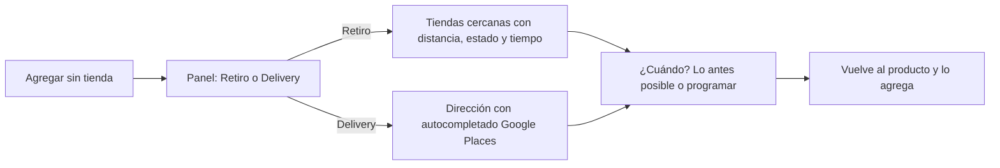

# 05 · Tienda y modalidad

- **Lienzo:** https://claude.ai/artifact/WAK6JrPuHueQ1fozG9EXKk, página «05 Tienda y modalidad»
- **Estado:** borrador v1, 16-oct-2026
- **Principios que aplica** ([propuesta](../00-propuesta/README.md)): 1 (ver antes de elegir tienda)

## Objetivo

Pedir la tienda y la modalidad **cuando hacen falta** (al agregar el primer producto), en un panel sobre la misma pantalla, y volver al producto con todo conservado. Corrige el muro de dirección de PJ Chile y a Melt, que deja al cliente en la portada.

## Recorrido

## Pantallas

| # | Pantalla (archivo) | Qué muestra |
|---|---|---|
| 1 | Panel · Retiro (`Tienda.dc.html`) | «Usar mi ubicación», buscador, tiendas con distancia, estado y tiempo; cuándo; botón que confirma y agrega |
| 2 | Panel · Delivery (`Tienda-Delivery.dc.html`) | Dirección con sugerencias de Google Places, tienda asignada, tiempo, costo de despacho y mínimo de compra |

## Reglas

1. **El panel dice para qué lo pide:** «Para agregar tu Pollo BBQ, dinos cómo lo quieres».
2. **Retiro:** cada tienda muestra distancia, «Abierta · cierra 23:30» o «Cerrada · abre 12:00», y «Listo en N min». Las cerradas no se pueden elegir para «lo antes posible», sí para programar.
3. **Delivery:** dirección con autocompletado (Google Places, ya soportado por Storefront Next), número de depto. opcional, tienda asignada automáticamente, tiempo estimado, costo de despacho y mínimo ($12.000, regla real del cliente).
4. **Cuándo:** «Lo antes posible» por defecto; «Programar» abre día y hora.
5. **Cambiar después:** el encabezado muestra modalidad, tienda y tiempo en todo el recorrido; cambiarla no vacía el carrito (si un producto no está en la nueva tienda, se avisa en el carrito).
6. **Se recuerda** entre visitas (cookie y, con sesión, preferencia del cliente).

## Modelo en Commerce Cloud

| Concepto | Cómo se resuelve | Tipo |
|---|---|---|
| Tiendas | Objeto Store con coordenadas, horario y atributos (`c_pickupMinutes`) | Configuración |
| Tienda y modalidad en el carrito | Extensiones `store-locator` y `bopis` de Storefront Next; envío por tienda | Estándar + desarrollo |
| Inventario y precio por tienda | Inventario por tienda y libros de precios por tienda | Configuración |
| Dirección | Google Places (llave en `PUBLIC__app__features__googleCloudAPI__apiKey`) | Configuración |
| Asignar tienda a una dirección | Zonas de reparto: servicio propio o del cliente | Integración |

## Supuestos

- Tiendas y tiempos reales (producción, 16-oct-2026): El Bosque, Tobalaba 201, 15 min; Salvador, Av. Salvador 1822, 35 min; Providencia, Av. Providencia 1349, 45 min. Distancias y horarios de cierre son de ejemplo.
- Costo de despacho: pendiente del cliente.

## Historial

| Fecha | Cambio |
|---|---|
| 16-oct-2026 | v1: panel de retiro y delivery |
| 16-oct-2026 | Revisión por procesos: delivery a Av. Providencia 1234 asignado a Salvador (Providencia figura cerrada); despacho $1.990 igual que el checkout; la hoja pasa por este panel si no hay tienda |
| 17-oct-2026 | Pendiente por el kit: «Comer en el local» como tercera modalidad (D32) |
| 17-oct-2026 | Kit: tercera modalidad «Comer aquí» con estado del comedor y cantidad de personas (D32); tienda cerrada (Providencia) muestra alternativas: El Bosque o programar (caso 1) |
