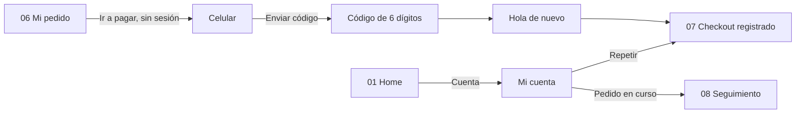

# 11 · Cuenta sin contraseña

## Objetivo y alineación con el cliente

La demo se cuenta con **clientes registrados**: Sofía (sesión iniciada), Valentina (tiene cuenta, vuelve por un correo de reactivación) y Diego (tiene cuenta, llega desde un anuncio en otro dispositivo). El flujo de invitado existe en el proyecto, pero queda fuera de la demo.

Para Papa Johns, la cuenta es la base de la recompra y de Papa Puntos: sin cuenta no hay historial, ni «Repetir pedido», ni canje, ni recordatorios de Marketing Cloud. Por eso el ingreso tiene que costar menos que llenar los datos a mano: **celular y un código de 6 dígitos, sin contraseña**.

## Recorrido

## Pantallas

| # | Archivo | Qué muestra |
|---|---|---|
| 1 | `Login.dc.html` | Hoja de ingreso en tres pasos sobre la pantalla actual: celular (o correo), código de 6 dígitos con reenvío, y bienvenida con el saldo de puntos. Sigue al checkout con todo el pedido conservado |
| 1b | `Login-Desktop.dc.html` | El mismo ingreso en escritorio: ventana centrada sobre el menú, con el resumen del pedido a la izquierda (lo que se está por pagar) y los tres pasos a la derecha. Se abre desde «Ir a pagar» del panel «Tu pedido» y sigue al checkout de escritorio |
| 2 | `Cuenta.dc.html` | Mi cuenta de Sofía: pedido en curso con su estado (abre el seguimiento), Papa Puntos, últimos pedidos con «Repetir», favoritos, direcciones, medios de pago (tarjeta guardada en Mercado Pago), datos de factura y cerrar sesión |

## Reglas de negocio

1. **Cuándo se pide:** al tocar «Ir a pagar» sin sesión, o desde «Ingresar» en el encabezado. Nunca antes de agregar productos.
2. **Identificador:** celular chileno (+56 9) por defecto; «Usar mi correo» como alternativa. El código vence en 5 minutos; «Reenviar» se habilita a los 30 segundos.
3. **Después de ingresar:** vuelve exactamente al paso en que estaba (checkout), con el pedido intacto, y muestra el saldo y lo que suma este pedido.
4. **Sesión recordada** en el dispositivo (90 días, por confirmar). Desde otro dispositivo se repite el código.
5. **Mi cuenta reemplaza el seguimiento de invitado** en la demo: el pedido en curso aparece primero y abre la misma pantalla de seguimiento.
6. **Invitado (fuera de la demo):** «Seguir sin cuenta» en la hoja de ingreso lleva al checkout de invitado (`Checkout-Invitado`), que se conserva para el proyecto.

## Modelo en Commerce Cloud

- **Ingreso sin contraseña:** SLAS *passwordless login* (código por SMS o correo) en Storefront Next. El SMS y el correo los envía Marketing Cloud (o el proveedor de SMS del cliente).
- **Perfil:** cliente registrado de B2C Commerce con direcciones y datos de factura (RUT, razón social, giro) como atributos personalizados.
- **Tarjeta guardada:** Mercado Pago Customers & Cards; Commerce guarda solo la referencia (D27).
- **Papa Puntos:** saldo y movimientos desde Loyalty Management (simulado en la demo).
- **Pedidos:** historial de pedidos de Commerce; estado en vivo desde OMS en la fase 2.

## Supuestos por confirmar

- Valentina tiene 40 Papa Puntos y no tiene tarjeta guardada; su pedido de vuelta suma puntos dobles (D1).
- El código de demo es 482 913 (cualquier código funciona en el lienzo).

## Decisiones abiertas

- **D28:** ¿el código se envía por SMS, por correo o por WhatsApp? ¿Quién paga el SMS?
- **D29:** ¿cuánto dura la sesión en el dispositivo?

## Historial

| Fecha | Cambio |
|---|---|
| 16-oct-2026 | v1: ingreso con código y Mi cuenta; la demo se centra en clientes registrados |
| 17-oct-2026 | Ingreso con código en escritorio (`Login-Desktop`) |
| 17-oct-2026 | Kit (caso 13 y consentimiento): «¿No te llega el código?» con reenviar, enviar al correo o pagar como invitada con el pedido; casilla de permisos de marketing en el ingreso (R4.8) |
| 17-oct-2026 | Revisión UX v2: «Flujo alternativo del proyecto (fuera de la demo)» pasa a «¿Prefieres no crear cuenta?» (móvil y escritorio) |
