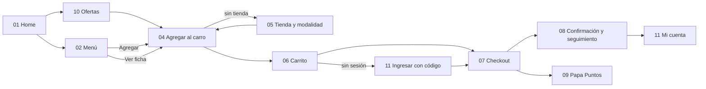

# Diseños de la demo Papa Johns Chile

Cada diseño es una carpeta con su especificación (`README.md`). Todas las pantallas viven en **un solo lienzo con una página por diseño**: https://claude.ai/artifact/WAK6JrPuHueQ1fozG9EXKk (privado hasta compartirlo). El Markdown es la fuente de verdad: primero se acuerda aquí, después se dibuja en el lienzo.

Punto de partida: **[00 · Qué recomendamos para Papa Johns Chile](00-propuesta/README.md)** (principios, arquitectura con Commerce, Marketing Cloud, Loyalty y OMS, y recomendación por perfil y recorrido).

Para construir la demo: **[Requerimientos de construcción](requerimientos-demo.md)**, lo que la demo calcula, simula o conecta (puntos, estados de OMS, ETA, BIN, Marketing Cloud).

Para afinar con el equipo: **[Preguntas y supuestos](preguntas-y-supuestos.md)**, el registro maestro de decisiones abiertas, supuestos y datos de ejemplo, con quién responde y su estado.

Revisiones críticas:

- **[Revisión contra el kit v2](revision-kit-v2.md)** (17-oct-2026, con el skill `ux-review`): ¿el lienzo cumple los objetivos del kit? Veredicto por principio, perfil, POC y KPI; la promesa del anuncio de Diego no se cumple, el hambre depende de material del cliente y falta omnicanalidad.
- **[Checklist contra el kit](checklist-kit.md)** (17-oct-2026): estado 🟢🟡⚪ de 245 ítems (las 11 secciones del kit y su mapa de 57 capacidades), con resumen por sección y lo más importante que falta. El kit completo está transcrito en [`datos/cliente/kit-pj/`](../datos/cliente/kit-pj/README.md).
- **[Revisión de UX v2](revision-ux-v2.md)** (17-oct-2026, experimental con el skill `ux-review`): pantallas del kit 00 y de OMS; riesgos de credibilidad en la demo (fecha de la oferta vencida, marcador de precio, textos para el presentador, «video» que es foto).
- **[Revisión contra el kit del cliente v1](revision-kit-v1.md)** (17-oct-2026): qué falta frente al kit, cobertura de las 10 etapas y de los 20 escenarios, decisiones a conversar (Synerise, invitado, medios de pago, comedor).
- **[Revisión por procesos v1](revision-procesos-v1.md)** (16-oct-2026): siete procesos de punta a punta, huecos, reglas de proceso y lo que falta diseñar, leído desde lo que gana o pierde Papa Johns.
- **[Revisión de UX v1](revision-ux-v1.md)**: ¿da hambre o es usable?, puntaje por pantalla y cambios para la v2.

## Recorrido completo

| # | Diseño | Estado | Página del lienzo |
|---|---|---|---|
| 00 | [Propuesta](00-propuesta/README.md) | Borrador v1.1 (principio 9 y desafío del kit) | — |
| 01 | [Home por perfil](01-home/README.md) | v3 (íconos, seguimiento siempre visible, Sofía antes/durante/después) | 01 Home |
| 02 | [Menú y categorías (PLP)](02-menu/README.md) | v3 (catálogo completo, mitades, armador de N partes) | 02 Menú |
| 03 | Listado | Incluido en 02 | — |
| 04 | [Agregar al carro (hoja y ficha)](04-agregar-al-carro/README.md) | v2.1 (hoja, combo y ficha); falta cantidad por ingrediente y mitades (D10) | 04 Agregar al carro |
| 05 | [Tienda y modalidad](05-tienda-y-modalidad/README.md) | Borrador v1 | 05 Tienda y modalidad |
| 06 | [Carrito](06-carrito/README.md) | v2 («Conviértelo en combo») | 04 Agregar al carro |
| 07 | [Checkout](07-checkout/README.md) | v3 (clientes registrados, pago rechazado, escritorio; invitado como alternativo) | 07 Checkout |
| 08 | [Confirmación y seguimiento](08-seguimiento/README.md) | v3 (registrados, retiro y delivery, escritorio) | 08 Confirmación |
| 09 | [Papa Puntos](09-papa-puntos/README.md) | Borrador v1 | 09 Papa Puntos |
| 10 | [Ofertas y constructor de combos](10-ofertas/README.md) | v2 (Super Dúo, Super Trío y Box Halloween) | 10 Ofertas |
| 11 | [Cuenta sin contraseña](11-cuenta/README.md) | v1 (ingreso con código, Mi cuenta; la demo es con clientes registrados) | 11 Cuenta |
| 12 | [Marketing y simulación](12-marketing/README.md) | v1 (journeys, herramientas de Commerce, panel del presentador) | 12 Marketing |
| 13 | [Operación: back office y OMS](13-operacion/README.md) | v1 (OMS real; guion de campaña a pedido y de pedido a SAC) | — (consolas reales) |

## Cómo trabajamos

1. **Conversación → Markdown.** Lo que se decide se escribe en el `README.md` del diseño: objetivo, recorrido, reglas, supuestos y decisiones.
2. **Markdown → lienzo.** Cada diseño es una página del lienzo; cada pantalla corresponde a una fila de la tabla «Pantallas» del Markdown, con el mismo número y nombre de archivo.
3. **Cambios.** Primero se corrige el Markdown, después el lienzo, y se anota en «Historial». Si alguien edita el lienzo directamente, se refleja en el Markdown.
4. **Preguntas y supuestos.** Toda pregunta o supuesto nuevo se registra en `preguntas-y-supuestos.md` con un ID. Cuando se responde, se actualiza ahí y en el diseño afectado.
5. **Respaldo.** `_canvas/` guarda una copia de todas las pantallas (`.dc.html`) y del índice (`canvas.json`) de la última versión publicada.
6. **Compartir.** El lienzo es privado hasta que se comparte desde su menú Compartir. Los Markdown se pueden publicar en Confluence con `/confluence-publish` (los diagramas Mermaid salen como imagen).

## Plantilla de cada diseño

- Objetivo y alineación con el cliente
- Recorrido (diagrama Mermaid)
- Pantallas (tabla número, archivo, qué muestra)
- Reglas de negocio
- Modelo en Commerce Cloud (y producto Salesforce que lo resuelve)
- Supuestos por confirmar
- Decisiones abiertas
- Historial
