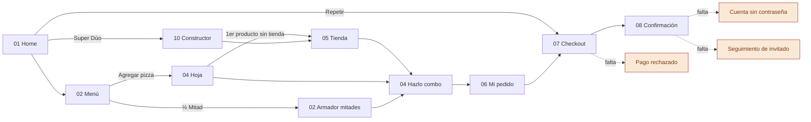

# Revisión por procesos v1

Fecha: 16-oct-2026. Alcance: los 10 diseños y las 29 pantallas del lienzo, revisados como **procesos de punta a punta** y no como pantallas sueltas.

## Lo que vería Papa Johns (resumen para el cliente)

Antes de corregirse, estos huecos le habrían costado al cliente lo siguiente:

| Lo que vería o perdería Papa Johns | Hallazgos | Ahora |
|---|---|---|
| **Credibilidad de la demo:** Webpay, que no van a usar; un total que cambia de $23.890 a $26.380 justo antes de pagar; una tienda cerrada repartiendo un delivery | T1, T2, P4.1 | Corregido: un solo pedido, los mismos datos, solo Mercado Pago y efectivo |
| **Venta del anuncio:** Diego toca «Armar mi Super Dúo», el botón principal de su campaña, y no pasa nada. Es plata de medios que se pierde en el último paso | P2.1, P2.2 | Corregido para Super Dúo; la box Halloween queda por diseñar |
| **Ticket promedio:** el menú nuevo agregaba la pizza sin pasar por «Hazlo combo», la palanca principal para subir el ticket | T3 | Corregido: toda pizza pasa por la hoja |
| **Recompra del cliente fiel:** Sofía, la que más compra, debía llenar sus datos y su tarjeta como si fuera nueva, y no veía el canje de puntos | P3.1, P3.2 | Corregido: checkout de cliente reconocido con tarjeta guardada y canje |
| **Operación de tienda:** pedidos por mitades sin formato definido en el carrito, la confirmación ni el pedido que llega a cocina | P6.2 | Formato definido; falta dibujarlo |
| **Ventas que se pierden sin que nadie lo vea:** pago rechazado sin salida, mínimo de delivery sin aviso, cuenta que se promete y no existe | P7.1, P7.2, P4.4 | Por diseñar, en ese orden de prioridad |

## Método

Se recorrieron siete procesos, uno por perfil o situación de negocio. En cada paso se revisaron tres cosas:

1. **Continuidad:** ¿el botón lleva a la pantalla que sigue en el proceso, o a un enlace vacío, a una pantalla obsoleta o a otro dispositivo?
2. **Coherencia de datos:** ¿el pedido, el precio, la tienda, el medio de pago y los puntos son los mismos de una pantalla a la siguiente?
3. **Reglas:** ¿se cumple en todas las pantallas lo que dicen los Markdown (puerta de tienda, «Hazlo combo», solo Mercado Pago y efectivo)?

Para el mapa de enlaces se leyeron los 29 archivos `.dc.html` del lienzo. Los precios se contrastaron con `datos/raw/` y con producción.

| Proceso | Perfil | Recorrido |
|---|---|---|
| P1 | Valentina, primer pedido, retiro, móvil | Home → Menú → Agregar → Tienda → Hazlo combo → Mi pedido → Checkout → Confirmación |
| P2 | Diego, llega desde un anuncio con la oferta | Home Diego → Super Dúo → Tienda → Mi pedido → Checkout |
| P3 | Sofía, cliente frecuente: repetir y canjear | Home Sofía → Repetir pedido → Checkout → Confirmación; y Canje de puntos |
| P4 | Delivery con efectivo | Home → Delivery (Google Places) → Checkout delivery → Confirmación |
| P5 | Escritorio | Home escritorio → Menú escritorio → Ficha → Checkout escritorio |
| P6 | Pizza por mitades | Menú → ½ Mitad → Armador → Mi pedido → Checkout → Confirmación |
| P7 | Después de pagar | Confirmación → cuenta y puntos → seguimiento → recordatorio y repetición |

## Mapa del proceso con sus huecos

Las líneas punteadas son pasos que el proceso necesita y que aún no están diseñados.

## Hallazgos

Severidad: 🔴 rompe o contradice el proceso · 🟡 dato o regla inconsistente · ⚪ menor.
Estado: **Corregido** (ya está en el lienzo) · **Por diseñar** (nueva pantalla o estado) · **Pregunta** (se registró en `preguntas-y-supuestos.md`).

### Transversales

| # | Sev. | Hallazgo | Por qué importa | Corrección | Estado |
|---|---|---|---|---|---|
| T1 | 🔴 | Siguen apareciendo **Webpay** en la Home de Sofía («Webpay ····4521»), en los beneficios de la Home móvil y en la Confirmación («Pagado con Webpay») | Contradice la decisión de usar solo Mercado Pago y efectivo; el cliente lo notaría en la demo | Cambiado a Mercado Pago (Visa ····4521 guardada) y «Pagas con Mercado Pago o en efectivo» | Corregido |
| T2 | 🔴 | **El pedido cambia entre pantallas.** En Mi pedido se convierte en combo ($23.890), pero el Checkout y la Confirmación muestran los productos sueltos ($26.380 y 26 puntos) | Romper la promesa de ahorro justo antes de pagar es la peor ruptura posible | Pedido canónico de la demo: **Pollo BBQ Familiar sin cebolla + Combo Palitos y bebida = $23.890 y 23 puntos**, igual en la Home de Sofía, el Checkout (móvil y escritorio), la Confirmación y los movimientos de puntos | Corregido |
| T3 | 🔴 | **Dos reglas para «Agregar» una pizza.** La nota de la página 04 dice que «Agregar» abre la hoja (tamaño, masa, Hazlo combo y, si falta, la tienda). El Menú v3 la agregaba directo, sin tienda y sin combo | Sin la hoja se pierden la puerta de tienda (D11) y el «Hazlo combo», que es la palanca de ticket promedio | Regla única: **una pizza abre la hoja** con el tamaño del selector ya marcado (un toque más). Lo simple (bebidas, acompañamientos, postres) se agrega directo. Aplicado en Menú móvil y escritorio | Corregido |
| T4 | 🔴 | Una pantalla obsoleta, `Main` (el menú v1 de 4 pizzas), seguía siendo el destino de «Volver al menú» desde la hoja, Hazlo combo, Mi pedido, las fichas y Bebidas | El usuario volvía a un menú distinto al que vio | Todos esos enlaces apuntan ahora al Menú v3 (móvil o escritorio). `Main` salió del lienzo (queda en `_canvas/retirados/`) | Corregido |
| T5 | 🟡 | **Borde de queso: dos precios.** La hoja, la ficha y Mi pedido usan +$3.490 (API, SC2). El armador de mitades usa +$2.790 (producción) | Si no coincide con la tienda real, el cliente lo verá | Se mantienen ambos hasta confirmar. Nueva pregunta SC6 | Pregunta |
| T6 | 🟡 | **Despacho:** el panel de delivery muestra «[COSTO]» y el checkout $1.990. En la API el costo va por tienda (hay tiendas con $990 y con $3.000) | Un mismo pedido no puede tener dos costos | El panel ahora dice «Despacho $1.990», igual que el checkout. El valor real depende de la tienda (E20) | Corregido · Pregunta |
| T7 | 🟡 | El cupón aparece en Mi pedido **y** en el Checkout | Dos lugares para lo mismo; además, abrir un campo de cupón invita a salir a buscar uno | Un solo lugar: el Checkout, colapsado. En Mi pedido se quita | Corregido |

### P1 · Valentina, primer pedido (retiro, móvil)

| # | Sev. | Hallazgo | Corrección | Estado |
|---|---|---|---|---|
| P1.1 | 🔴 | Desde la Home, «Agregar» lleva a la hoja y de ahí a Hazlo combo **sin pasar por la tienda**, aunque Valentina aún no la eligió. La tienda solo aparece si se toca el encabezado | Regla del proceso (05): si no hay tienda, el botón «Agregar» de la hoja abre el panel de Tienda y vuelve a Hazlo combo. En el lienzo, la hoja ya lleva a Tienda; Sofía, que ya tiene tienda, no pasa por ahí | Corregido |
| P1.2 | 🟡 | Si en Hazlo combo aceptó el combo, Mi pedido igual le vuelve a ofrecer «Convertir en combo» | Mi pedido es la pantalla para quien **no** aceptó en la hoja; se aclara en la nota de la página 04. En la tienda real, el estado del carrito lo resuelve | Documentado |
| P1.3 | ⚪ | «Cambiar bebida» en el combo y «Cómo llegar» no llevan a ninguna parte | Aceptable en la demo (el selector de bebida es el de la hoja; «Cómo llegar» abre Google Maps) | Documentado |

### P2 · Diego, desde un anuncio

| # | Sev. | Hallazgo | Corrección | Estado |
|---|---|---|---|---|
| P2.1 | 🔴 | El botón principal de Diego, **«Armar mi Super Dúo», no llevaba a ninguna parte**, aunque el constructor existe (página 10). Lo mismo pasaba con las ocasiones «Para 1, 2, 4, 6+» | Super Dúo → constructor; las ocasiones → Ofertas (móvil y escritorio) | Corregido |
| P2.2 | 🔴 | El hero de Halloween («Lo quiero») lleva a la hoja de Pollo BBQ Familiar, pero la oferta es una **box con pizza mediana**, bebida y postres. En Ofertas, «Armar» de Halloween, Super Trío, Combo Palitos y Papa Flash no lleva a ninguna parte | El hero lleva ahora a Ofertas. El constructor de la box (y el de Super Trío) es el mismo patrón que Super Dúo con otra receta: queda por diseñar como variante | Corregido · Por diseñar |
| P2.3 | 🟡 | Diego llega con una oferta de un anuncio y el constructor manda a Tienda **antes** de agregar, pero no dice si la oferta vale en esa tienda o modalidad | El constructor ya muestra «Retiro y delivery»; se agrega la regla: si la oferta no aplica en la tienda elegida, se avisa en el panel y se ofrece otra tienda | Documentado |

### P3 · Sofía, repetir y canjear

| # | Sev. | Hallazgo | Corrección | Estado |
|---|---|---|---|---|
| P3.1 | 🔴 | «Repetir pedido» lleva a un Checkout **de invitado**: le pide nombre, celular y correo, le ofrece «Ingresar» y «Guarda tus puntos / creamos tu cuenta», y le pide la tarjeta completa. Sofía ya tiene sesión | Nueva variante del Checkout, **cliente reconocido**: datos en una línea con «Cambiar», tarjeta guardada de Mercado Pago (solo el CVV), saldo de puntos y canje en el mismo checkout | Corregido |
| P3.2 | 🔴 | El canje solo existía en un carrito aparte (`Puntos-Canje`), al que no se llega desde «Repetir pedido» porque ese camino se salta el carrito | El canje se ofrece también en el Checkout de cliente reconocido: «Suma una Super Pepperoni mediana gratis por 260 puntos» | Corregido |
| P3.3 | 🟡 | El aviso «Ya puedes canjear» de la Home de Sofía no tenía botón, y la insignia «340 Papa Puntos» no llevaba a ninguna parte | El aviso lleva a Canjear (carrito con canje) y la insignia, a Mis Papa Puntos | Corregido |
| P3.4 | 🟡 | Al repetir, ¿qué pasa si un producto ya no existe, cambió de precio o la tienda está cerrada? | Regla: repetir valida contra el catálogo y la tienda de hoy; lo que falte se avisa en el checkout con una alternativa | Por diseñar |

### P4 · Delivery con efectivo

| # | Sev. | Hallazgo | Corrección | Estado |
|---|---|---|---|---|
| P4.1 | 🔴 | El panel de delivery asigna el pedido a **Papa Johns Providencia**, la misma tienda que el panel de retiro muestra **cerrada** | La tienda asignada a Av. Providencia 1234 pasa a ser **Salvador** (Av. Salvador 1822, abierta) | Corregido |
| P4.2 | 🔴 | Después del checkout de delivery, la Confirmación decía «Retiro en El Bosque» y «Pagado con Webpay» | La Confirmación tiene ahora las variantes **retiro con Mercado Pago** y **delivery con efectivo**: estados Recibido → En preparación → En camino → Entregado, dirección, «Paga $… en efectivo · lleva vuelto de $30.000» | Corregido |
| P4.3 | 🟡 | La hora estimada del checkout (21:10–21:20) no cuadra con «35–45 min» desde las 20:27 | Ajustada a 21:05–21:15 | Corregido |
| P4.4 | 🟡 | El mínimo de delivery ($12.000) se informa en el panel, pero ninguna pantalla muestra qué pasa si el pedido no llega | Regla: Mi pedido muestra «Te faltan $X para delivery» y bloquea «Ir a pagar» en delivery | Por diseñar |

### P5 · Escritorio

| # | Sev. | Hallazgo | Corrección | Estado |
|---|---|---|---|---|
| P5.1 | 🔴 | **El recorrido de escritorio se pasaba a pantallas móviles:** «Ir a pagar», «Mi pedido», «Repetir pedido» y «Agregar» de la ficha llevaban al carrito y al checkout **móviles**, y la ficha volvía al menú móvil v1. `Checkout-Desktop` no tenía ningún enlace de entrada | Escritorio queda en escritorio: Home → Menú escritorio → Ficha escritorio → Checkout escritorio. En escritorio, «Mi pedido» es el panel lateral del menú | Corregido |
| P5.2 | 🟡 | No hay Confirmación de escritorio ni carrito de escritorio fuera del menú (por ejemplo, el ícono del encabezado en la Home o en Ofertas) | Confirmación de escritorio: la misma columna de la móvil, centrada, con el mapa al lado. Carrito: panel deslizable desde el encabezado. Falta también el checkout de escritorio de cliente reconocido: hoy «Repetir» y «Canjear» de Sofía en escritorio llegan al checkout de invitado | Por diseñar |
| P5.3 | ⚪ | El panel de tienda y el armador de mitades se abren como pantalla móvil desde el escritorio | En escritorio son modales con el mismo contenido; se documenta así | Documentado |

### P6 · Pizza por mitades

| # | Sev. | Hallazgo | Corrección | Estado |
|---|---|---|---|---|
| P6.1 | 🔴 | En la ficha de producto, «Armar por mitades» no llevaba a ninguna parte | Lleva al armador | Corregido |
| P6.2 | 🔴 | **Una pizza por mitades no tiene cómo verse después de agregarla:** no está definida su línea en Mi pedido, en el Checkout, en la Confirmación, en el pedido que recibe la tienda ni al repetirla | Formato de línea: «Pizza mitad y mitad · Familiar · Tradicional» y, debajo, «½ Pollo BBQ · ½ Todas las Carnes» (o los 4 cuartos); «Editar» vuelve al armador con todo cargado. En Commerce Cloud es un solo producto con opciones por parte; en OMS, una línea con atributos por parte | Documentado · Por diseñar |
| P6.3 | 🟡 | Después de «Agregar», el armador pasa a Hazlo combo, que dice «Pollo BBQ agregada» | Hazlo combo muestra el nombre de lo que se agregó; en la demo se acepta como ejemplo | Documentado |
| P6.4 | 🟡 | Las mitades no aparecen en los combos (Super Dúo) | Pregunta D24: ¿se puede pedir una pizza por mitades dentro de un combo? | Pregunta |

### P7 · Después de pagar

| # | Sev. | Hallazgo | Corrección | Estado |
|---|---|---|---|---|
| P7.1 | 🔴 | **No hay proceso de cuenta.** «Ingresar» (checkout), «Crear mi cuenta» (Papa Puntos), «Guardar mis puntos» (confirmación), «Cuenta» (barra inferior) llevan a ninguna parte. La confirmación promete «Solo falta confirmar el código que te enviamos», pero esa pantalla no existe | Nuevo diseño **11 · Cuenta sin contraseña**: ingresar con celular o correo + código de 6 dígitos (OTP), crear cuenta desde el checkout o la confirmación, y la página Mi cuenta (pedidos, favoritos, direcciones, puntos) | Por diseñar |
| P7.2 | 🔴 | **No hay proceso de pago rechazado.** Mercado Pago puede rechazar la tarjeta, pedir 3DS o quedar pendiente; hoy el diseño siempre termina en éxito | Estado en el Checkout: mensaje claro según el motivo, el pedido no se pierde, «Probar otra tarjeta» o «Pagar en efectivo al retirar» | Por diseñar |
| P7.3 | 🟡 | El seguimiento de invitado («Sigues tu pedido sin crear cuenta») depende del enlace por SMS o correo, pero no está diseñada la página a la que llega ese enlace ni la búsqueda de pedido (`order-lookup` de Storefront Next) | La página de seguimiento es la Confirmación con otra URL; la búsqueda pide N.º de pedido + correo | Por diseñar |
| P7.4 | ⚪ | La barra inferior móvil (Inicio, Menú, Promos, Pedido, Cuenta) tenía enlaces vacíos en varias pantallas | Inicio → Home, Promos → Ofertas, Cuenta → Papa Puntos (hasta que exista 11) | Corregido |

## Reglas de proceso que faltaban (se agregan a los diseños)

1. **Puerta de tienda única.** La tienda y la modalidad se piden una sola vez, al primer «Agregar» (hoja, constructor de combo o armador de mitades). Desde el checkout o el carrito, «Cambiar» abre el mismo panel y **vuelve a donde estaba**, en vez de «Confirmar y agregar».
2. **Cambiar de tienda revalida el carrito.** Precios, disponibilidad, ofertas, costo de despacho y mínimo se recalculan; lo que no esté disponible se avisa con una alternativa (D13).
3. **Un pedido, los mismos datos.** El carrito es la única fuente: Mi pedido, el Checkout y la Confirmación muestran las mismas líneas, total y puntos.
4. **Escritorio no salta a móvil.** Cada paso tiene su versión de escritorio o es un modal sobre la pantalla de escritorio.
5. **Cliente reconocido ≠ invitado.** Con sesión, el checkout no pide datos ya conocidos, usa la tarjeta guardada de Mercado Pago y ofrece el canje.
6. **Todo CTA principal lleva al siguiente paso.** Ningún botón principal de un perfil (hero, oferta, repetir) puede quedar vacío en la demo.

## Lo que falta diseñar (por prioridad)

| Prioridad | Diseño | Por qué |
|---|---|---|
| 1 | 11 · Cuenta sin contraseña (ingresar con código, crear cuenta, Mi cuenta) | Cierra P3 y P7; es la base de Papa Puntos y de la recompra |
| 2 | Pago rechazado o pendiente (Mercado Pago) | Es donde más se pierde una venta ya decidida |
| 3 | Pizza por mitades en Mi pedido, Checkout y Confirmación | Producto que ya se vende; la demo debe mostrarlo hasta el final |
| 4 | Constructor de la box Halloween y de Super Trío (variantes del constructor) | El hero de Valentina y la ocasión «Para 6+» necesitan llegar a agregar |
| 5 | Confirmación de escritorio y carrito deslizable | Completa el recorrido de escritorio |
| 6 | Mínimo de delivery y repetir con productos no disponibles | Estados de borde de P3 y P4 |
| 7 | Página de seguimiento de invitado y búsqueda de pedido | Cierra la promesa «sin crear cuenta» |

## Preguntas nuevas (en el registro)

- **SC6:** el borde de queso, ¿cuesta +$3.490 (API) o +$2.790 (armador de mitades en producción)? ¿Depende del tamaño o de la especialidad?
- **D24:** ¿se puede pedir una pizza por mitades dentro de un combo (Super Dúo, Super Trío)?
- **D25:** el canje de puntos y un cupón, ¿se pueden usar en el mismo pedido?
- **D26:** en delivery, ¿quién asigna la tienda (la más cercana abierta, la zona de reparto) y se le muestra al cliente?
- **D27:** cliente reconocido: ¿Mercado Pago guarda la tarjeta (Customers & Cards) y basta con el CVV para repetir?

## Pantallas nuevas o cambiadas en el lienzo

| Pantalla | Cambio |
|---|---|
| `Checkout-Sofia` (nueva, página 07) | Checkout de cliente reconocido: datos en una línea, tarjeta guardada, canje de puntos |
| `Confirmacion-Delivery` (nueva, página 08) | Confirmación de delivery pagado en efectivo |
| `Checkout`, `Checkout-Desktop`, `Confirmacion` | Pedido canónico ($23.890, 23 puntos), Mercado Pago, prop `cliente` y `modalidad` |
| `Home` (3 perfiles), `Home-Desktop` | Enlaces de Super Dúo, ocasiones, Halloween, puntos, canje y barra inferior; Mercado Pago; repetir → checkout de cliente reconocido |
| `Menu`, `Menu-Desktop` | «Agregar» de pizza abre la hoja; escritorio «Ir a pagar» → checkout de escritorio |
| `Sheet-Pizza`, `Complementa`, `Pedido`, `PDP-Mobile`, `PDP-Desktop`, `Simple-Add`, `Ofertas-Desktop` | Ya no vuelven a `Main`; escritorio queda en escritorio; ficha → armador de mitades; cupón solo en el checkout |
| `Tienda` | Delivery asignado a Salvador, despacho $1.990 |
| `Puntos-Cuenta` | Movimiento del 2 de octubre: +23 |
| `Main` | Retirado del lienzo (reemplazado por 02 Menú) |

## Decisiones del 16-oct-2026 sobre los pendientes

| # | Pendiente | Decisión | Cómo queda |
|---|---|---|---|
| 1 | Cuenta | **La demo se cuenta con clientes registrados.** El invitado es un flujo alternativo del proyecto, fuera de la demo | Nuevo diseño [11 · Cuenta](11-cuenta/README.md): ingreso con celular y código (`Login`) y Mi cuenta (`Cuenta`). Valentina y Diego ingresan al ir a pagar; Sofía ya tiene sesión. El checkout de invitado se conserva como `Checkout-Invitado`, marcado como alternativo |
| 2 | Pago rechazado | Es una demo: basta un **aviso (toast)** | `Checkout-Rechazo`: al pagar aparece «Tu banco rechazó la tarjeta. No te cobramos», con «Usar otra tarjeta» y «Pagar en efectivo al retirar»; el pedido no se pierde |
| 3 | Mitades en el pedido | Se dibuja | Línea «Pizza mitad y mitad» con foto dividida y «½ Pollo BBQ · ½ Todas las Carnes» en Mi pedido (`Pedido-Mitades`), en el checkout y en la confirmación (prop `mitades`) |
| 4 | Box Halloween y Super Trío | Se dibujan como variantes del constructor | `Combo` con prop `oferta`: Super Dúo, Super Trío (3 familiares) y Box Halloween (1 mediana + Coca-Cola 1,5 L + box Dulce y Truco, incluidos) |
| 5 | Escritorio | Se dibuja | Checkout de escritorio registrado (Valentina y Sofía), carrito deslizable (`Carrito-Desktop`) y confirmación de escritorio (`Confirmacion-Desktop`) |
| 6 | Mínimo de delivery y productos no disponibles al repetir | No importa para la demo | Queda para el proyecto |
| 7 | Seguimiento de invitado | Se reemplaza por el de registrado | El pedido en curso aparece primero en Mi cuenta y abre el seguimiento |

### Estado al cierre del 16-oct-2026

Los puntos 1, 2, 3, 4, 5 y 7 están dibujados en el lienzo (versión 49). El 6 queda para el proyecto. Recorrido de la demo, de punta a punta y solo con clientes registrados:

- **Valentina (móvil):** Home → Menú → hoja → Tienda → Hazlo combo → Mi pedido → **Ingresar con código** → Checkout (puntos dobles) → Confirmación → Mi cuenta.
- **Diego (móvil):** Home Diego → Super Dúo → Tienda → Mi pedido → Ingresar con código → Checkout → Confirmación.
- **Sofía (móvil):** Home Sofía → Repetir pedido → Checkout con tarjeta guardada y canje → Confirmación → Mi cuenta (pedido en curso).
- **Sofía (escritorio):** Home escritorio → Mi pedido (panel) → Checkout escritorio → Confirmación escritorio.
- **Variantes para mostrar:** pago rechazado (aviso), delivery con efectivo, pizza mitad y mitad en el pedido, Box Halloween y Super Trío.
