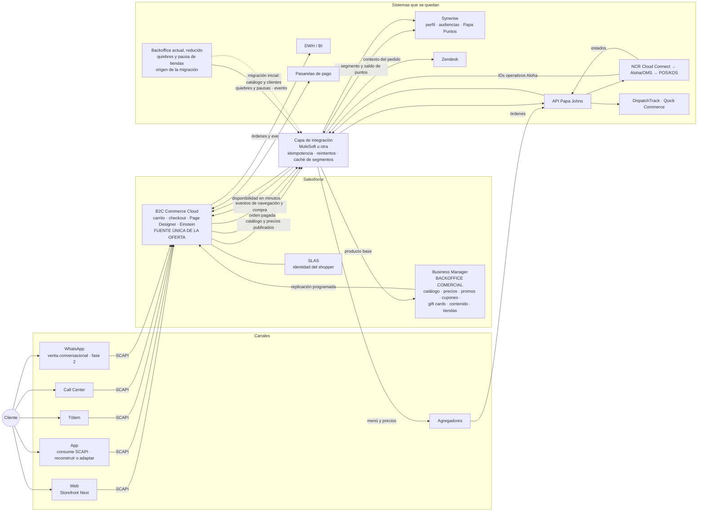
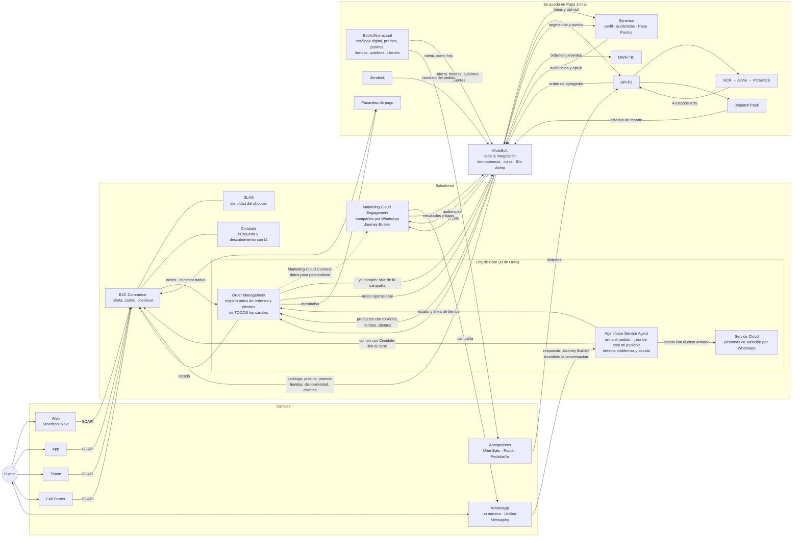
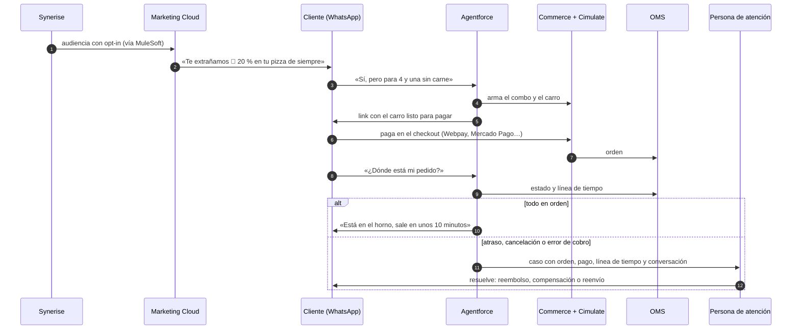
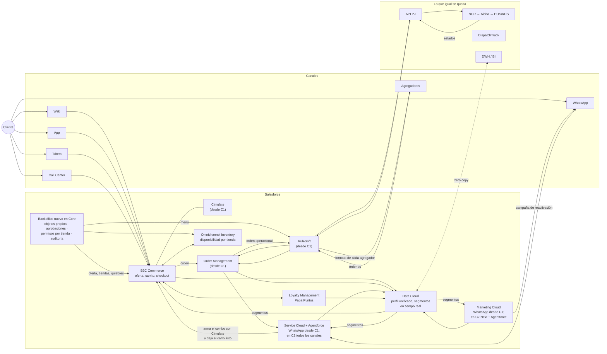

# Papa Johns Chile · Anexo: alternativas de arquitectura evaluadas

- **Estado:** archivo, 24-oct-2026. Se conserva como respaldo del análisis.
- **Decisión:** el 24-oct-2026 se eligió **una sola propuesta** (Commerce, Order Management, Marketing Cloud y MuleSoft, con el backoffice nuevo como evolución). Está en la [vista unificada §3](solucion-vista-unificada.md).
- Este anexo conserva las alternativas que llevaron a esa decisión: **A** (Commerce integrado), **C1** (Commerce + OMS + MuleSoft + WhatsApp conversacional) y **C2** (plataforma Salesforce completa). Las referencias internas (§4.1, §7.3, §9.3, S1…) apuntan a la vista unificada.

---

## A1. TO-BE A · «Lo que pidió el cliente»: Commerce al centro, integrado

Salesforce reemplaza solo la capa de comercio. La unificación se logra con una **capa de integración** (MuleSoft o equivalente) y con Commerce como **fuente única de la oferta** para todos los canales.

**Qué pasa con el Backoffice** (en el AS-IS «se evoluciona», T-66): su parte comercial (catálogo digital, precios, promociones, cupones, gift cards, contenido y tiendas) **pasa a Business Manager**, que es el backoffice de Commerce. Lo que Business Manager no hace bien, **bloquear quiebres y pausar tiendas en minutos** (§7.4), queda en el Backoffice actual reducido a esa función operativa, que publica por evento a la capa de integración. El Backoffice también es el **origen de la migración** inicial (catálogo y clientes) y se apaga cuando la operación tenga su reemplazo.

**Cómo queda cada unificación:**

| # | Cómo se resuelve en A | Producto |
|---|---|---|
| U1 SAC | App lateral en Zendesk que consulta el pedido por API (Commerce + API PJ + Synerise) | Integración |
| U2 Identidad | SLAS en Commerce con mail/RUT como llave; Synerise sigue siendo el perfil maestro | Commerce + integración |
| U3 Oferta | Commerce es el maestro de la oferta digital (Business Manager reemplaza la parte comercial del Backoffice) y la publica a agregadores, tótem y call center vía la capa de integración; Aloha conserva los IDs operativos; los quiebres y pausas siguen en el Backoffice reducido y llegan por evento | Commerce + integración |
| U4 Analítica | Commerce emite eventos y órdenes al DWH | Integración |

**Pros:** es exactamente lo que pide el RFP; sin migración de CRM, OMS ni SAC; time-to-market corto para el MVP 2027 (T-70); cumple T-25 (perfil en Synerise, historia en el DWH).
**Contras:** la vista 360 no existe en un solo lugar, se arma por integración; cada nuevo uso de datos es un desarrollo; la personalización depende de que Synerise exponga segmentos en tiempo real (T-63 «por confirmar»); para el partner, un contrato menor.

---

## A2. TO-BE C1 · «Commerce + OMS + MuleSoft»: la fase 1 (recomendado)

**Decisión del 24-oct-2026.** Salesforce entra con tres productos: **B2C Commerce** (la tienda de todos los canales propios), **Order Management** (el registro único de las órdenes de todos los canales) y **MuleSoft** (toda la capa de integración). Por decisión de la jefatura (24-oct) se suma **WhatsApp como canal de campañas y de venta**: **Marketing Cloud Engagement** envía las campañas, **Service Cloud** recibe la conversación en el mismo número (Unified Messaging) y **Agentforce** la atiende: arma el pedido con **Cimulate** (búsqueda en lenguaje natural) y responde «¿dónde está mi pedido?» leyendo OMS, que está en el mismo org. El caso de uso completo está en §4.1. **Se quedan** Aloha/NCR, la API PJ, Synerise (como CDP y fuente de audiencias y consentimiento), Zendesk (para los canales que no son WhatsApp), DispatchTrack, el DWH **y el backoffice actual**, que MuleSoft sincroniza con Commerce y con OMS.

El detalle está en los alcances: [OMS](oms/alcance-oms.md) y [MuleSoft](mulesoft/alcance-mulesoft.md).

**Qué sincroniza MuleSoft con cada producto de Salesforce:**

| Dato del backoffice o de Aloha | B2C Commerce (para vender) | OMS (para registrar y operar la orden) |
|---|---|---|
| Productos, variantes, mitades, combos con su ID Aloha | Sí: catálogo digital | Sí: producto de Core con el ID Aloha, para entregar la orden a la tienda y para SAC |
| Precios (3 listas × 3 zonas) | Sí | No: la orden ya trae el precio cobrado |
| Promociones, cupones y gift cards | Sí | No: la orden trae los ajustes aplicados |
| Tiendas: datos, horarios, modalidades, zonas | Sí | Sí: ubicación de cada tienda, para las Fulfillment Orders y la consola por tienda |
| Quiebres y estado de tienda | Sí: disponibilidad en ≤ 60 s | No en C1 (sin Omnichannel Inventory) |
| Clientes (carga inicial y delta) | Sí: cuenta del shopper | Sí: cliente transaccional, con mail y RUT como llave |

**Cómo queda cada unificación (§1):**

| # | Cómo se resuelve en C1 | Producto |
|---|---|---|
| U1 SAC | Por WhatsApp: Service Cloud con la orden de OMS en el mismo org y el caso armado por Agentforce (§4.1). En los demás canales: app lateral en Zendesk que consulta **un solo sistema**, OMS (orden, pago, reembolsos, estados de todos los canales); puntos desde Synerise | OMS + Service Cloud + MuleSoft |
| U2 Identidad | SLAS con mail/RUT como llave; OMS guarda al cliente que compra; **Synerise sigue siendo el perfil maestro** | Commerce + OMS + MuleSoft |
| U3 Oferta | El backoffice actual sigue siendo el maestro; MuleSoft lo publica a Commerce y concilia los IDs Aloha. **Resuelve la sincronización (T-108), no la doble carga (T-73)**: eso llega con C2 | MuleSoft (§7.3, opción 2 como transición) |
| U4 Analítica | OMS tiene las órdenes de todos los canales y MuleSoft las lleva al DWH junto con los eventos de Commerce | OMS + MuleSoft |
| Órdenes centralizadas (T-68 b) | Todas las órdenes en OMS y entregadas a su OMS de tienda, que se mantiene (T-61, T-128) | OMS + MuleSoft |

### A2.1 Caso de uso: de la campaña por WhatsApp al pedido, y «¿dónde está mi pedido?»

Ataca dos metas del cliente a la vez: hablar con el 5 % de los activos y el 3 % de los dormidos (T-2) y la venta conversacional (T-48). Además entrega la «vista unificada» para atención (T-19) en el canal que más se usa.

**Qué ve el agente** (todo en el org de OMS, sin integraciones nuevas para consultar):

| Dato | De dónde llega a OMS |
|---|---|
| Orden, productos, pago y cupones | Commerce, o MuleSoft si viene de un agregador |
| Estado en la tienda: recibido, en preparación, en horno, listo | Aloha/KDS → API PJ → MuleSoft |
| Estado del reparto | DispatchTrack → MuleSoft |
| Cancelaciones, reembolsos y compensaciones | OMS |

**Qué hace con eso:**

1. **Responde solo los casos normales** («está en el horno, sale en unos 10 minutos»): una consulta menos para atención al cliente.
2. **Detecta que algo anda mal:** el pedido lleva más tiempo del estimado, se quedó en un estado, se canceló, o el pago se cobró y la orden no llegó a la tienda.
3. **Escala con todo el contexto:** crea el caso con la orden, el pago, la línea de tiempo de estados y lo que el cliente ya dijo. La persona que lo toma no vuelve a preguntar y puede actuar de inmediato.
4. **Clasifica el motivo** (atraso, pedido incompleto, error de cobro…): deja medición para operaciones, por ejemplo qué tienda se atrasa más.

**Siguiente paso (opcional):** aviso proactivo. Si OMS detecta un atraso, el agente escribe primero («tu pedido viene con 15 minutos de retraso, te dejamos un cupón»).

**Cómo llegan los datos a Marketing Cloud** (detalle en el [alcance de MuleSoft §3.4](mulesoft/alcance-mulesoft.md)): las audiencias con opt-in salen de Synerise por MuleSoft (I19); los datos para personalizar llegan desde OMS por Marketing Cloud Connect, nativo (I20); cuando el cliente compra, MuleSoft lo saca del journey (I21), y los resultados y las bajas vuelven a Synerise y al DWH (I22). El consentimiento sigue viviendo en Synerise (T-24) y el contacto usa la misma llave de cliente que Synerise y OMS.

**Qué se mide:** conversaciones y pedidos originados por campaña, conversión de campaña a orden, porcentaje de «¿dónde está mi pedido?» resueltos sin persona, tiempo de resolución de los casos escalados y motivos de escalamiento por tienda.

**Supuestos:** S10 a S13 (§11).

**Por qué C1:**
- **Para el cliente:** recibe lo que pidió (Commerce headless, Aloha, Synerise y Zendesk se quedan) y además **un solo registro de órdenes de todos los canales**, que hoy no existe. La operación comercial no cambia el día del lanzamiento: menos riesgo para el MVP 2027 (T-70).
- **Para la plataforma:** OMS trae un **org de Salesforce Core** (cuentas, productos, órdenes, Flows, objetos propios, permisos, auditoría). Es la base de todo C2: el backoffice nuevo, Service Cloud, Data Cloud y Loyalty se suman sin otra migración de órdenes.
- **Para nosotros como partner:** un deal mayor que A, defendible frente al RFP, con el *land & expand* ya dibujado.
- **Para Salesforce:** tres productos hoy y un pipeline con fecha.

**Contras y cómo se manejan:**

| Contra | Mitigación |
|---|---|
| Puede leerse como que contradice T-61 («mi OMS se queda») | OMS es el registro comercial; Aloha sigue ejecutando. Tabla de frontera en el [alcance de OMS §2](oms/alcance-oms.md#2-la-frontera-qué-hace-cada-oms) |
| Un salto más en la ruta crítica, con picos de ~9 K órdenes por hora | Objetivo medible: P95 < 5 s entre pago y acuse de la tienda; prueba de carga conjunta |
| El backoffice actual se queda y el cliente pidió uno nuevo (video [07:06]) | El backoffice nuevo tiene lugar y fecha en C2, sobre el core que ya trae OMS ([alcance de MuleSoft §6](mulesoft/alcance-mulesoft.md#6-riesgo-de-c1-el-backoffice-se-queda)) |
| MuleSoft se superpone en parte con la API PJ (T-11, T-60) | La API PJ sigue siendo la puerta de la tienda y de los agregadores; se ofrece la alternativa sobre AWS (§7.6) |

---

## A3. TO-BE C2 · «Plataforma Salesforce»: la visión por fases

C2 suma productos **sobre el core que dejó C1**. Commerce no pasa por Data Cloud para llegar a OMS: la orden sigue yendo directo de Commerce a OMS (conector nativo), y Data Cloud está *al lado*, recibiendo datos de todas las nubes y unificando el perfil.

**Fases dentro de C2** (cada una con su caso de negocio y su disparador):

```mermaid
flowchart LR
  subgraph C1["C1 · MVP 2027"]
    direction TB
    A1["B2C Commerce headless"]
    A2["Order Management"]
    A3["MuleSoft"]
    A4["Cimulate<br/>búsqueda con IA"]
    A5["WhatsApp: Marketing Cloud Engagement<br/>+ Service Cloud + Agentforce<br/>(campaña → pedido → estado)"]
  end
  subgraph C2A["C2 · etapa 1"]
    direction TB
    B1["Backoffice nuevo en Core<br/>(reemplaza el actual)"]
    B2["Menú a agregadores vía MuleSoft"]
    B3["Aviso proactivo de atrasos<br/>y más acciones de Agentforce"]
  end
  subgraph C2B["C2 · etapa 2"]
    direction TB
    C21["Data Cloud<br/>si Synerise no da tiempo real · T-63"]
    C22["Service Cloud en todos los canales<br/>si Zendesk vence o no logra U1"]
    C23["Marketing Cloud Next + Agentforce y Loyalty<br/>requiere Data 360 · si se decide salir de Synerise"]
    C24["Omnichannel Inventory<br/>si hay fuente de stock · T-103"]
  end
  C1 --> C2A --> C2B
```

**Lo que suma C2 (y tiene sentido):**
- **Backoffice nuevo en Core:** una sola fuente comercial (Kit §04) con aprobación, programación, permisos por tienda, auditoría y rollback, cosas que Business Manager no trae (§10, P18). Resuelve la doble carga (T-73) y la gobernanza (T-107): es la opción 3 de la §7.3.
- **Data Cloud:** identidad y segmentos en tiempo real → Sofía, Diego y Valentina sin depender del refresco semanal de Synerise.
- **Marketing Cloud Next con Agentforce y Loyalty** sobre el mismo perfil: carrito abandonado, reactivación por WhatsApp y puntos sin integraciones punto a punto. Cierra la historia de punta a punta: la campaña abre la conversación, Agentforce la atiende y Cimulate arma el combo. Los agentes de marketing viven en Marketing Cloud Next, no en Marketing Cloud Engagement, y se apoyan en Data Cloud (alcance exacto a confirmar con Salesforce).
- **Service Cloud + Agentforce:** SAC nativo sobre OMS y venta conversacional por WhatsApp (T-48).

**Contras reales de C2:**

| Contra | Por qué pesa en Papa Johns |
|---|---|
| **Contradice el RFP** | T-66 «se mantienen Aloha/OMS, Synerise y logística»; T-46 Synerise como fuente de perfil; T-25 el perfil vive en Synerise y la historia en su DWH. Por eso C2 va por fases y con disparadores, nunca como alcance inicial |
| **El backoffice en Core cambia la herramienta de Comercial y Operación** | Es lo que el cliente pidió («nuevo»), pero es el cambio de mayor impacto en la operación: va después del lanzamiento, fuera de temporadas peak (T-70) |
| **OCI no modela ingredientes** | La disponibilidad depende de ingredientes (T-102, T-105): la regla ingrediente → producto se construye igual |
| **Proyectos de migración** | (1) Synerise → Data Cloud + Marketing Cloud: perfiles, 24 meses de historia (T-40), consentimientos (T-24), plantillas y journeys. (2) Papa Puntos → Loyalty Management: saldos, reglas y reversas (T-54). (3) Zendesk + Centribal → Service Cloud: casos, macros, agentes. Cada uno con su riesgo y su ventana |
| **Costos de salida desconocidos** | El cliente no informó vencimientos ni penalidades de Synerise y Zendesk (A-1, A-1b: «Fuera de alcance») |
| **Gestión del cambio** | Marketing, SAC y Operación cambian de herramienta; conviene escalonarlo |

**Disparadores para avanzar de C1 a C2:** el cliente confirma que quiere el backoffice nuevo antes de lo previsto; Synerise no expone segmentos en tiempo real (T-63); vencen los contratos de Synerise o Zendesk; la App se reconstruye y se quiere un solo backend de cliente; se quiere operar los agregadores en la misma plataforma.

**Cómo mostrarlo en la demo:** C1 en vivo (Commerce y OMS con instancia real; Aloha, DispatchTrack y Synerise simulados); C2 como **una lámina de visión** («así crece la plataforma»), nunca como el alcance.

---

## A4. Comparación rápida

| Criterio | A · Commerce integrado | C1 · Commerce + OMS + MuleSoft (recomendado) | C2 · Plataforma Salesforce |
|---|---|---|---|
| Alineado al RFP | Total | Alto: OMS se suma sin reemplazar Aloha | Bajo como punto de partida; por fases, sí |
| Órdenes de todos los canales en un registro (T-68 b) | No: quedan repartidas | Sí | Sí |
| SAC con una pantalla (U1) | Por integración, consultando 3 sistemas | Por integración, consultando OMS | Nativo (Service Cloud) |
| Una sola fuente comercial (U3) | Sí: Commerce como maestro (§7.3) | No: el backoffice actual sigue; se sincroniza | Sí: backoffice nuevo en Core |
| Descubrimiento con IA en web y app (Cimulate) | Sí | Sí | Sí, y además lo usa Agentforce para vender por WhatsApp |
| WhatsApp: campañas y venta | No: queda en Synerise o un tercero | Sí: campaña de Marketing Cloud → conversación con Agentforce → pedido → «¿dónde está mi pedido?» (§4.1) | Igual, más agentes de marketing en Marketing Cloud Next y Service Cloud en todos los canales |
| Datos de clientes donde los pide el cliente (T-25: perfil en Synerise, historia en el DWH) | Sí | Sí | No: el perfil pasa a Data Cloud y Marketing Cloud Next |
| Migraciones | E-commerce (usuarios, 24 meses de órdenes) | Igual que A + clientes y órdenes abiertas a OMS | + CRM, loyalty, SAC y backoffice |
| Riesgo para el MVP 2027 | Bajo | Bajo a medio (un salto más en la ruta de la orden) | Alto si se hace de una vez |
| Valor para el partner | Medio | Medio-alto hoy, alto a 3 años | Alto, si se gana |
