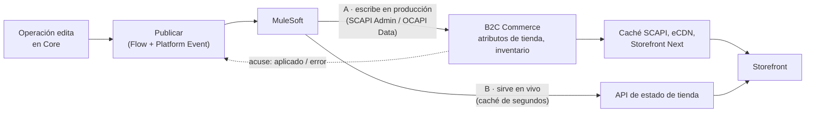

# Backoffice en Salesforce Core: qué se puede hacer

- **Estado:** v2, 24-oct-2026
- **Qué responde:** de las funciones que muestra el backoffice actual de Papa Johns (video del 21-oct), cuáles se pueden hacer en Salesforce Core y cómo. Es la base del activo 4 del [README](../../README.md) («Torre de control»).
- **Fuentes:** [video del backoffice](../../datos/cliente/backoffice-video.md) y su [auditoría](../../datos/cliente/backoffice-video-auditoria.md); [matriz de trazabilidad](../matriz-trazabilidad.md) §3 (filas 01 a 13) y N11.
- **Dónde encaja en la propuesta:** la fase 1 (B2C Commerce + Order Management + Marketing Cloud + MuleSoft) **no construye un backoffice nuevo**: Business Manager toma lo comercial y el backoffice actual sigue con lo operativo ([vista unificada §3.1](../solucion-vista-unificada.md)). Este documento evalúa qué haría Core si en el camino Papa Johns elige la **opción 2** (un backoffice nuevo en Salesforce que complemente a Business Manager) o la **opción 3** (uno que lo incluya todo) del futuro del backoffice ([vista unificada §5](../solucion-vista-unificada.md)). Order Management vive en Core, así que ese core ya está en la propuesta.
- **Dudas técnicas:** las marcadas con **(TB-n)** las resolvemos nosotros en la documentación y el sandbox; mientras tanto, rige el supuesto de la §7.

---

## 1. Respuesta corta

1. **Todo lo que muestra el video se puede *operar* desde Core, pero no todo es *de* Core.** La operación de tienda (estado, horarios, cierres, zonas, bloqueos, grupos, perfiles, NPS, órdenes) cabe bien en Core. Lo comercial (catálogo, precios, promociones, combos, contenido) es información de B2C Commerce: editarlo desde Core obliga a duplicar su modelo en Core y a mandar cada cambio a Commerce, con el mismo problema de publicación inmediata.
2. **Si se elige la opción 2: dos herramientas con dueños claros.**
   - **Core = torre de control de la operación.** Tiendas, horarios, cierres, zonas de reparto, bloqueos, grupos de tiendas, medios de pago por tienda, NPS, órdenes (OMS) y el diagnóstico de vendibilidad. Lo usan Operación, gerentes de mercado, tiendas y servicio al cliente.
   - **Business Manager de B2C = estudio comercial.** Catálogo, precios, promociones, combos, cupones, contenido e imágenes. Lo usan Comercial y Digital. Core muestra lo comercial en solo lectura cuando hace falta (por ejemplo, las promociones de una tienda).
3. **Por qué Core y no Business Manager para la operación.** Cuatro cosas que BM no da y Core sí: permisos **por tienda** (el gerente de mercado ve solo las suyas; los roles de BM son por sitio y módulo), **aprobación e historial** de cambios (BM guarda 1 a 7 días), **la consola de órdenes** de OMS en el mismo lugar (fila 08 de la matriz) y que 176 tiendas no tengan que entrar a la herramienta donde se editan precios.
4. **El tema de la publicación inmediata no lo resuelve Core: lo resuelve cómo viaja cada dato.** Lo que cambia en el turno (cierre, ETA, bloqueos) no debe pasar por el catálogo de B2C: se lee en vivo o va al inventario de producción. Lo comercial se publica en B2C con un tiempo objetivo acordado (§2.2).
5. **La opción 3 (todo en Core) es posible, pero la más cara.** Obliga a duplicar en Core el modelo comercial de B2C (promociones, combos, precios) y a traducir cada cambio a Commerce (§4.1 y §4.2), con más riesgo para la publicación.
6. **En la fase 1 (opción 1) nada de esto se construye.** El backoffice actual sigue operando y MuleSoft lo integra; las APIs de MuleSoft son las mismas en las tres opciones.

| Caso | Funciones donde es el caso principal |
|---|---|
| Core ya lo trae (estándar o configuración) | Listado de tiendas, datos de tienda, NPS, usuarios y perfiles, pertenencia a grupos, aprobación e historial, órdenes |
| Se construye sobre Core | Horarios con varias franjas, cierres programados, editor de zonas, bloqueos, orden y activación masiva de medios de pago, tramos de delivery, motor de alcance, botón Publicar con acuse, panel de vendibilidad (la pantalla) |
| Queda en B2C Commerce | Promociones y combos, precios, catálogo y menús, cupones, contenido e imágenes, preferencias de sitio, medios de pago del checkout, cálculo de vendibilidad y de costo de envío |

---

## 2. Cómo leer esta evaluación

### 2.1 Los tres casos

| Caso | Qué significa | Cómo se costea |
|---|---|---|
| **Core ya lo trae** | Objetos estándar (Location, Address, User), campos propios sobre ellos, list views, páginas de registro, reglas de validación, reportes y dashboards, perfiles y compartición, procesos de aprobación, historial de campos | Configuración |
| **Se construye sobre Core** | Objetos propios, Flows, LWC, Apex, Platform Events | Desarrollo en Core |
| **Queda en B2C** | Es información de Commerce: catálogo, precios, promociones, cupones, contenido, preferencias de sitio, inventario. Core no la edita directamente | Configuración o desarrollo en B2C; si Core la toca, **más** la integración |

Una función puede caer en los tres a la vez. Ejemplo: un bloqueo se decide en Core (se construye), se refiere a un producto que es de B2C y se aplica en el inventario de B2C (queda en B2C).

### 2.2 El viaje hacia Commerce y la publicación inmediata

Core no escribe en B2C. Cada cambio hecho en Core viaja así:

Hoy su backoffice es «inmediato» porque **el front lee la API de Papa Johns en vivo** (`Cache-Control: max-age=0` en `near_me`, video 28:57). El nuevo commerce tiene que dar ese resultado por un camino distinto según lo rápido que cambia cada dato:

| Velocidad del dato | Ejemplos del video | Camino | Tiempo objetivo a proponer |
|---|---|---|---|
| **De turno** (minutos) | Cerrar tienda o modalidad, ETA, bloqueo de producto, agotar XL | **B**: API en vivo servida por MuleSoft, o inventario por tienda en producción (u OCI, TB-3) | Segundos |
| **De configuración operativa** (días) | Horarios, zonas, montos mínimos, tramos de delivery, medios de pago por tienda | **A**: Core resuelve el alcance y escribe el valor efectivo en la tienda de B2C en producción | ≤ 60 s más la caché (matriz N11; TB-1) |
| **Comercial** (campañas) | Promociones, combos, precios, vigencias | No viaja desde Core: se edita en B2C | Precios en producción ≤ 60 s; promociones con replicación granular, en minutos (TB-2) |

Tres reglas de diseño que salen de aquí:

1. **Core resuelve la jerarquía de alcance; B2C no.** El cliente exige que toda regla pueda aplicar a «una tienda, un grupo, un menú, todas o ninguna» [36:32]. Core calcula el valor que rige en cada tienda (tienda > grupo > global) y publica solo ese valor. B2C lee un atributo plano por tienda.
2. **El storefront no consulta Core directamente.** Con picos de 245–260 mil sesiones diarias y el 70 % de las órdenes entre las 18:00 y las 21:00 ([volumetría](../../datos/cliente/preventa/03-volumetria-xlsx.md)), leer Core en cada visita choca con sus límites diarios de API. Core empuja eventos; MuleSoft mantiene la copia y la sirve (TB-7).
3. **«Publicado» quiere decir «aplicado en el sitio», no «enviado».** El botón Publicar en Core espera el acuse de MuleSoft y muestra el estado (enviado, aplicado, error, reintento). Si no, el «inmediato» queda sin prueba frente a la operación.

---

## 3. Resumen por función

● caso principal · ◐ una parte · — no aplica.

| # | Función del video | Core ya lo trae | Se construye en Core | Queda en B2C | Riesgo de inmediatez | Dónde se edita |
|---|---|---|---|---|---|---|
| 1 | Promociones: listado, destacar, orden, publicar | — | ◐ vista de solo lectura | ● | Alto | BM |
| 2 | Editar combo | — | — | ● | Alto | BM (+ extensión) |
| 3 | Listado de tiendas | ● | ◐ columna incidencias | — | Bajo | Core |
| 4 | Panel de vendibilidad por tienda | — | ● pantalla | ● cálculo | Bajo (es lectura) | Core muestra, B2C calcula |
| 5 | Editar tienda: datos, menús, modo, IDs | ● | ◐ | ◐ recibe copia | Medio (modo de pedido: alto) | Core |
| 6 | Horarios y cierres programados | ◐ | ● | ◐ recibe copia | Medio | Core |
| 7 | Zonas de reparto y exclusión | — | ● | ◐ servicio de cobertura | Medio | Core |
| 8 | Bloqueo de productos | — | ● | ● aplica | **Muy alto** | Core |
| 9 | Métodos de pago: orden y activación | ◐ | ● | ● pasarelas | Medio | Core (activación y orden), B2C (medios) |
| 10 | Dashboard NPS | ● | ◐ ingesta | — | No aplica | Core |
| 11 | Configuraciones generales | ◐ | ◐ | ● | Medio | Mixto (§4.11) |
| 12 | Grupos de tiendas y delivery por tramos | ● | ● | ◐ cálculo del envío | Medio | Core |
| 13 | Menús | ◐ asignación | — | ● | Medio | B2C |
| 14 | Usuarios y perfiles | ● | ◐ reversa | ◐ usuarios de BM | No aplica | Core |
| T1 | Alcance: tienda, grupo, menú, todas, ninguna | ◐ | ● motor | ◐ en promociones | — | Core |
| T2 | Guardar y publicar en dos pasos | ◐ | ● | ◐ recibe | — | Core |

---

## 4. Detalle por función

### 4.1 Promociones: listado (Combos, Promos, PapaPartner)

Listado con plataforma, destacar, despacho, vigencia, precios por modalidad; clonar, eliminar, Publicar; máximo 6 destacadas por prioridad; orden programado («cronómetros»).

- **Core ya lo trae:** nada propio. Core no tiene promociones de B2C.
- **Se construye en Core:** opcional, una vista de solo lectura (LWC que consulta B2C a través de MuleSoft) para ver las promociones dentro de la ficha de la tienda.
- **Queda en B2C:** campañas y promociones, copiar promoción (estándar de BM), vigencias, orden en categoría y reglas de orden (las 6 destacadas), orden programado mediante campañas.
- **Viaje:** ninguno si se edita en BM. Editarlas en Core exigiría un objeto espejo de la promoción y un traductor al modelo de B2C. **Se descarta.**
- **Inmediatez:** alta. La frase «cualquier cambio… se ve de forma inmediata» se dijo con el combo en pantalla [05:38]. Depende de TB-2.

### 4.2 Editar combo

Textos por modalidad, card B, SEO, cupón de cortesía, agrupador, precios tienda y domicilio, Arma tu pizza (ingredientes gratis, mínimo, máximo, límite de carnes), pasos con precio delta, pizza de reemplazo, tiendas y canal, imágenes por canal, temporizador, vigencia con días y franjas.

- **Core ya lo trae:** nada.
- **Se construye en Core:** nada (recomendado).
- **Queda en B2C:** todo el combo.
  - Precio tienda y domicilio: listas de precios elegidas por contexto (matriz D2-03).
  - Vigencia, días de la semana y franjas: recurrencia estándar de la asignación de la promoción (probado en el sandbox el 24-oct).
  - Textos base y «para domicilio», SEO, temporizador, agrupador, pasos, precio delta, pizza de reemplazo, reglas de Arma tu pizza: atributos propios y lógica del storefront.
  - Imágenes por canal (web, app, delivery, PeYa, PapaPuntos, tótem): tipos de vista de imagen del producto.
  - Card B: atributo «versión B» con experimentos por Shopper Context (supuesto S14 de la vista unificada).
  - Cupón de cortesía: cupón de B2C.
  - Si el formulario estándar de BM no alcanza («armar una promoción no es trivial» [17:02]), una **extensión de BM** para armar el combo por pasos.
- **El punto de cruce con Core:** «Grupo de menús y/o tiendas». Los grupos viven en Core (4.12). El combo guarda el **ID del grupo**; la pertenencia de cada tienda a sus grupos viaja a B2C como atributo de la tienda. Así, mover una tienda de grupo en Core no obliga a tocar el combo.

### 4.3 Listado de tiendas

Estado por modalidad, tipo de cierre, incidencias, estimados de entrega y retiro, filtros de cerradas (total o por modalidad), orden, clonar, Publicar, vista lista o grilla.

- **Core ya lo trae:** list views sobre la tienda con columnas, filtros y orden; vista Kanban como grilla; botón Clonar; páginas de registro con Dynamic Forms.
- **Se construye en Core:** la columna de incidencias (número de bloqueos activos, desde 4.8) y el acceso al panel de 4.4.
- **Queda en B2C:** nada; la tienda en B2C es una copia (4.5).

### 4.4 Panel de vendibilidad por tienda

Contadores publicadas, disponibles y no disponibles; por promoción, estado, canal (APP, WEB, TOTEM) y motivo. Un bloqueo no vuelve no disponible la promo; sí la vuelve no disponible que falte un grupo requerido en el menú (auditoría C3). Es lo que el cliente más valoró [20:08] y la pieza más cara (matriz fila 11).

- **Core ya lo trae:** nada.
- **Se construye en Core:** la pantalla (LWC en la ficha de la tienda) que llama en vivo al cálculo de B2C a través de MuleSoft.
- **Queda en B2C:** **el cálculo.** Las promociones, los menús y la regla de grupo requerido viven en B2C, y el resultado tiene que ser el mismo que ve el cliente. Se construye como una API propia en B2C (SCAPI custom) que usa la misma lógica que el storefront, por tienda y canal.
- **Viaje:** inverso, de B2C a Core, solo lectura. Sin riesgo de inmediatez.

### 4.5 Editar tienda

| Subfunción | Core ya lo trae | Se construye en Core | Queda en B2C |
|---|---|---|---|
| Nombre, teléfono, dirección, comuna, región, lat/long, Google My Business, localidad SEO, descripción, mostrar en locales | Objeto Location con Address y campos propios (TB-4) | — | La tienda del localizador recibe copia |
| Menús asociados (PJ, Tótem, PedidosYa, Just Eat) | Campos de selección | — | El menú en sí (4.13) |
| Modo de pedido (domicilio, retiro, cerrar) y cierre según perfil | Lista de selección; regla de validación con permiso personalizado para cerrar | — | Lo lee el storefront en vivo (camino B) |
| Última milla (proveedor, FarEye) | Lista de selección | — | No es B2C: lo usa MuleSoft u OMS para despachar |
| IDs de integración (Aloha, NCR, Uber Eats, Sodexo, Webpay, Zendesk, OneClick, PedidosYa) | Campos de ID externo | — | B2C solo usa los de pago; el resto lo usa MuleSoft |
| Medios de pago por tienda | Selección múltiple o registros hijos | Activación masiva (4.9) | Los medios del checkout (4.9) |
| Tiempos: personalizados (30/15), ETA constante, dinámicos | Campos | — | Camino B |
| Excepciones de tiempo periódicas y específicas | — | Objeto Excepción de tiempo + Flow que calcula el tiempo vigente | Camino B |
| Horarios de tienda y de entrega, varias franjas por día | Business Hours admite **una** franja por día: no alcanza. Operating Hours y Time Slots sí, pero vienen con Field Service o Scheduler | Objeto Franja (tienda, tipo, día, desde, hasta) + LWC de edición | Atributo de horarios en la tienda (camino A) |
| Agendar cierre | — | Objeto Cierre programado + Flow programado que cambia el modo de pedido | Camino B |
| Zonas de reparto y exclusión | Ver 4.7 | Ver 4.7 | Ver 4.7 |
| Espacios públicos | — | Objeto hijo, solo si se decide migrarlo (pregunta 15 del video) | Copia en la tienda |
| Clonar tienda | Clonar estándar copia campos, **no** registros hijos | Flow que clona franjas, zonas, excepciones y medios | — |

- **Viaje:** dos velocidades en la misma ficha. Modo de pedido, cierre y tiempos van por el camino B; el resto, por el A al pulsar Publicar.

### 4.6 Horarios y cierres

Incluido en la tabla de 4.5. Se separa en el resumen porque es el bloque más grande de construcción de la ficha de tienda. Hay que decidir en la migración si se mantiene el modelo actual, donde ninguna franja cruza la medianoche y la madrugada es una franja del día siguiente (auditoría C8, pregunta 21 del video).

### 4.7 Zonas de reparto y exclusión

Una zona nace como hexágono editable, con nombre obligatorio y toggle de activación; la exclusión requiere una zona de reparto; se ven las zonas de tiendas vecinas en 8 km; las dibuja servicio al cliente (dicho).

- **Core ya lo trae:** el campo geolocalización guarda un punto, no un polígono. El componente `lightning-map` muestra marcadores; no edita polígonos.
- **Se construye en Core:**
  - Objeto Zona (tienda, nombre, activa, exclusión, polígono en GeoJSON) y la regla «exclusión solo si hay reparto».
  - Editor en LWC con Google Maps (dibujar, mover vértices, ver vecinas en 8 km). Cargar Google Maps dentro de Lightning tiene restricciones de seguridad; el patrón habitual es un contenedor aislado (TB-5). Alternativa: Salesforce Maps.
- **Queda en B2C:** nada por fuerza. **Qué tienda atiende una dirección** es un servicio de cobertura (punto dentro de polígono) que hoy resuelve la API de Papa Johns con Google Maps [26:55]. Puede vivir en MuleSoft, leyendo las zonas publicadas desde Core, o en B2C como API propia con las zonas copiadas en la tienda. Recomendación: MuleSoft, porque también lo necesitan el call center y el tótem. En la fase 1, la cobertura sigue con la lógica actual (supuesto S17 de la vista unificada; I23 del alcance de MuleSoft).
- **Viaje:** camino A (zonas publicadas a la copia de MuleSoft o de B2C).

### 4.8 Bloqueo de productos

Por tienda y variante; tipos Pizza, Complemento, Ingrediente, Promociones, Combos (auditoría C1); «todas las tiendas» (dicho); agotar la XL bloquea todas las especialidades (dicho, en producción); sustituto en vez de bloquear.

- **Core ya lo trae:** nada. Los productos no viven en Core.
- **Se construye en Core:**
  - Objeto Bloqueo: alcance (tienda, grupo o todas), tipo, producto, variante o atributo (p. ej. tamaño XL), sustituto, motivo, desde y hasta.
  - LWC de alta con buscador de productos. Necesita el catálogo: o se consulta B2C en vivo por MuleSoft, o se mantiene en Core un espejo liviano de IDs y nombres (B2C → Core, solo lectura).
  - Expansión del bloqueo por atributo (XL → todas las especialidades) antes de publicar.
- **Queda en B2C:** **aplicar** el bloqueo.
  - Productos y variantes: inventario por tienda en producción, que no pasa por replicación (u OCI, TB-3).
  - Ingredientes, promociones y combos: atributo o registro que lee el storefront; pizza de reemplazo y sustituto se resuelven en el storefront.
- **Viaje:** el más urgente (camino B). Es la función con mayor riesgo frente a «inmediato»: un producto agotado que se sigue vendiendo es una orden que la tienda no puede preparar.

### 4.9 Métodos de pago: orden y activación

Orden por modalidad con drag & drop; corte de «visibles primero» (3); activación por tienda; activación masiva (dicho, auditoría C2); catálogo no uniforme (7 en la tienda, 10 en el orden, otros en la API).

- **Core ya lo trae:** el catálogo único de medios (lista de selección global) y la selección por tienda.
- **Se construye en Core:**
  - LWC de orden por modalidad con el corte de visibles.
  - Acción masiva: elegir tiendas en un list view y prender o apagar un medio (Flow de pantalla).
- **Queda en B2C:** los medios de pago del sitio y su integración con las pasarelas (Webpay, Oneclick, Mercado Pago, Fintoc…). Core solo dice qué medios están activos en cada tienda y en qué orden; B2C lo lee como atributo de tienda o preferencia de sitio.
- **Previo:** unificar el catálogo de medios en la migración (auditoría F4).

### 4.10 Dashboard NPS

Puntaje, enviadas y respondidas, histórico por día, semana, mes y año, por tienda, por pregunta, comentarios; apertura por tienda, grupo o total.

- **Core ya lo trae:** reportes y dashboards con filtros por fecha, tienda y grupo, histórico y suscripciones. Si las encuestas se mueven a Core, Salesforce Surveys tiene pregunta de tipo NPS.
- **Se construye en Core:** un objeto Respuesta NPS y su carga por MuleSoft, con el supuesto de que la herramienta de encuestas actual sigue fuera de Salesforce.
- **Queda en B2C:** nada.
- **Viaje:** ninguno hacia B2C.

### 4.11 Configuraciones generales

| Parámetro | Dónde | Por qué |
|---|---|---|
| Montos mínimo y máximo por modalidad, pedido anticipado (48 h), intervalo de ETA, tope de entrega, delivery fijo y gratis | **Core** (registro de configuración global) → atributos o preferencias en B2C | Son el nivel «global» de la misma jerarquía que el grupo y la tienda: se resuelven en un solo lugar (regla 1 de §2.2) |
| Cupón por abandono, códigos de invitación (25 %) | **B2C** (promociones y cupones); el disparo, Synerise | Es información comercial |
| Puntos por invitación, precio mínimo con puntos | **Synerise** (Papa Puntos), fuera de Core y de B2C | Loyalty se queda en el cliente |
| Desactivar servicios (API Core, usuarios, órdenes) | **MuleSoft** y preferencias de sitio de B2C | Son interruptores de integración |
| App móvil (modal de cupones, forzar actualización) | Configuración de la app, servida como preferencia de sitio | No es de Core |

### 4.12 Grupos de tiendas y delivery por tramos

Nombre, precio mínimo de entrega, cobro fijo **o** por tramos (excluyentes; el tramo 1 parte en el mínimo del grupo), proveedores de última milla deshabilitados, tiendas asignadas.

- **Core ya lo trae:** la pertenencia tienda–grupo (Location Group de OMS, o un objeto propio si Location Group se reserva para disponibilidad en OCI; TB-4), campos propios, reglas de validación para la exclusión fijo/tramos y para el «desde» del tramo 1, list views con paginación.
- **Se construye en Core:**
  - Objeto Tramo de delivery (hijo del grupo) y el resumen.
  - El motor de alcance (T1): cuando cambia un grupo o el global, recalcula el valor que rige en cada tienda afectada y lo publica.
- **Queda en B2C:** el cálculo del costo de envío en el checkout. Es configuración estándar: un método de envío con tabla de costos por monto del pedido, restringido a un grupo de clientes dinámico que Shopper Context activa según el grupo de la tienda (probado en el sandbox el 24-oct; vista unificada §3.1). Core solo publica la pertenencia de la tienda al grupo.
- **Viaje:** camino A.

### 4.13 Menús

Un menú por tipología de tienda (chica, mall, regular) y por canal (propio, tótem, PedidosYa, Just Eat).

- **Core ya lo trae:** solo la asignación tienda → menú (4.5).
- **Se construye en Core:** nada.
- **Queda en B2C:** el menú es catálogo. B2C tiene un catálogo por sitio, así que el surtido por tienda se resuelve con inventario por tienda o atributos (matriz fila 02). Los menús de agregadores los sigue publicando el backoffice actual con la oferta que le entrega MuleSoft; con un backoffice nuevo, la publicación automática es la candidata de la etapa 2 (I17 del alcance de MuleSoft).

### 4.14 Usuarios y perfiles

Muchos perfiles; el gerente de mercado ve solo sus tiendas; cerrar tienda solo para algunos perfiles.

- **Core ya lo trae:** perfiles, conjuntos de permisos, roles, reglas de compartición (el gerente ve sus tiendas), permisos personalizados para acciones como cerrar tienda, SSO, Setup Audit Trail, historial de campos (18 meses; más con Field Audit Trail) y **procesos de aprobación**. Esto cubre la mitad de la fila 09 de la matriz.
- **Se construye en Core:** la **reversa por cambio** (guardar una versión al publicar y poder restaurarla): no es estándar.
- **Queda en B2C:** los usuarios de BM del equipo comercial (Account Manager y roles por sitio y módulo).

### T1. Alcance: tienda, grupo, menú, todas, ninguna

- **Core ya lo trae:** campos de relación y listas de selección para expresar el alcance.
- **Se construye en Core:** el motor que resuelve tienda > grupo > global (Apex o Flow) y publica el valor efectivo por tienda. Resuelve además la pregunta 13 del video (qué pisa a qué).
- **Queda en B2C:** el alcance de las **promociones**, que vive en la promoción: los calificadores por tienda o grupo son lógica propia que usa los IDs de grupo publicados desde Core.

### T2. Guardar y publicar en dos pasos

- **Core ya lo trae:** estado del registro (borrador, en aprobación, publicado), proceso de aprobación, historial.
- **Se construye en Core:** acción Publicar (Flow que valida y emite un Platform Event), bandeja de publicaciones con su estado y acuse, reintento ante error.
- **Queda en B2C:** recibir el cambio (escritura en producción vía MuleSoft) y devolver el acuse.

---

## 5. Módulos que aparecen en el menú pero no se abrieron

Clasificación por el nombre; sin verlos, es una hipótesis.

| Módulo | Caso probable | Comentario |
|---|---|---|
| Productos (Pizzas, Ingredientes, Complementos) | Queda en B2C | Catálogo. Los IDs de Aloha van como atributo (matriz fila 01) |
| Banners | Queda en B2C | Page Designer y contenido |
| Campañas, Cupones | Queda en B2C | Notificaciones y carrito abandonado, Synerise (supuesto S22); campañas por WhatsApp, Marketing Cloud |
| Gift Cards | Sigue en el backoffice actual en la fase 1 | Commerce las consulta y redime (I3); a futuro, gift certificates de B2C |
| Órdenes | **Core ya lo trae** | Consola de Order Summary de OMS: búsqueda, filtros por tienda y canal, cancelar, devolver. Cubre la fila 08 de la matriz; se enciende en la fase futura (F9 del alcance de OMS) |
| Reglas | Por ver | Podría ser el motor de alcance (T1) o reglas de promoción |
| Notificaciones móviles | Ni Core ni B2C | Synerise o la app |
| Clientes | Queda en B2C (perfiles) y Synerise (CRM) | Core solo tiene las cuentas que crea OMS al registrar órdenes |

---

## 6. Qué cambia para el costeo

**Nada de esta sección entra en la estimación de la fase 1:** se costea si Papa Johns elige la opción 2 o la 3. Sobre la [matriz](../matriz-trazabilidad.md) §3, si se adopta Core para la operación:

| Fila | Hoy en la matriz | Con Core |
|---|---|---|
| 05 Configuración de tiendas (L) | Desarrollo sobre BM o consola propia | Configuración en Core más objetos Franja, Excepción, Cierre, Zona y el editor de zonas. Sigue siendo **L** por el editor de polígonos y los horarios |
| 08 Pedidos y última milla (L) | «Nadie» | Consola de OMS estándar. Baja a **M** (filtros e incidencias de despacho propios) |
| 09 Roles, auditoría, rollback (L) | Desarrollo | Permisos por tienda, aprobación e historial son estándar; queda la reversa. Baja a **M** |
| 11 Diagnóstico por tienda (L) | Desarrollo | Sin cambio: el cálculo sigue en B2C; Core solo suma la pantalla |
| 12 Bloqueos (M) | Desarrollo | Objeto y pantalla en Core + aplicación en B2C. Sigue en **M** |
| 13 Configuración general y grupos (S) | Preferencias y atributos de B2C | Sube a **M** por el motor de alcance y su publicación |
| Nueva | — | **Integración Core → MuleSoft → B2C** para datos de tienda (camino A), API de estado en vivo (camino B) y acuse. Va en el alcance de MuleSoft (activo 3) |

**Core para la operación + BM para lo comercial** es la opción 2 de la vista unificada §5. Es más cara que mantener el backoffice actual en integración, pero aprovecha OMS (que ya está en la propuesta) y resuelve permisos, aprobación e historial sin construirlos.

---

## 7. Dudas técnicas y supuestos

Lo técnico lo resolvemos nosotros en la documentación y el sandbox; a Salesforce solo van preguntas comerciales ([vista unificada §9.1](../solucion-vista-unificada.md)). Mientras una duda no se resuelve, rige su supuesto.

| # | Duda técnica | Supuesto mientras se resuelve | Por qué importa |
|---|---|---|---|
| TB-1 | Qué datos se escriben directo en producción por SCAPI Admin u OCAPI Data sin que la replicación los pise, y cuánto tarda en verse con la caché | Inventario por tienda y atributos de tienda se escriben en producción y se ven en ≤ 60 s más la caché (meta M3 del alcance de MuleSoft) | Define el tiempo objetivo del camino A |
| TB-2 | Cuánto tarda la replicación granular de una campaña | Minutos; se mide en el sandbox con el volumen del cliente (P19) | Qué responder a «inmediato» en lo comercial |
| TB-3 | Si Omnichannel Inventory sirve para bloqueos por tienda en segundos, incluidos ingredientes | No se usa: los bloqueos van a las listas de inventario de producción de B2C, como en la fase 1 (I5) | Camino B para bloqueos |
| TB-4 | Si Location y Location Group de OMS sirven como maestro de tienda sin chocar con OCI | Location con campos propios para la tienda; los grupos, en un objeto propio | Tienda como objeto estándar u objeto propio |
| TB-5 | Patrón para editar polígonos con Google Maps dentro de Lightning | LWC con Google Maps en un contenedor aislado; la licencia de Google la provee el cliente | Esfuerzo del editor de zonas |
| TB-7 | Si el patrón «Core empuja eventos, MuleSoft mantiene la copia y la sirve al storefront» respeta los límites de API de Core en los picos | Sí: el storefront nunca consulta Core | Arquitectura del camino B |

Las preguntas abiertas del [video](../../datos/cliente/backoffice-video.md#preguntas-abiertas) se cierran con supuestos:

| Pregunta del video | Supuesto |
|---|---|
| 1 · Qué significa «inmediato» si hay que pulsar Publicar | Quiebres, cierres y pausas se ven en ≤ 60 s; lo comercial, en minutos tras publicar |
| 2 · Dónde nacen catálogo y precios | El producto nace en Aloha con su ID y se completa en Business Manager; los precios, en Business Manager (vista unificada §7.4) |
| 13 · Qué pisa a qué | Tienda > grupo > global |
| 17 · Activación masiva de medios de pago | Por grupo de tiendas o por selección de tiendas |
| 18 · Bloqueo en todas las tiendas | Es el alcance «todas» del bloqueo |

---

## 8. Qué mostrar en la demo

Solo si se quieren ilustrar las opciones 2 o 3 del futuro del backoffice; la fase 1 no las incluye. La instancia de OMS ya es real en la demo ([13 · Operación](../../disenos/13-operacion/README.md)), así que hay un Core donde enseñar la idea:

- **Simular:** en Core, la ficha de una tienda con «Cerrar delivery» y un bloqueo de la XL; en el storefront del sandbox, la tienda aparece cerrada para delivery y la XL no se puede elegir. Es el caso que hace creíble el «inmediato».
- **Diseñar:** el panel de vendibilidad dentro de la ficha de la tienda en Core (pantalla, sin cálculo real).
- **Explicar:** el reparto «Core opera, BM vende» con el diagrama de §2.2 y la tabla de §3.

## Historial

| Fecha | Cambio |
|---|---|
| 24-oct-2026 | v2: alineado con la vista unificada v3.0. El documento respalda las opciones 2 y 3 del futuro del backoffice; la fase 1 no construye backoffice. Delivery por tramos y promociones por día y franja, estándar (probado en el sandbox); Card B con experimentos por Shopper Context (S14); gift cards siguen en el backoffice; consola de OMS en la fase futura. Las preguntas a Salesforce (SF-B) pasan a dudas técnicas con supuesto (TB) y las preguntas del video, a supuestos. Sin menciones a licencias o ediciones de Salesforce |
| 24-oct-2026 | v1: qué funciones del backoffice del video caben en Core |
