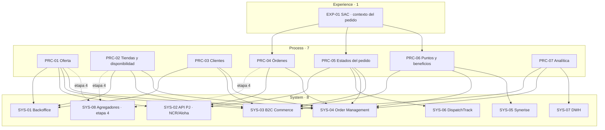
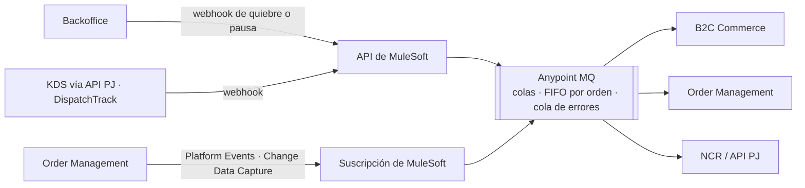
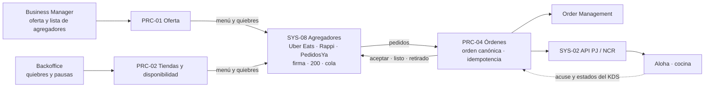

# Papa Johns Chile · Alcance de MuleSoft

- **Estado:** borrador v2.5, 28-oct-2026
- **Propuesta:** B2C Commerce + Order Management + Marketing Cloud + **MuleSoft** ([vista unificada §3](../solucion-vista-unificada.md)). MuleSoft es **toda la capa de integración**: sincroniza Commerce y OMS con todos los demás sistemas (backoffice actual, API PJ, Aloha, Synerise, Zendesk, DispatchTrack, DWH). **Business Manager es el maestro de la oferta digital** (catálogo, precios, promociones, contenido y tiendas); el backoffice actual opera quiebres, gift cards y reportes, y publica el menú a los agregadores hasta la etapa 4. Marketing Cloud recibe los clientes del e-commerce por exportación programada desde Commerce, sin MuleSoft.
- **Se lee con:** [alcance de OMS](../oms/alcance-oms.md) (los flujos F1 a F15 definen las integraciones de órdenes) y la [vista unificada §7](../solucion-vista-unificada.md) (datos maestros).

---

## 1. En una frase

**MuleSoft conecta todo lo que se queda (backoffice, API PJ, Aloha, Synerise, Zendesk, DispatchTrack, DWH) con lo nuevo (B2C Commerce y OMS), con APIs reutilizables para cualquier canal nuevo.**

Es lo que pide el cliente: una capa desacoplada (T-12), idempotente (T-14), con servicios reutilizables que bajen el time-to-market de los canales nuevos (T-20). Y es la base de la evolución: si en el camino se elige un backoffice nuevo en Salesforce ([vista unificada §5](../solucion-vista-unificada.md)), las mismas APIs cambian de origen sin tocar Commerce ni los canales.

**Lo que MuleSoft no es:** no es el **maestro** de ningún dato (vista unificada §7.3). Transporta, transforma, concilia IDs y orquesta. En la propuesta los dueños son Business Manager (oferta digital: catálogo, precios, promociones, contenido y tiendas), Aloha (IDs operativos y recetas), el backoffice actual (lo operativo: quiebres, cierres, zonas, grupos de tiendas, menú a agregadores y gift cards) y Synerise (perfil, segmentos y puntos) (vista unificada §7.4).

---

## 2. Arquitectura por capas

Patrón API-led: **System APIs** (una por sistema), **Process APIs** (una por proceso de negocio) y **Experience APIs** (solo donde un canal lo necesita; Commerce y OMS se conectan a las Process APIs).

**Principios de diseño:**

| # | Principio | Por qué | Evidencia |
|---|---|---|---|
| D1 | **Nada en la ruta del checkout espera a un sistema lento** | Puntos y segmentos con caché y corte a 1 s; el checkout sigue si Synerise cae | T-12, T-43, caso 17 |
| D2 | **Idempotencia y colas en toda orden** | Cero duplicados y cero pérdidas; reintentos sin efectos dobles | T-13, T-14, N5 |
| D3 | **Eventos para lo que cambia en minutos, lotes para lo programado** | Quiebres y estado de tienda por evento, directo a producción; catálogo y precios por publicación programada | Vista unificada §7.4, N11 |
| D4 | **Un mapeo de IDs Aloha, en un solo lugar** | El producto, la mitad, el borde y el descuento llegan a la tienda con sus códigos | T-73, T-76, T-121 |
| D5 | **Monitoreo y alertas por flujo** | Operación sabe cuándo una tienda dejó de recibir órdenes antes que el cliente | N2 |
| D6 | **Una sola llave de cliente en todos los sistemas** | Commerce, OMS, Synerise y Marketing Cloud identifican al cliente con el mismo ID (mail o RUT); el teléfono va como atributo en formato +56. Evita perfiles duplicados | T-4, T-16 |

### 2.0 Catálogo de APIs (base para costear)

**16 APIs** (8 de sistema, 7 de proceso, 1 de experiencia). Tamaño: **S** = pocas operaciones, sin lógica; **M** = varias operaciones o lógica de negocio; **L** = flujo crítico con idempotencia, colas, conciliación o mapeo complejo.

| ID | Capa | API | Operaciones principales | Integraciones (§3) | Tamaño |
|---|---|---|---|---|---|
| SYS-01 | Sistema | Backoffice PJ | Recibe la oferta publicada en Business Manager; envía quiebres, pausas y grupos de tiendas; gift cards; cobertura; lectura de clientes para la migración | I1–I5, I7, I23 | M |
| SYS-02 | Sistema | API PJ / NCR / Aloha | Entrega la orden, recibe el acuse, los estados del KDS, los IDs Aloha y las órdenes de agregadores; ETA | I6, I8–I10, I23 | L |
| SYS-03 | Sistema | B2C Commerce (SCAPI Admin) | Lee la oferta publicada, escribe inventario, grupos de tiendas y clientes, lee órdenes | I1–I7, I12, I13, I23 | M |
| SYS-04 | Sistema | Order Management | Ingesta de órdenes, Fulfillment Orders, productos, ubicaciones, cuentas; Platform Events | I1, I4, I6–I11, I15, I16 | M |
| SYS-05 | Sistema | Synerise | Segmentos, saldo y movimientos de Papa Puntos, eventos de compra | I12, I13 | M |
| SYS-06 | Sistema | DispatchTrack | Estados de reparto y link de seguimiento | I11 | S |
| SYS-07 | Sistema | DWH | Carga de órdenes y eventos | I16 | S |
| PRC-01 | Proceso | Oferta | Producto base desde Aloha a Business Manager; oferta publicada hacia OMS y el backoffice; mapeo de IDs Aloha | I1, I2, I4, I6 | L |
| PRC-02 | Proceso | Tiendas y disponibilidad | Tiendas, horarios, modalidades y grupos; quiebres y pausas en ≤ 60 s, también por ingrediente con la receta de Aloha (I18); cobertura y ETA en línea | I4, I5, I18, I23 | L |
| PRC-03 | Proceso | Clientes | Migración de 2,5 M, delta en la convivencia, 24 meses de historia | I7 | M |
| PRC-04 | Proceso | Órdenes | Agregadores → OMS, OMS → tienda una sola vez, conciliación diaria | I8, I9 | L |
| PRC-05 | Proceso | Estados del pedido | KDS y reparto en orden (FIFO) hacia OMS y Commerce | I10, I11 | M |
| PRC-06 | Proceso | Puntos y beneficios | Saldo con caché y corte a 1 s, acumulación (la reversa por causal, en la fase futura) | I12, I13 | M |
| PRC-07 | Proceso | Analítica | Órdenes y eventos de todos los canales al DWH | I16 | S |
| EXP-01 | Experiencia | SAC | Contexto del pedido para la app lateral de Zendesk | I15 | S |
| SYS-08 | Sistema | Agregadores (Uber Eats, Rappi, PedidosYa) | **Etapa 4.** Una API con un adaptador por agregador: publica menú, precios y quiebres por tienda; recibe los webhooks de pedidos (valida la firma, responde 200 y encola); acepta o rechaza y envía los estados | I17, I24 | L |

**Fuera del catálogo:** I14 (reembolsos) sigue en los procesos actuales en la propuesta y no pasa por MuleSoft.

**Resumen de tamaños:** 5 L, 7 M, 4 S.

**Por qué una sola API para los tres agregadores:** los tres hacen lo mismo (menú, quiebres, pedidos, estados) y entran por el mismo proceso. Cada agregador es un adaptador dentro de SYS-08, con su propia firma, credenciales y formato, y se despliega y prueba por separado; un cambio de Rappi no toca el de Uber Eats. Si mañana se suma otro agregador, es un adaptador más, no una API nueva.

**En la etapa 4 crecen tres APIs** (§3.6): PRC-01 y PRC-02 suman la traducción de la oferta y los quiebres al formato de cada agregador, y PRC-04 la orden canónica del agregador (mapeo de productos y tiendas, aceptación).

### 2.1 Eventos y confiabilidad

**No hace falta Kafka.** El volumen es bajo para un bus de eventos: ~622 K órdenes y ~3 M de eventos de estado al mes; en el peak, ~3 órdenes y ~15 eventos por segundo. Kafka sumaría un clúster que operar sin necesidad (T-110). **Se usa lo que trae Anypoint Platform**, y el backoffice solo llama a un webhook: no tiene que conocer el broker.

**Qué trae MuleSoft para cada necesidad:**

| Necesidad | Qué trae MuleSoft | Uso en Papa Johns |
|---|---|---|
| Broker de colas | **Anypoint MQ**: colas, *exchanges* (un mensaje a varias colas), colas FIFO y colas de errores | Órdenes a la tienda, estados, quiebres y avisos de publicación de Business Manager |
| Orden garantizado | Colas **FIFO** de Anypoint MQ | Los estados de una orden llegan en secuencia («Entregado» nunca antes que «En preparación»). Su rendimiento es menor que el de una cola normal, pero sobra para ~15 eventos por segundo |
| Cero duplicados | **Idempotent Message Validator** + **Object Store v2** (claves ya procesadas, con vencimiento) | Una orden o un estado repetido se descarta (T-14) |
| Reintentos | Ámbito **Until Successful** y estrategias de reconexión de los conectores | Caídas cortas de NCR o de la API PJ, sin intervención |
| Mensajes que no se pudieron entregar | **Cola de errores** de Anypoint MQ + alertas | Cero órdenes perdidas: quedan retenidas y se reprocesan (T-13) |
| Escuchar a Salesforce | **Salesforce Connector** y **Salesforce Pub/Sub Connector** (Platform Events y Change Data Capture) | OMS avisa «orden creada» y sus cambios de estado, y MuleSoft reacciona (cancelaciones y reembolsos, en la fase futura) |
| Recibir webhooks | API HTTP en Mule + **API Manager** (seguridad, límite de llamadas, credenciales por cliente) | Backoffice, KDS y DispatchTrack llaman a una API protegida |
| Cargas masivas | **Batch module** | Oferta publicada en Business Manager, migración de clientes, exportación al DWH |
| Transformar y mapear IDs | **DataWeave** | Producto, mitad, borde y descuento a IDs Aloha (T-73, T-121) |
| Monitoreo | **Anypoint Monitoring**: paneles, alertas y trazas por flujo | Operación ve si una tienda dejó de recibir órdenes (D5) |
| Contrato de cada evento | Diseño de APIs asíncronas con **AsyncAPI** en Exchange | El contrato queda documentado y es de Papa Johns |
| Si el cliente ya tiene un broker | Conectores de **Kafka, JMS, AMQP y Amazon SQS** | MuleSoft se conecta a lo que exista, sin reemplazarlo |

**Qué va por cola y qué por lote:**

| Por cola (eventos) | Por lote |
|---|---|
| Orden operacional a la tienda (I9) | Catálogo, precios y tiendas publicados en Business Manager (I1, I2, I4) |
| Estados del KDS y de reparto (I10, I11) | Pertenencia de tiendas a grupos (I4) |
| Quiebres y pausas de tienda (I5) | Exportación al DWH (I16) |
| Aviso de publicación de Business Manager (dispara el lote de I1, I2 e I4) | Migración de clientes (I7) e historia |
| Órdenes de agregadores (I8), acumulación de puntos (I13) | Conciliación nocturna OMS ↔ tienda (M1) |

**Regla:** los flujos críticos (órdenes, estados, quiebres) van en colas propias y nunca esperan detrás de una carga masiva.

**Alternativa si el cliente prefiere usar su propio broker:** EventBridge + SQS en el AWS del cliente, con los mismos patrones; MuleSoft se conecta con el conector de SQS. Encaja con la alternativa de la §5.

**Cuándo sí pensar en Kafka:** en una fase futura, si el cliente quiere un bus corporativo para muchos consumidores (Data Cloud, DWH en tiempo real, otras marcas o países, T-132) o si su TI ya lo usa (supuesto SM5, §7).

---

## 3. Inventario de integraciones

Tratamiento en la demo: **Real**, **Simular**, **Explicar** o **Proyecto**.

### 3.1 Oferta, tiendas y clientes

> **Cómo se conecta el backoffice:** no tiene integración propia; es la consola del e-commerce que está detrás de la API PJ. En la propuesta solo envía lo operativo (quiebres, pausas y grupos de tiendas) y recibe la oferta para los agregadores. Vía principal: un webhook cuando cambia un dato operativo; los endpoints de la API PJ como respaldo, y la lectura de la base solo para la migración. Detalle y evidencia en [backoffice-y-api-pj.md](backoffice-y-api-pj.md).

**Business Manager es el maestro de la oferta digital.** MuleSoft la entrega a OMS (productos con su ID Aloha y tiendas, para registrar y operar la orden) y al backoffice actual (para publicar el menú a los agregadores y para la operación). El backoffice sigue enviando quiebres y gift cards. Precios, promociones y quiebres no van a OMS: la orden ya trae el precio cobrado y los descuentos aplicados.

| # | Origen → destino | Qué datos | Patrón y frecuencia | Evidencia | Demo |
|---|---|---|---|---|---|
| I1 | Business Manager → backoffice **y OMS** | **Catálogo digital**: productos, variantes, mitades, combos, imágenes y textos. A OMS va el producto con su ID Aloha (sin contenido de marketing); al backoffice, lo que necesita para agregadores y operación | Lote al publicar en Business Manager | T-73, T-107 | Explicar |
| I2 | Business Manager → backoffice | **Precios** de la lista de agregadores (y las demás, para la operación) | Lote con fecha de vigencia | T-94, T-96 | Explicar |
| I3 | B2C Commerce ↔ backoffice | **Gift cards**: el checkout consulta el saldo y las redime en el backoffice, que las sigue administrando | Consulta en línea con corte de tiempo | T-115, T-120 | Explicar |
| I4 | Business Manager → backoffice **y OMS**; backoffice → Commerce | **Tiendas**: datos, horarios, modalidades y medios de pago por tienda. En OMS, cada tienda es una ubicación para las Fulfillment Orders. En sentido contrario, la pertenencia de cada tienda a sus grupos (para precios, promociones y delivery por tramos) nace en el backoffice y llega a Commerce. Las zonas de reparto se quedan en el backoffice | Lote diario + evento al cambiar | T-23, T-106, matriz §3-05 | Explicar |
| I5 | Backoffice → B2C Commerce | **Quiebres y estado de tienda** (abierta, pausada, saturada) | **Evento**, directo a la lista de inventario de producción; visible en ≤ 60 s | T-102, T-103, T-130, D7-04 | Simular |
| I6 | Aloha / API PJ → Business Manager **y OMS** | **IDs operativos** (producto, mitad, borde, descuento): el producto base nace en Aloha | Evento al crear o cambiar; poco frecuente | T-73, T-121 | Proyecto |
| I7 | Backoffice (servicio Users) → B2C Commerce y OMS | **Clientes**: carga inicial de 2,5 M y delta durante la convivencia; mail y RUT como llave | Lote inicial + delta diario hasta el corte | T-1, T-4, T-16, video [07:27] | Proyecto |
| I23 | B2C Commerce → backoffice / API PJ | **Cobertura y ETA**: qué tienda atiende una dirección y el tiempo estimado, con la lógica actual (supuestos S17 y S18 de la vista unificada) | Consulta en línea, con caché corta y corte de tiempo | D7-02, T-123, T-126 | Simular |

**Sobre la publicación:** catálogo, precios y promociones se publican en Business Manager de *staging* a producción. El backoffice actual publica «al instante» (N11). La publicación granular reduce la espera a minutos; los quiebres no esperan: van por evento directo a producción (I5).

### 3.2 Órdenes y estados

| # | Origen → destino | Qué datos | Patrón | Evidencia | Demo |
|---|---|---|---|---|---|
| — | B2C Commerce → OMS | Orden de Web, App, Tótem y Call Center | **Conector nativo, no pasa por MuleSoft** | F1 | Real |
| I8 | API PJ → OMS | **Órdenes de agregadores** (200 K al mes) hasta la etapa 4, y como respaldo durante el corte; desde la etapa 4 las recibe MuleSoft directo (I24) | Evento por orden, idempotente | T-33, F2 | Explicar |
| I9 | OMS → API PJ → NCR/Aloha | **Orden operacional** con IDs Aloha | Evento por orden, clave de idempotencia, cola y reintentos; acuse de vuelta | T-14, T-32, T-61, F3 | Simular |
| I10 | API PJ (KDS) → OMS → B2C | **4 estados del KDS** | Webhook → evento | T-35, F4 | Simular |
| I11 | DispatchTrack → OMS → B2C | **Estados de reparto y enlace de seguimiento** | Webhook (supuesto SM3); si no lo expone, consulta periódica | T-129, F4 | Simular |

### 3.3 Pagos, puntos, SAC y analítica

| # | Origen → destino | Qué datos | Patrón | Evidencia | Demo |
|---|---|---|---|---|---|
| I12 | B2C Commerce ↔ Synerise | **Segmentos y saldo de Papa Puntos** | Consulta con caché y corte a 1 s; segmentos por lote semanal hasta que Synerise dé tiempo real | T-5, T-43, T-55, T-63 | Simular |
| I13 | B2C Commerce y OMS → Synerise | **Eventos de navegación y compra, estados del pedido** (para las notificaciones y el carrito abandonado que sigue enviando Synerise, supuesto S22) **y acumulación de puntos**. La reversa de puntos sigue en los procesos actuales (fase futura, F7) | Eventos | T-46, T-54 | Simular |
| I14 | OMS ↔ pasarelas | **Reembolsos** (fase futura, F6) | En la fase 1 siguen en los procesos actuales. En la fase futura, adaptador de pasarela en OMS; MuleSoft solo si la pasarela lo requiere | T-62, F6 | Explicar |
| I15 | Zendesk → OMS | **Contexto del pedido** para el agente | Experience API consultada por la app lateral de Zendesk | T-19, T-65, F8 | Mock identificado (T-65) |
| I16 | B2C Commerce y OMS → DWH | **Órdenes y eventos** de todos los canales. Es el compromiso de T-25: la historia queda en el DWH del cliente, no solo en Salesforce | Lote diario + eventos | T-6, T-18, T-25, F14 | Proyecto |

### 3.4 Marketing Cloud: fuera de MuleSoft en la fase 1

Marketing Cloud solo envía campañas por WhatsApp con link a los clientes del e-commerce ([vista unificada §4](../solucion-vista-unificada.md)). Esos clientes llegan por una **exportación programada desde Commerce** hacia Marketing Cloud, sin MuleSoft, y se asume que tienen opt-in. Si más adelante se quieren las audiencias y el consentimiento de Synerise, se suma una API de proceso de marketing (audiencias, compras, resultados y bajas).

### 3.5 Lo que va al final o queda fuera

| # | Integración | Cuándo y por qué |
|---|---|---|
| I17 | **Menú, precios y quiebres a Uber Eats, Rappi y PedidosYa por API** (T-108, el mayor trabajo manual hoy; T-75) | **Etapa 4.** Hasta entonces el backoffice sigue publicando como hoy, con la oferta que le entrega MuleSoft (I1, I2); desde la etapa 4 lo hace MuleSoft (SYS-08, §3.6) |
| I24 | **Recepción de los pedidos de agregadores en MuleSoft**, que los registra en OMS y los entrega a la tienda | **Etapa 4.** Hasta entonces siguen entrando por la API PJ, que ya está certificada con los tres (T-33, I8): cambiar esa ruta junto con el lanzamiento pondría en riesgo un tercio de las órdenes. Va al final, cuando el camino de las órdenes propias ya está probado (§3.6) |
| I18 | **Regla ingrediente → producto** («sin piña, sin hawaiana») | **Entra en la propuesta (PRC-02), con el quiebre que marca Operación como disparador:** MuleSoft cruza el ingrediente con las recetas de Aloha y bloquea en ≤ 60 s solo las configuraciones afectadas en esa tienda; la especialidad se ofrece con sustituto (T-105). Queda fuera el disparo automático por stock, porque no hay stock de ingredientes en línea (T-100, T-103) |

### 3.6 Etapa 4: los agregadores por MuleSoft

**Menú y pedidos van juntos:** la misma System API (SYS-08 Agregadores, con un adaptador por agregador) publica el menú y recibe los pedidos de cada uno. Al terminar la etapa, **todas las órdenes llegan a la cocina por un solo camino** (I9), y se apaga la ruta de agregadores de Core, que era la condición para no tener dos caminos hacia NCR ([backoffice-y-api-pj.md §3.3](backoffice-y-api-pj.md)). La entrega a la tienda sigue siendo la de la opción A (SYS-02).

**Cómo funciona cada agregador** (documentación pública, 27-oct; el detalle se valida con el acceso de partner):

| | Uber Eats | Rappi | PedidosYa |
|---|---|---|---|
| Aviso de pedido | Webhook `orders.notification` firmado (HMAC-SHA256, `X-Uber-Signature`); el detalle se pide a su API | Webhook `NEW_ORDER`, configurado por evento y por lista de tiendas; `NEW_ORDER_SCHEDULED` para los programados | Webhook de la Partner API: pedido nuevo y cambios de estado |
| Aceptar o rechazar | `accept_pos_order` / `deny_pos_order` | `take/{cookingTime}` / `reject` | Actualización de la orden (`PUT`) con sus estados |
| Plazo para aceptar | 11,5 min, o se cancela (llamada a la tienda a los 90 s) | 4 a 6 min (la documentación no es consistente) | No publicado |
| Menú | `PUT /eats/stores/{id}/menus`, por tienda | `POST menu`, con aprobación por tienda | Asíncrono: 202 con `job_id` y resultado por webhook |
| Quiebres | Actualización del producto y estado de la tienda | `availability/stores/items`, hasta 100 productos por llamada | Por la actualización del catálogo |
| Acceso | OAuth; aprobación escrita de Uber | OAuth; certificación de Rappi antes de producción | OAuth, token de 2 h por cadena; vía el account manager |

MuleSoft no tiene conectores para ninguno (P21): se integran por HTTP, con el webhook protegido en API Manager.

**Reglas del flujo de pedidos:**
1. **Responder primero, procesar después:** el webhook se responde en segundos y el pedido queda en una cola propia (D2), separada de la de los canales propios.
2. **El ID del agregador es la llave de idempotencia:** un webhook repetido no duplica la orden.
3. **La aceptación espera el acuse de Aloha**, con alerta por tienda si se acerca el plazo del agregador.
4. **Conciliación nocturna** contra el listado de órdenes de cada agregador (M1).

**Corte gradual:** un agregador a la vez y unas pocas tiendas primero. La URL del webhook se cambia tienda por tienda, y la API PJ queda como respaldo hasta apagar su ruta.

---

## 4. Objetivos medibles

| # | Objetivo | Meta propuesta | Evidencia |
|---|---|---|---|
| M1 | Cero órdenes perdidas y cero duplicadas | 0 por mes, con conciliación diaria | T-13, T-14 |
| M2 | Entrega de la orden a la tienda | P95 < 5 s desde pago autorizado hasta acuse de la API PJ | T-36, O1 de OMS |
| M3 | Quiebre o pausa visible en todos los canales propios | ≤ 60 s después del cambio en el backoffice | T-103, T-130, caso 16 |
| M4 | El checkout no se cae por Synerise | Corte a 1 s; 100 % de checkouts posibles con Synerise caído | T-43, caso 17 |
| M5 | Capacidad en el peak | 9 K órdenes por hora con holgura de 7× sobre un día normal | T-28, volumetría |
| M6 | Disponibilidad de la capa | ≥ 99,95 % mensual | Volumetría |
| M7 | Canal nuevo más rápido | Un canal nuevo reutiliza las Process APIs de oferta y órdenes sin desarrollo nuevo en los sistemas de origen | T-20 |

---

## 5. Alternativa sin MuleSoft

El cliente ya tiene la API PJ en AWS (API Gateway, Lambda), por la que pasa todo su tráfico (T-11, T-60). La propuesta usa MuleSoft (vista unificada §7.6); la alternativa queda documentada por si el cliente la pide:

| | MuleSoft (recomendada) | Extender la API PJ o servicios de AWS |
|---|---|---|
| Conectores con B2C y OMS | Conector de Salesforce para OMS; HTTP sobre SCAPI para B2C (los conectores B2C de Mule 4 están deprecados) | HTTP sobre SCAPI y APIs de OMS |
| Monitoreo, reintentos, idempotencia | De la plataforma | A construir |
| Camino a la evolución | Directo: Data Cloud, Service Cloud y un backoffice nuevo en Salesforce se conectan a las mismas APIs | Igual de posible, con más desarrollo |

---

## 6. El backoffice actual se queda en la fase 1

En la demo del 21-oct el cliente dijo que espera **un backoffice nuevo**: «En la licitación tienen que considerar incluso un panel de control… Pero nuevo» (video [07:06]). T-66 dice que el backoffice «se evoluciona», y el kit §04 pide «una sola fuente comercial para todo el ecosistema».

**Cómo lo resuelve la propuesta:**
- **Lo comercial pasa a Business Manager** (vista unificada §3.1): el producto nace en Aloha con su ID y se completa una sola vez en Business Manager. Eso resuelve la doble carga (T-73) y da una fuente clara de la oferta (T-107).
- **Lo operativo sigue en el backoffice actual** (quiebres, cierres, zonas, grupos de tiendas, menú a agregadores, gift cards), sincronizado por MuleSoft (T-108). Comercial y Operación no cambian su forma de trabajar el día del lanzamiento: menos riesgo para el MVP 2027 (T-70).
- **El futuro del backoffice se evalúa en el camino**, con tres opciones (vista unificada §5): mantenerlo; uno nuevo en Salesforce que complemente a Business Manager; o uno nuevo en Salesforce que lo incluya todo. En las tres, las APIs de MuleSoft se mantienen: cambia el origen de los datos y nada más se toca.

**Supuesto SM4 (§7):** el cliente acepta convivir con el backoffice actual durante la fase 1.

---

## 7. Preguntas comerciales para Salesforce y supuestos

A Salesforce solo van preguntas comerciales; están en la [vista unificada §9.1](../solucion-vista-unificada.md). Lo técnico de MuleSoft lo resolvemos en la documentación, el sandbox o el discovery (por ejemplo, P21 sobre activos para agregadores, vista unificada §9.2).

Los vacíos sobre los sistemas del cliente se cierran con supuestos:

| # | Supuesto | Base | Si no se cumple |
|---|---|---|---|
| SM1 | **El backoffice emite un webhook** cuando cambia un quiebre, una pausa o un grupo de tiendas (desarrollo acotado de su equipo); los endpoints de la API PJ sirven de respaldo y la base se lee solo para la migración | [backoffice-y-api-pj.md §3.2](backoffice-y-api-pj.md) | MuleSoft consulta los endpoints cada pocos segundos, con riesgo para la meta M3 (≤ 60 s) |
| SM2 | **La API PJ recibe la orden y devuelve los estados** con contratos que aguantan el peak (una llamada por orden y por estado, 9 K órdenes por hora) | T-11, T-32; T-34 y T-37 sin respuesta | Más desarrollo en SYS-02, o entrega directa a NCR Cloud Connect ([backoffice-y-api-pj.md §3.3](backoffice-y-api-pj.md)) |
| SM3 | **DispatchTrack expone webhooks** de estado y el link de seguimiento | T-129 | Consulta periódica; el estado de reparto se ve con más demora |
| SM4 | **El backoffice actual convive** con la nueva plataforma durante la fase 1 (§6) | T-66, decisión del 24-oct | Si lo quieren reemplazar en la fase 1, se suma una de las opciones 2 o 3 del futuro del backoffice |
| SM5 | **No hay un broker corporativo** que haya que usar: las colas son Anypoint MQ (§2.1) | Arquitectura cloud del cliente | Si existe uno (SQS, EventBridge, Kafka), MuleSoft se conecta a él sin cambiar el alcance |
| SM6 | **Cobertura y ETA** se consultan a la lógica actual (I23) | Supuestos S17 y S18 de la vista unificada | Si hay que rehacerlas, es un motor de zonas o un cálculo de ETA propio, fuera de MuleSoft |
| SM7 | **Etapa 4:** Papa Johns documenta qué hace hoy Core con los pedidos de agregadores (mapeo de productos y tiendas, reglas de aceptación, ETA, cancelaciones desde el agregador) | E4, T-33; Core no se ha visto | Se levanta al inicio de la etapa 4 y puede crecer PRC-04 |
| SM8 | **Etapa 4:** Papa Johns gestiona la aprobación de Uber Eats y las certificaciones de Rappi y PedidosYa, y entrega credenciales de partner y tiendas de prueba | Acceso con aprobación previa de los tres | La etapa 4 espera esas aprobaciones; mientras, los pedidos siguen por la API PJ y el menú lo publica el backoffice |

---

## 8. Qué cambia en los otros documentos

| Documento | Cambio |
|---|---|
| [Matriz](../matriz-trazabilidad.md) | «INT» pasa a ser MuleSoft con las integraciones I1 a I18, I23 e I24; D2-01 se apoya en Business Manager como maestro de la oferta digital; D7-02 usa I23 (supuesto S17) |
| [Requerimientos de la demo](../../disenos/requerimientos-demo.md) | Qué integraciones se simulan en la demo (columna «Demo») |

## Historial

| Fecha | Cambio |
|---|---|
| 28-oct-2026 | v2.5: I18 entra en PRC-02 (pasa a L): el quiebre de un ingrediente que marca Operación bloquea solo lo afectado, con la receta de Aloha; sigue fuera el disparo por stock |
| 28-oct-2026 | v2.4: sin «etapa 2» para agregadores (chocaba con la etapa 2 · Operar): pasan a la **etapa 4 · Agregadores**, después de Vender, Operar y Medir. Las cuatro APIs (EXP-02, SYS-08 a SYS-10) se juntan en **SYS-08 Agregadores**, con un adaptador por agregador (L): **16 APIs** |
| 27-oct-2026 | v2.3: etapa 2 de agregadores por MuleSoft (§3.6): menú, quiebres y pedidos con las mismas APIs; EXP-02 recibe los webhooks y SYS-08 a SYS-10 hablan con Uber Eats, Rappi y PedidosYa (+4 APIs, 19 en total). Nueva I24; I8 queda para la fase 1; supuestos SM7 y SM8 |
| 24-oct-2026 | v2.2: alineado con la vista unificada v3.0. Los dueños de los datos son los de la §7.4 (Business Manager, Aloha, backoffice actual y Synerise). El backoffice solo envía lo operativo (webhook de quiebre o pausa) y los grupos de tiendas; las zonas se quedan en él. Nueva integración I23 (cobertura y ETA en línea, S17 y S18). Reversa de puntos y reembolsos pasan a la fase futura. §6 presenta las tres opciones del futuro del backoffice. §7 sin preguntas al cliente: supuestos SM1 a SM6 |
| 24-oct-2026 | v2.1: reunión con la jefatura: Business Manager es el maestro de la oferta digital; Marketing Cloud recibe los clientes por exportación programada desde Commerce, sin MuleSoft. Salen PRC-07, SYS-08, I19 a I22 y M8: **15 APIs** |
| 24-oct-2026 | v2: propuesta única. Marketing Cloud recibe clientes y compras de Commerce y estados de OMS por MuleSoft (I19 a I22 redefinidos); Synerise solo recibe las bajas. Catálogo de 17 APIs sin la columna de la Propuesta 1. Referencias a C1/C2 pasan a «propuesta» y «fase futura» |
| 24-oct-2026 | v1.5: el licenciamiento y las métricas de MuleSoft los define Salesforce; se quita la estimación de mensajes |
| 24-oct-2026 | v1.4: §2.0 Catálogo de APIs: 17 en la Propuesta 2 (8 de sistema, 8 de proceso, 1 de experiencia) y 14 en la Propuesta 1, con tamaño y volumen estimado de mensajes para costear |
| 24-oct-2026 | v1.3: Marketing Cloud entra por las campañas por WhatsApp: §3.4 con I19 a I22 (I20 por Marketing Cloud Connect, sin MuleSoft), Process API «Marketing y consentimiento», principios D6 (las bajas vuelven a Synerise) y D7 (una sola llave de cliente), objetivos M8 y M9. La segunda etapa pasa a §3.5 |
| 24-oct-2026 | v1.2: §2.1 Eventos y confiabilidad: Anypoint MQ en vez de Kafka, qué trae MuleSoft para cada necesidad, qué va por cola y qué por lote; Q1 suma Anypoint MQ y Object Store; Q7 nueva |
| 24-oct-2026 | v1.1: MuleSoft sincroniza productos, tiendas, IDs Aloha y clientes también con OMS (I1, I4, I6), no solo con Commerce |
| 24-oct-2026 | v1: alcance de MuleSoft para el escenario C1 |
