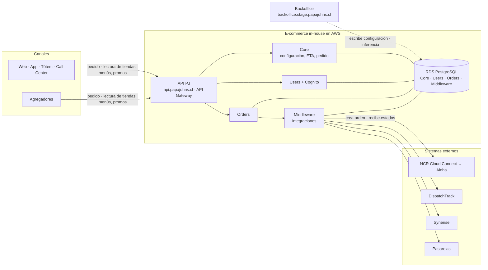

# Papa Johns Chile · Cómo se integra hoy el backoffice con la API Papa Johns

- **Estado:** v2.2, 28-oct-2026
- **Para qué:** en la propuesta, Business Manager toma la oferta digital y el backoffice actual sigue con lo operativo (quiebres, cierres, zonas, grupos de tiendas, menú a agregadores y gift cards; [vista unificada §3.1](../solucion-vista-unificada.md)). MuleSoft lo sincroniza con B2C Commerce y OMS ([alcance de MuleSoft §3.1](alcance-mulesoft.md#31-oferta-tiendas-y-clientes)). Para diseñar esa sincronización hay que saber cómo sale hoy el dato del backoffice hacia los canales y qué es realmente la «API PJ».
- **Fuentes revisadas:** kit del cliente ([§05 Ecosistema y §06 Flujo digital](../../datos/cliente/kit-pj/README.md)), diagrama `Flujo Online Ordering.html` (draw.io del cliente, revisado conexión por conexión), `Arquitectura cloud.png`, [respuestas a Salesforce](../../datos/cliente/preventa/01-respuestas-salesforce.md) y [video del backoffice del 21-oct](../../datos/cliente/backoffice-video.md) con su transcripción.
- **Cómo leerlo:** **Dicho** = el cliente lo escribió o lo dijo. **Visto** = aparece en pantalla o en un diagrama del cliente. **Inferencia** = conclusión nuestra; donde la propuesta depende de ella, queda como supuesto (§4).

---

## 1. Lo que dice cada fuente

| # | Fuente | Qué dice o muestra | Tipo |
|---|---|---|---|
| E1 | `Flujo Online Ordering.html` | **El BACKOFFICE es una caja sin ninguna conexión.** Está en el diagrama, pero no tiene flechas de entrada ni de salida. Es el único sistema del diagrama así | Visto |
| E2 | `Flujo Online Ordering.html` | La **API PAPA JOHNS** tiene una sola flecha de salida, y va **hacia el bloque eCommerce** (Core, Users, Orders, Middleware). Recibe la respuesta de las pasarelas (paso 4) y los eventos de despacho de Quick Commerce (paso 11) | Visto |
| E3 | `Flujo Online Ordering.html` | **Quien habla con la tienda es el MIDDLEWARE del eCommerce**: crea la orden en NCR Cloud Connect (paso 5), crea el despacho en DispatchTrack (paso 5), pide el pago (paso 3) y crea y actualiza la orden en Synerise (pasos 5 y 8). NCR le devuelve los estados (paso 7) | Visto |
| E4 | `Flujo Online Ordering.html` | Todos los canales, **incluidos los agregadores** y el tótem, crean el pedido en **CORE** (paso 1); CORE devuelve el ETA (paso 2). ORDERS envía la orden al DWH (paso 16) | Visto |
| E5 | `Arquitectura cloud.png` | `api.papajohns.cl` es un **API Gateway de AWS** que entra por un balanceador a Elastic Beanstalk y de ahí a cuatro servicios en EC2: **Core** (lógica de negocio principal), **Middleware** (servicios de integración), **Users** y **Orders**. Cada servicio tiene su base **PostgreSQL** en RDS (Core, Users, Orders, Middleware). Cognito autentica. **El backoffice tampoco aparece** | Visto |
| E6 | Kit §05 | API Papa Johns: «Capa de integración que coordina el resultado del pago con la creación y el envío de la orden operacional, además de sus estados y datos de despacho» | Dicho |
| E7 | Kit §05 | Backoffice: «Herramientas internas para que los equipos gestionen y supervisen la operación, con visibilidad de pedidos e incidencias» | Dicho |
| E8 | T-15 | «Todo el consumo y tráfico de información desde y hacia los canales digitales es a través de nuestra API PJ y luego enviada al canal o integración correspondiente» | Dicho |
| E9 | T-11, T-10 | Las órdenes «se ingresan vía API PJ y se envían al OMS mediante API NCR Aloha»; «la API de NCR Aloha se encarga de recibir y orquestar las órdenes hacia la cocina/tienda» | Dicho |
| E10 | T-23, T-115, T-126 | «Toda la edición de contenido y configuración se realiza en nuestro backoffice» (tiendas, zonas, promociones) | Dicho |
| E11 | T-107, T-73 | Productos y recetas en Aloha + Backoffice; precios en Backoffice/Aloha; promos, quiebres y estado de tienda en el Backoffice. El producto se crea en los dos: «Buscamos reducir esa duplicidad mediante sincronización» | Dicho |
| E12 | T-66 | «Reemplazar la capa ecommerce/experiencia y **evolucionar el Backoffice**, manteniendo… Aloha/OMS, Synerise y logística» | Dicho |
| E13 | Video [05:38–06:05] | «Cualquier cambio que se haga en este backoffice se ve de forma inmediata en el productivo… No tiene una capa de caché… esto es in situ» | Dicho |
| E14 | Video [28:08–29:27] | El front de producción consulta `api.papajohns.cl/v1/pickup_places/near_me` y `delivery?latitude=…` con `Cache-Control: max-age=0`. La respuesta trae **la configuración que se edita en el backoffice**: horarios, zonas de reparto, tiempos de espera, `menu_id`, `menu_totem_id`, `menu_peya_id`, `menu_just_eat_id`, medios de pago, `external_delivery_company: "uber_direct"` | Visto |
| E15 | Video, Configuraciones [35:12] | El backoffice puede **desactivar servicios: «API Core, API de usuarios, API de órdenes»** | Visto |
| E16 | Video [38:55] | «Es la integración vía su API y el back office lo que hace es si usa la integración o no usa la integración» (Uber Direct) | Dicho |
| E17 | Video, listados | Promociones y Tiendas se guardan con «Actualizar» y se publican con un botón **Publicar** aparte | Visto |
| E18 | Video [06:44–06:52] | Salesforce preguntó «¿cómo nos podemos conectar a este back office?». **No hubo respuesta técnica**: el cliente contestó que espera un backoffice nuevo [07:06] | Dicho |
| E19 | Ambiente | El backoffice vive en `backoffice.stage.papajohns.cl` (staging), en el mismo dominio que la API | Visto |

---

## 2. Cómo funciona hoy (nuestra lectura)

**El backoffice no se integra con la API PJ por una API. Es la consola de administración del mismo e-commerce que hay detrás de la API PJ.** *(Inferencia, con E1, E2, E5, E10, E13, E14 y E15.)*

- **La «API PJ» es la puerta (`api.papajohns.cl`, API Gateway) del e-commerce in-house completo**: Core, Users, Orders y Middleware (E2, E5, E8). No es un sistema aparte.
- **El backoffice escribe la configuración comercial y operativa en ese e-commerce**, muy probablemente en la base de Core (E10, E14). Por eso no tiene flechas en el diagrama (E1), por eso un cambio se ve «al instante sin caché» (E13) y por eso puede apagar los servicios Core, Users y Orders (E15).
- **Los canales leen esa configuración en vivo a través de la API PJ** (E14): tiendas, zonas, horarios, menús por canal y medios de pago.
- **La integración con la tienda la hace el Middleware** (E3): NCR Cloud Connect, DispatchTrack, Synerise y pasarelas.

**Lo que no sabemos (no está en ninguna fuente; se cierra con los supuestos de §4):**
- Si el backoffice escribe directo en la base o llama a una API interna de Core.
- Si existe alguna API de lectura masiva o de exportación (catálogo completo, todas las tiendas) o solo los endpoints que usa el front, que son por tienda o por ubicación.
- Si «Publicar» (E17) dispara un evento que se pueda escuchar o solo cambia un estado en la base.
- Qué hace el backoffice con los agregadores: la tienda trae `menu_peya_id` y `menu_just_eat_id` (E14), pero la publicación a los agregadores es manual (T-108).

---

## 3. Lo que esto cambia en la propuesta

### 3.1 La «API PJ» no se queda entera: es la puerta del sistema que se reemplaza

Hasta hoy dibujamos «OMS → MuleSoft → **API PJ** → NCR» suponiendo que la API PJ es un sistema que se queda. Pero según E2, E3 y E5, **la API PJ es el frente del e-commerce que se reemplaza** (T-66), y la orden a NCR la crea el Middleware, que es parte de ese e-commerce.

Como la propuesta mantiene el backoffice, **una parte del e-commerce actual sigue viva**, porque el backoffice y sus datos viven en él. Hay que decir qué parte:

| Pieza del e-commerce actual | En la propuesta | Por qué |
|---|---|---|
| **Backoffice + Core (configuración) + su base** | **Se queda, para lo operativo** | Quiebres, cierres, zonas y cobertura, grupos de tiendas, menú a agregadores y gift cards. Catálogo digital, precios, promociones y datos de tienda pasan a Business Manager |
| **API PJ (API Gateway)** | **Se queda, más chica** | Sigue siendo la puerta de entrada de los agregadores (T-33) y la lectura del backoffice para MuleSoft (§3.2) |
| **Users + Cognito** | **Se retira** al migrar a SLAS | Los clientes pasan a Commerce y OMS (I7) |
| **Orders** | **Se retira** para canales propios | Las órdenes de Web, App, Tótem y Call Center nacen en Commerce y viven en OMS |
| **Middleware: integración con NCR, DispatchTrack, Synerise, pasarelas** | **Se queda para entregar la orden a NCR** (opción A de §3.3, supuesto SB3) | Hoy es quien entrega la orden a la tienda |
| **Core: creación de pedidos, ETA y cobertura** | **Se retira** la creación de pedidos de canales propios; **se queda** para agregadores, ETA y cobertura | Commerce toma el pedido; los agregadores siguen entrando por la API PJ (T-33); Commerce consulta ETA y cobertura a la lógica actual (I23; supuestos S17 y S18 de la vista unificada) |

### 3.2 Cómo lee MuleSoft el backoffice: tres opciones

| | 1 · Evento al «Publicar» (recomendada) | 2 · Leer los endpoints de la API PJ | 3 · Leer la base de datos (CDC) |
|---|---|---|---|
| Idea | El backoffice (o Core) avisa a MuleSoft cuando cambia un quiebre, una pausa o un grupo de tiendas, con el dato o con su ID | MuleSoft consulta los mismos endpoints que usa el front (`pickup_places`, `delivery`, menús) | MuleSoft lee los cambios de la base PostgreSQL de Core |
| Desarrollo del lado de Papa Johns | **Sí**, acotado: un webhook al publicar | No | No, pero requiere acceso a la base |
| Cumple «inmediato» (E13) | Sí: el quiebre va directo al inventario de producción de Commerce (≤ 60 s) | No: hay que consultar cada cierto tiempo | Sí, casi en tiempo real |
| Riesgo | Depende de su equipo y su calendario | Los endpoints son por tienda y por ubicación, no para sincronizar todo; sin aviso de cambios | **Acopla MuleSoft al esquema de su base**: si cambian una tabla, se rompe |
| Uso propuesto | Lo operativo del día a día (quiebres, pausas, grupos de tiendas) | Respaldo y conciliación nocturna | **Solo para la migración inicial** (clientes, y catálogo, precios, promociones y tiendas hacia Business Manager) |

**Para quiebres y pausas de tienda** (M3: visible en ≤ 60 s) la opción 1 es la única que cumple sin consultar cada pocos segundos.

### 3.3 Quién entrega la orden a la tienda: dos opciones

| | A · MuleSoft entrega a la API PJ, y el Middleware actual sigue hablando con NCR (supuesto de la propuesta) | B · MuleSoft habla directo con NCR Cloud Connect (evolución) |
|---|---|---|
| Coincide con lo que dijo el cliente | Sí, al pie de la letra: «entregar la orden a la capa/API/OMS de Papa Johns» (T-32) | Sí en el fondo: Aloha y NCR se quedan (T-61); cambia el componente que les entrega la orden |
| Qué queda vivo del e-commerce actual | API PJ + Orders + Middleware, solo para pasar órdenes | Solo lo que sirve al backoffice y a los agregadores |
| Riesgo | Dos capas de integración en serie (MuleSoft y Middleware) en la ruta crítica, con picos de ~9 K órdenes por hora | Hay que reconstruir en MuleSoft lo que hoy hace el Middleware con NCR (mapeo de IDs Aloha, estados); requiere las APIs de NCR Cloud Connect |
| Alcance para nosotros | Menor | Mayor, pero la arquitectura queda más limpia y el Middleware puede apagarse en una fase futura |

**La propuesta va con A** (supuesto SB3): es lo que pidió el cliente al pie de la letra (T-32), deja intacta la ruta que hoy funciona hacia la tienda y reduce el riesgo del MVP. B queda como evolución si la doble capa afecta la meta de P95 < 5 s.

**Los agregadores:** hoy entran por la API PJ a Core (E4). En la propuesta siguen entrando igual y llegan a la tienda por el camino actual; lo que cambia es que su orden también se registra en OMS (I8). En la etapa 4 de MuleSoft (Agregadores), MuleSoft recibe los pedidos directo de cada agregador y los entrega por la misma ruta que los canales propios, así que queda un solo camino hacia NCR ([alcance de MuleSoft §3.6](alcance-mulesoft.md)).

---

## 4. Supuestos

Ya no hay ronda de preguntas con el cliente: cada vacío de §2 se cierra con un supuesto, que se confirma en el discovery.

| # | Supuesto | Base | Si no se cumple |
|---|---|---|---|
| SB1 | **El backoffice puede emitir un webhook** cuando cambia un quiebre, una pausa o un grupo de tiendas; es un desarrollo acotado de su equipo (opción 1 de §3.2) | E13, E17 | MuleSoft consulta los endpoints de la API PJ cada pocos segundos (opción 2), con riesgo para la meta de ≤ 60 s |
| SB2 | **La migración inicial** de catálogo, precios, promociones, tiendas y clientes se hace con una exportación del backoffice o con acceso de solo lectura a su base (opción 3 de §3.2, solo para migrar) | E5, E10 | Su equipo prepara exportaciones; sube el esfuerzo de migración |
| SB3 | **La API PJ recibe la orden con los IDs Aloha y el Middleware actual sigue hablando con NCR** (opción A de §3.3) | T-32, E3 | Si la API PJ no puede recibir órdenes de MuleSoft, se pasa a B: MuleSoft habla con NCR Cloud Connect (mayor alcance) |
| SB4 | **Hasta la etapa 4, las órdenes de agregadores siguen pasando por la API PJ y Core** como hoy; MuleSoft las toma de la API PJ para registrarlas en OMS (I8). Desde la etapa 4 las recibe MuleSoft directo (SYS-08, I24) | E4, T-33 | Se registran desde otro punto de captura, con el mismo flujo de MuleSoft |
| SB5 | **Hasta la etapa 4, el backoffice sigue publicando el menú a cada agregador** como hoy, con la oferta que le entrega MuleSoft. Desde la etapa 4 lo publica MuleSoft por la API de cada agregador (SYS-08, I17) | E14, T-108 | — |

---

## 5. Qué cambia en los otros documentos

| Documento | Cambio |
|---|---|
| [Alcance de MuleSoft](alcance-mulesoft.md) | I5 y los grupos de tiendas usan el webhook (SB1), con la API PJ como respaldo; I9 entrega a la API PJ (SB3); I23 consulta cobertura y ETA a la lógica actual |
| [Alcance de OMS](../oms/alcance-oms.md) | F3: la orden operacional va a la API PJ (opción A) |
| [Vista unificada](../solucion-vista-unificada.md) §2 | El AS-IS dibuja la API PJ como un sistema aparte del e-commerce; según el diagrama del cliente es su puerta |
| [Matriz](../matriz-trazabilidad.md) N6 | «API PJ como puerta única de los canales y los agregadores»: en la propuesta sigue para agregadores, la entrega a la tienda y el backoffice, no para los canales propios |

## Historial

| Fecha | Cambio |
|---|---|
| 28-oct-2026 | v2.2: la «etapa 2» de agregadores pasa a ser la etapa 4 de MuleSoft (Agregadores), con una sola API, SYS-08 |
| 27-oct-2026 | v2.1: SB4 y SB5 distinguen fase 1 y etapa 2; en la etapa 2 los agregadores pasan por MuleSoft (alcance de MuleSoft §3.6) |
| 24-oct-2026 | v2: alineado con la propuesta vigente (vista unificada v3.0). El backoffice queda solo para lo operativo; Business Manager toma lo comercial. El webhook es para quiebres, pausas y grupos de tiendas. La entrega a la tienda va con la opción A (API PJ) como supuesto y B como evolución. Las preguntas a TI de Papa Johns pasan a supuestos SB1 a SB5. Sin referencias a C1 y C2 |
| 24-oct-2026 | v1: revisión de fuentes; el backoffice no tiene integración propia (es la consola del e-commerce); la API PJ es la puerta del e-commerce que se reemplaza; opciones para leer el backoffice y para entregar la orden a la tienda |
