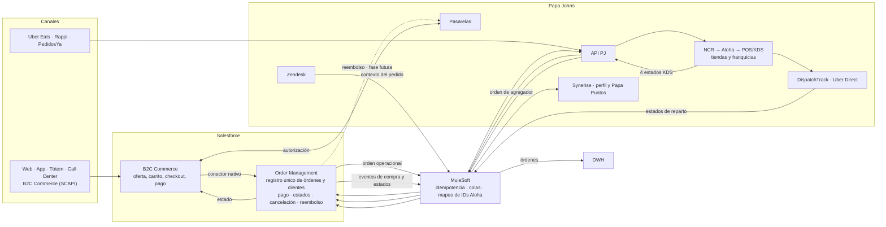

# Papa Johns Chile · Alcance de Salesforce Order Management

- **Estado:** borrador v2.1, 24-oct-2026
- **Propuesta:** B2C Commerce + **Order Management** + Marketing Cloud + MuleSoft ([vista unificada §3](../solucion-vista-unificada.md)). **OMS registra y sincroniza las órdenes** de todos los canales. Synerise, Zendesk, Aloha/NCR, la API PJ, DispatchTrack y el DWH se quedan; Business Manager toma la oferta digital y el backoffice actual opera el resto.
- **Supuestos:** los de la [vista unificada §11](../solucion-vista-unificada.md) (en especial S1 y S3) y los de este documento (§8).
- **Se lee con:** [alcance de MuleSoft](../mulesoft/alcance-mulesoft.md), que define cómo llegan y salen los datos de OMS.

---

## 1. En una frase

**Salesforce OMS es el registro único de las órdenes y de los clientes que compran, de todos los canales, sobre el core de Salesforce. Aloha sigue ejecutando la orden en la tienda.**

No es el «360» del cliente: el perfil de marketing, los segmentos y los Papa Puntos siguen en Synerise (T-46). OMS sabe **qué compró cada cliente, por qué canal, cómo lo pagó y qué le pasó a su pedido**; Synerise sabe **quién es y qué le ofrecemos**.

**Por qué en la propuesta:**

| Para Papa Johns | Evidencia |
|---|---|
| Hoy la orden está repartida entre el Ecommerce (servicio Orders en AWS), la API PJ y Aloha. Nadie ve en un solo lugar una orden de la web junto a una de Rappi | T-60, Kit §05, video [39:44] |
| La fila 08 del back office («consultar pedidos, filtrar por tienda y canal, gestionar incidencias») no la cubre nadie sin OMS: era desarrollo L. Con OMS, la consola se enciende en la fase futura (F9) sobre el mismo registro | [Matriz §3-08](../matriz-trazabilidad.md) |
| Cancelaciones parciales, reembolsos y reversa de puntos según causal y estado (T-54) son acciones estándar de OMS. En la fase 1 siguen en los procesos actuales; se encienden después sin otra migración (§3.1) | T-54, D6-04 |
| SAC pide la vista de pedido, pago, estado, cupones, puntos e incidencias (T-19). Con OMS, la app de Zendesk consulta **un** sistema en vez de tres | T-19, T-65 |
| **Abre la plataforma:** OMS trae un org de Salesforce Core (cuentas, productos, órdenes, Flows, objetos propios, permisos y auditoría). Si en el camino se elige un backoffice nuevo en Salesforce (opciones 2 o 3 de la [vista unificada §5](../solucion-vista-unificada.md)), se construye sobre ese core; también se pueden sumar Service Cloud, Data Cloud y Loyalty sin otra migración de órdenes | Decisión del 24-oct |

---

## 2. La frontera: qué hace cada OMS

El cliente fue explícito: la orden se inyecta a su OMS, que se mantiene incluso para franquicias (T-61); el despacho se crea desde allí (T-128); la nueva plataforma entrega la orden a la API PJ (T-32). **Salesforce OMS no reemplaza nada de eso: se pone antes, como registro comercial único de la orden.**

| Responsabilidad | Salesforce OMS | API PJ → NCR → Aloha (OMS de tienda) |
|---|---|---|
| Recibir la orden de todos los canales (Web, App, Tótem, Call Center, agregadores) | **Sí**: registro único | Sigue siendo la puerta de entrada de los agregadores (T-33) y la reenvía a OMS |
| Pago: autorización, captura, reembolso | **Registra** el pago que autorizó Commerce; los reembolsos siguen en los procesos actuales (fase futura, F6) | No |
| Enviar la orden a la tienda correcta, una sola vez | Decide cuándo se envía y registra el acuse | **Ejecuta**: cocina, KDS, POS |
| Asignar repartidor y despachar | No | **Sí**: el despacho se crea desde su OMS (T-128); DispatchTrack y Uber Direct |
| Estados de la orden | **Consolida** los 4 estados del KDS (T-35) y los de DispatchTrack (T-129) y los publica a Commerce y, vía MuleSoft, al SAC | **Emite** los estados |
| Cancelación total o parcial, reembolso, reversa de puntos | **Registra** el estado que resulta; la orquestación según causal y estado (T-54) es fase futura (§3.1) | Recibe la anulación de la tienda |
| Franquicias | Igual que las tiendas propias | **Sí**: se mantiene (T-61) |
| Boleta electrónica | No | **Sí**: la emite Aloha/POS, como hoy (supuesto S19 de la vista unificada) |

**La regla para la ruta crítica:** pasar por OMS no puede atrasar la llegada de la orden a la cocina. Por eso la entrega a la tienda se dispara apenas OMS crea el registro y el pago está autorizado, con un objetivo medible (§6, O1).

---

## 3. Flujos que entran en la propuesta

Tratamiento en la demo: **Real** (instancia), **Simular**, **Explicar** (lámina) o **Proyecto** (solo en la implementación).

| # | Flujo | Cómo se resuelve en OMS | Tipo | Evidencia | Demo |
|---|---|---|---|---|---|
| F1 | **Captura de órdenes de Web, App, Tótem y Call Center** | Conector B2C Commerce → OMS: crea Order Summary, líneas, ajustes de promoción y pago | Estándar + Config. | T-68, D6-01 | Real |
| F2 | **Captura de órdenes de agregadores** | API PJ → MuleSoft → API de ingesta de OMS, con un cliente genérico por agregador (sus clientes no son contactables, T-51) | Integración | T-33, T-51 | Explicar |
| F3 | **Entrega a la tienda (orden operacional)** | Fulfillment Order por tienda → MuleSoft → API PJ, con clave de idempotencia y reintentos; el acuse de Aloha queda en la orden | Integración + Desarrollo | T-14, T-32, T-61, N5 | Simular (el presentador avanza «como la tienda») |
| F4 | **Estados para el cliente y SAC** | Los 4 estados del KDS (webhook, T-35) y los de DispatchTrack actualizan la Fulfillment Order; OMS los publica a B2C (seguimiento) y, vía MuleSoft, a Zendesk | Integración + Desarrollo | T-35, T-128, T-129, D6-02 | Real (avance manual en la consola) |
| F8 | **Vista de SAC** | App lateral de Zendesk que consulta OMS a través de MuleSoft (EXP-01): orden, pago e historial de estados | Integración + Desarrollo | T-19, T-65 | Real en OMS; Zendesk con mock identificado (T-65) |
| F10 | **Pedido programado** | La Fulfillment Order se libera a la tienda en la hora pedida (1 % de las órdenes) | Config. + Desarrollo | T-125, D6-03 | Explicar |
| F11 | **Historial y «Repetir pedido»** | B2C sigue mostrando el historial del cliente; OMS es la fuente para SAC y para órdenes de otros canales | Estándar + Desarrollo | T-125, D6-05 | Real (B2C) |
| F12 | **Cliente transaccional** | Person Account por cliente registrado (llave mail y RUT, T-4), creada por el conector desde B2C y por la carga de clientes de MuleSoft (I7); los datos de marketing no se duplican: siguen en Synerise | Config. | T-4, T-16, T-46 | Real |
| F13 | **Productos en OMS** | Producto de Core sincronizado por MuleSoft desde Business Manager (I1, I6), con el ID Aloha como atributo para la entrega a la tienda | Integración | T-73, D2-01 | Proyecto |
| F15 | **Tiendas en OMS** | Cada tienda como ubicación, sincronizada por MuleSoft desde Business Manager (I4): destino de las Fulfillment Orders y filtro de la consola por tienda o grupo | Integración | Matriz §3-05, §3-08 | Proyecto |
| F14 | **Envío de órdenes al DWH** | Exportación diaria o por eventos de las órdenes de todos los canales, vía MuleSoft (PRC-07) | Integración | T-6, T-18 | Proyecto |

### 3.1 Se activan en una fase futura, sobre el mismo OMS

En la propuesta, OMS registra y sincroniza. Las cancelaciones, los reembolsos y la reversa de puntos siguen en los procesos actuales, y OMS registra el estado que resulta. Estas capacidades se encienden después sin otra migración de órdenes:

| # | Flujo | Cómo se resuelve en OMS | Tipo | Evidencia | Demo |
|---|---|---|---|---|---|
| F5 | **Cancelación total o parcial** | Acciones estándar de Order Summary; la causal viene del cliente, la tienda, el pago o el atraso | Estándar + Config. | T-54, D6-04 | Real (cancelar una línea) |
| F6 | **Reembolso** | Adaptador de pasarela en OMS para Webpay, Mercado Pago y Fintoc (los adaptadores de pasarelas chilenas son desarrollo) | Desarrollo | T-62, D6-04 | Real con pasarela simulada |
| F7 | **Reversa y compensación de puntos** | Evento de OMS → MuleSoft → Synerise, según causal y estado | Integración | T-54, D9 | Simular |
| F9 | **Consola de pedidos para Operación** (fila 08) | Consola de OMS con vistas por tienda, canal, estado e incidencia; acceso por tienda o grupo de tiendas con reglas de visibilidad | Config. + Desarrollo | Matriz §3-08, video [34:00] | Real |

---

## 4. Lo que no entra en la propuesta

| Fuera de la propuesta | Por qué | Dónde queda |
|---|---|---|
| Enrutamiento a cocina, KDS, POS | Aloha lo hace y se queda (T-61) | Cliente |
| Asignación de tienda | La decide Commerce al elegir dirección o retiro (D7-02); OMS la recibe | B2C |
| Asignación de repartidor y despacho | Lo crea su OMS y DispatchTrack (T-127, T-128) | Cliente |
| Disponibilidad por tienda con Omnichannel Inventory | No modela ingredientes (T-102); los quiebres van a listas de inventario de B2C | Fase futura |
| **Backoffice nuevo sobre Core** (promociones, tiendas, quiebres, aprobaciones) | Decisión del 24-oct: Business Manager toma la oferta digital y el backoffice actual opera el resto; su futuro se evalúa en el camino | Por evaluar |
| Service Cloud como reemplazo de Zendesk | Zendesk se queda | Fase futura |
| Loyalty Management | Papa Puntos sigue en Synerise | Fase futura |
| Devoluciones físicas | No aplica: comida a pedido | — |

---

## 5. Volumen

| Dato | Valor | Fuente |
|---|---|---|
| Órdenes al mes, todos los canales | ~622.500 (App 300 K, Agregadores 200 K, Web 100 K, Call Center 20 K, Tótem 2,5 K) | Volumetría |
| Órdenes al año | ~7,5 M | Cálculo |
| Peak | ~9 K órdenes por hora; 27 K entre 18:00 y 20:00 el Día de la Pizza; 70 % del día entre 18:00 y 21:00 | T-28, T-29 |
| Cambios de estado | 4 del KDS por orden + los de reparto → ~2,5 a 3,5 M de eventos al mes | T-35, cálculo |
| Historia a conservar | 24 meses | T-40 |

**Lo que esto obliga a dimensionar:**
- **Almacenamiento de datos en Core:** cada orden crea varios registros (resumen, líneas, pagos, Fulfillment Orders). Política de archivo: 6 meses vivos en OMS para SAC y el resto en el DWH (**supuesto SO2**, §8).
- **Migración de los 24 meses de historia (T-40):** 15 M de órdenes es demasiado para OMS. Propuesta: el historial de canales propios va a B2C para «Repetir pedido» y al DWH para análisis; a OMS solo entran las órdenes abiertas al momento del corte (**supuesto SO3**, §8).
- **Ingesta en el peak:** ~2,5 órdenes por segundo de media en la hora peak, con ráfagas mayores. Los límites de API y de Flows por orden los revisamos en la documentación y en la prueba de carga (**supuesto SO1**, §8).

---

## 6. Objetivos medibles

| # | Objetivo | Meta propuesta | Cómo se mide |
|---|---|---|---|
| O1 | La orden llega a la cocina sin atraso por pasar por OMS | P95 < 5 s entre pago autorizado y acuse de la API PJ (se ajusta con la latencia actual medida en discovery) | Monitoreo de MuleSoft |
| O2 | Cero órdenes perdidas y cero duplicadas | 0 por mes; la caída de sincronización con tiendas hoy es < 1 evento al año (T-13) | Conciliación diaria OMS ↔ API PJ |
| O3 | Un solo registro por orden, de todos los canales | 100 % de las órdenes de canales propios en OMS; agregadores según §5 | Conteo OMS vs. API PJ |
| O4 | El cliente ve el estado real | Estado visible en el seguimiento < 10 s después del webhook del KDS | Monitoreo de punta a punta |
| O5 | SAC resuelve sin llamar a la tienda | Tiempo de primera respuesta del SAC: línea base a medir en discovery | Zendesk |
| O6 | Reembolso parcial sin intervención manual (fase futura, F6) | 100 % de las cancelaciones parciales con reembolso automático en la pasarela | OMS |
| O7 | Operación ve las incidencias por tienda (fase futura, F9) | Consola con filtros por tienda, canal y estado (fila 08) | Revisión con Operación |

---

## 7. Riesgos y condiciones

| Riesgo | Por qué importa | Mitigación |
|---|---|---|
| **Contradice T-61 si se explica mal** | El cliente dijo «mi OMS se queda» | Presentarlo como «registro comercial único», con la tabla del §2; nunca como reemplazo de Aloha |
| **Un salto más en la ruta crítica** | Picos de 9 K por hora | Objetivo O1 y prueba de carga conjunta con la API PJ |
| **Adaptadores de pasarelas chilenas** (fase futura) | OMS no trae Webpay, Mercado Pago ni Fintoc | Se estiman cuando se encienda F6; se reutiliza la experiencia de Avatar con Webpay y Mercado Pago |
| **APIs de la API PJ y de DispatchTrack sin documentar** | T-34, T-37 y T-129 sin respuesta | Supuestos SM2 y SM3 del [alcance de MuleSoft §7](../mulesoft/alcance-mulesoft.md); inventario técnico en discovery |
| **El backoffice actual sigue vivo** | El cliente pidió uno nuevo (video [07:06]) y T-66 dice «se evoluciona» | Tres opciones para su futuro, a evaluar en el camino ([vista unificada §5](../solucion-vista-unificada.md), [alcance de MuleSoft §6](../mulesoft/alcance-mulesoft.md#6-el-backoffice-actual-se-queda-en-la-fase-1)) |

---

## 8. Preguntas comerciales para Salesforce y supuestos

**Para Salesforce (comercial):** ¿tienen referencias de clientes que usen Order Management como registro de órdenes con el POS de tienda como ejecutor, sin que OMS haga el fulfillment? Si hay, ¿se pueden citar o visitar? (Se suma a P3 de la [vista unificada §9.1](../solucion-vista-unificada.md).)

**Supuestos** (lo técnico lo resolvemos nosotros en la documentación y la prueba de carga):

| # | Supuesto | Si no se cumple |
|---|---|---|
| SO1 | La ingesta de OMS soporta el peak (~9 K órdenes por hora, con ráfagas) con un Flow liviano por orden; se valida en la prueba de carga conjunta con la API PJ | Se agrupa la ingesta por lotes cortos o se simplifican los Flows de la orden |
| SO2 | Política de archivo: 6 meses de órdenes vivas en OMS para SAC; el resto, en el DWH | Más almacenamiento de datos en Core |
| SO3 | Migración: a OMS solo entran las órdenes abiertas al momento del corte; los 24 meses de historia van a B2C («Repetir pedido») y al DWH | Migrar historia a OMS es una carga de ~15 M de órdenes, fuera del alcance |

---

## 9. Qué cambia en los otros documentos

| Documento | Cambio |
|---|---|
| [Matriz](../matriz-trazabilidad.md) | D6-01, D6-04 y §3-08 dejan de ser «sin Salesforce OMS»: D6-01 y la fila 08 pasan a OMS (la consola, F9, en la fase futura); D6-04 sigue en los procesos actuales con OMS registrando el estado |
| [13 · Operación](../../disenos/13-operacion/README.md) | El guion de la demo se alinea con F1 a F4 y F8; cancelación, reembolso y consola (F5 a F9) se muestran como fase futura |

## Historial

| Fecha | Cambio |
|---|---|
| 24-oct-2026 | v2.1: alineado con la vista unificada v3.0. OMS registra el pago y el estado de cancelaciones y reembolsos, que siguen en los procesos actuales (fase futura); Zendesk, Synerise y el DWH, siempre vía MuleSoft; boleta por Aloha/POS (S19); §8 con una pregunta comercial a Salesforce y supuestos SO1 a SO3; el futuro del backoffice remite a las tres opciones de la vista §5 |
| 24-oct-2026 | v2: propuesta única; OMS registra y sincroniza las órdenes. Cancelación, reembolso, reversa de puntos y consola de Operación (F5, F6, F7, F9) pasan a §3.1, fase futura sobre el mismo OMS |
| 24-oct-2026 | v1.1: productos (F13), tiendas (F15) y clientes llegan a OMS por MuleSoft desde el backoffice actual |
| 24-oct-2026 | v1: alcance de OMS para el escenario C1 |
