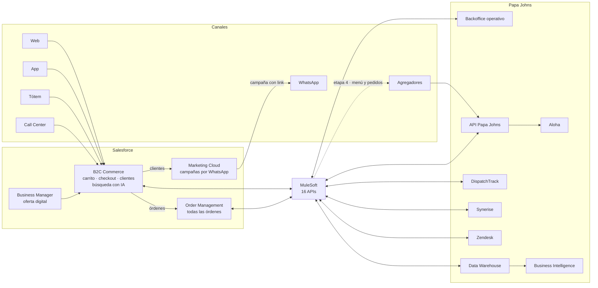
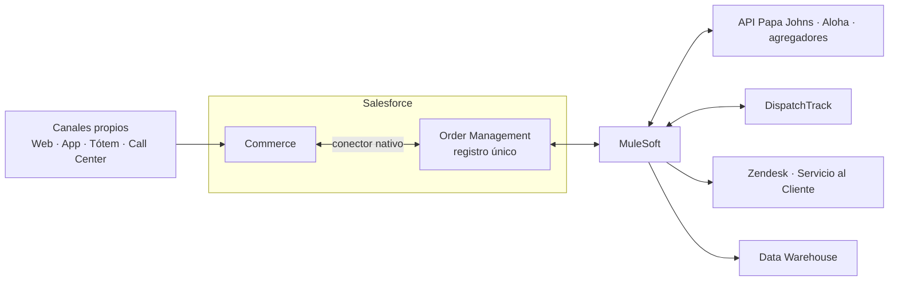
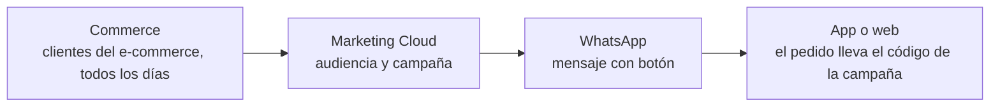

# Papa Johns Chile · Propuesta de arquitectura (fase 1)

> Guion de la [presentación publicada](https://claude.ai/artifact/8w1HbZtkmJBQaeVnWjon2s) (15 láminas). Cada sección `##` es una lámina; la línea en **negrita** bajo el título es su mensaje. Detalle en la [vista unificada](solucion-vista-unificada.md), el [alcance de OMS](oms/alcance-oms.md) y el [alcance de MuleSoft](mulesoft/alcance-mulesoft.md).

---

## 1 · Portada

**Un nuevo e-commerce que suma a lo que Papa Johns ya tiene.**

Fase 1 · B2C Commerce, Order Management, Marketing Cloud y MuleSoft · Octubre de 2026

---

## 2 · Cuatro productos, un objetivo: vender más

| Producto | Qué gana Papa Johns |
|---|---|
| **B2C Commerce** | Una sola tienda para Web, App, Tótem y Call Center, con búsqueda con IA. Marketing administra la oferta sin depender de tecnología |
| **Order Management** | Por primera vez, las ~622 mil órdenes del mes de todos los canales en un solo lugar, agregadores incluidos |
| **Marketing Cloud** | Campañas por WhatsApp que llevan directo a comprar en la web o la app |
| **MuleSoft** | Lo nuevo y lo que ya existe conversan sin perder una orden; cada canal nuevo se conecta más rápido |

**Se quedan:** Aloha/NCR · API Papa Johns · Synerise · Zendesk · DispatchTrack · Data Warehouse y Business Intelligence · el backoffice para lo operativo.

---

## 3 · Arquitectura

**Salesforce se suma; MuleSoft conecta los dos mundos.**

Business Manager alimenta a Commerce · Commerce envía las órdenes a Order Management y los clientes a Marketing Cloud · los agregadores entran por la API Papa Johns y, desde la etapa 4 de MuleSoft, hablan directo con MuleSoft.

---

## 4 · Dos piezas que Papa Johns puede sumar

| Opcional | Qué es | Si no se contrata / qué ya incluye la fase 1 |
|---|---|---|
| **App móvil** | Construimos la app para Android e iOS sobre Commerce | Si Papa Johns mantiene su app actual, su equipo la adapta para usar las APIs de Commerce, los contenidos y los links de las campañas, con soporte de nuestro equipo durante la integración |
| **Reseñas de clientes** | Reseñas con texto en la página de producto, con el proveedor que Papa Johns elija | Ya incluido en la fase 1: «la más pedida» y las estrellas con la calificación que hoy captura la encuesta de satisfacción (NPS) |

---

## 5 · B2C Commerce: fácil de comprar, fácil de operar

| # | Caso de uso | Cómo se ve | Qué gana Papa Johns |
|---|---|---|---|
| 01 | Búsqueda con IA | «Pizza para 4 sin carne» encuentra opciones que calzan, no un «sin resultados» | Menos abandono en la búsqueda |
| 02 | Decidir en segundos | «La más pedida», combos para 2 y para 4, y estrellas de clientes en cada pizza | Más conversión y mejor ticket |
| 03 | Un menú por cliente | Banners y promociones distintos para el frecuente, el que compara y el nuevo | Ofertas que hablan a cada segmento |
| 04 | Promociones con calendario | «Martes 2×1 de 18 a 21 h» o delivery gratis sobre un monto, programados una vez | Marketing lanza y apaga promociones solo |
| 05 | Un checkout para todos | Web, App, Tótem y Call Center con los mismos precios, promociones y Papa Puntos | Una sola regla comercial |
| 06 | Probar antes de escalar | Dos versiones de una tarjeta o una promoción, medidas en Google Analytics | Decisiones con datos |

---

## 6 · El backoffice: Business Manager toma lo comercial

| Business Manager · lo comercial | Backoffice de Papa Johns · lo operativo |
|---|---|
| Pizzas, complementos y combos | Cerrar o pausar tiendas |
| Precios por canal y zona | Bloqueo de productos por tienda |
| Promociones y cupones | Zonas de reparto en el mapa |
| Contenido para web, app y tótem | Menú para los agregadores, con la oferta de Business Manager (desde la etapa 4 lo publica MuleSoft) |
| Tiendas, horarios y medios de pago | Gift cards, encuestas y permisos |

**En el camino, con Papa Johns:**
1. Mantener el backoffice, integrado por MuleSoft.
2. Uno nuevo en Salesforce que complemente a Business Manager.
3. Uno nuevo en Salesforce que lo incluya todo.

En los tres, las integraciones se mantienen.

---

## 7 · Order Management: todo el negocio en un solo lugar

| Hoy | Con Order Management |
|---|---|
| La orden está repartida entre el e-commerce, la API Papa Johns y Aloha | Un registro de los 6 canales |
| Servicio al Cliente busca el pedido en varios sistemas | Orden, pago y estado en una sola pantalla |
| Medir por canal exige cruzar fuentes | Todas las órdenes iguales en el Data Warehouse |

Order Management guarda y consolida la orden; **MuleSoft es el único que habla con los sistemas de Papa Johns**.

---

## 8 · Order Management: cada orden, vista y seguida de punta a punta

| # | Caso de uso | Ejemplo | Qué gana Papa Johns |
|---|---|---|---|
| 01 | Ver todas las órdenes | Una orden de la App y una de PedidosYa, lado a lado, con su canal y su tienda | El negocio completo: ~622 mil órdenes al mes |
| 02 | A la tienda, una vez | La orden pagada llega a la cocina correcta en segundos, aunque haya un reintento | Cero órdenes perdidas o duplicadas |
| 03 | ¿Dónde está mi pedido? | El cliente ve «en el horno», «en camino» y el link del repartidor | Menos llamadas a Servicio al Cliente |
| 04 | Servicio al Cliente con contexto | El agente abre el caso y ya ve qué pidió, cómo pagó y qué pasó | Atención más corta y mejor escalamiento |
| 05 | Historia para decidir | Ventas por canal, tienda y franja en el Business Intelligence de Papa Johns | Datos propios, sin depender del proveedor |

**Compromisos:** < 5 s orden en la cocina (95 % de las órdenes) · < 10 s estado visible tras la cocina · 9 mil órdenes por hora en el peak.

*Notas:* sobre el mismo registro se suman en una fase siguiente las cancelaciones parciales, los reembolsos automáticos y la consola de incidencias por tienda.

---

## 9 · MuleSoft: que todo converse, sin perder una orden

**Papa Johns mantiene sus sistemas; MuleSoft los conecta con lo nuevo.**

| Hoy | Con MuleSoft |
|---|---|
| Producto, precios y quiebres se cargan dos veces y a mano | Se cargan una vez y llegan a todos los canales |
| Cada canal nuevo exige integrar todo de nuevo | Un canal nuevo reutiliza lo ya construido |
| La caída de un sistema puede frenar la venta | Si Synerise no responde, el checkout sigue |

**Compromisos:** ≤ 60 s quiebre visible en todos los canales · < 5 s orden en la tienda, en el 95 % de los casos · 9 mil órdenes por hora en el peak · 99,95 % disponibilidad de la integración.

---

## 10 · MuleSoft: sus prioridades, resueltas una vez para todos los canales

| Lo que más le preocupa | Cómo lo resuelve MuleSoft | Lo que logra MuleSoft |
|---|---|---|
| **Disponibilidad por tienda e ingrediente, en tiempo real** (T-102, T-103, T-105) | Operación marca «sin piña» una vez y MuleSoft lo cruza con las recetas de Aloha: en ≤ 60 s bloquea solo lo afectado, en esa tienda y en todos los canales | Cero pedidos de lo que no hay |
| **Contenido omnicanal, sin desarrollo** (T-111, T-91; kit §04) | MuleSoft reparte el mismo menú, imágenes y textos de Business Manager a todo lo que no es Commerce: backoffice, Order Management y agregadores | El mismo menú en todos lados |
| **Oferta sincronizada a mano** (T-108, T-73) | MuleSoft toma el producto que nace en Aloha, lo concilia por su ID con Business Manager y lleva producto, precio y promoción a cada sistema | Una carga, todos los canales |
| **Órdenes seguras en el peak** (T-14; kit, eventos 10, 11 y 20) | MuleSoft da una llave única a cada orden, encola hasta 9 mil por hora, reintenta, concilia cada día y alerta por tienda | Ninguna orden perdida |
| **Cada canal nuevo es otro proyecto** (T-20, T-68) | MuleSoft expone APIs reutilizables: un canal nuevo o el futuro backoffice se conecta a lo ya construido | Lo construido se reutiliza |
| **Que un sistema lento frene la venta** (T-12, T-43) | MuleSoft responde con caché y corta a 1 s: si Synerise falla, el checkout sigue | La venta no se detiene |

**La diferencia de MuleSoft:** lo que se construye una vez sirve para cada canal nuevo y para el futuro backoffice, y queda de Papa Johns.

---

## 11 · MuleSoft: menos trabajo manual, ninguna orden perdida

| # | Caso de uso | Ejemplo | Qué gana Papa Johns |
|---|---|---|---|
| 01 | Quiebre en un minuto | Providencia se queda sin pepperoni y en menos de un minuto deja de ofrecerse | Cero pedidos de lo que no hay |
| 02 | Oferta sin doble carga | La pizza nace en Aloha, se completa en Business Manager y llega igual a todos | Menos trabajo manual y errores |
| 03 | Orden segura | Una caída de red no duplica ni pierde la orden: se reintenta y se concilia cada día | Ninguna orden perdida |
| 04 | Papa Puntos al pagar | El cliente ve y usa sus puntos en el checkout, sin esperar | Fidelización sin fricción |
| 05 | Servicio al Cliente en una pantalla | Zendesk muestra orden, pago, estados y puntos del cliente | Atención más rápida |
| 06 | Clientes de hoy | 2,5 M de clientes y 24 meses de historia llegan a la tienda nueva, sin duplicados | Nadie empieza de cero |

---

## 12 · MuleSoft: 16 APIs en cuatro etapas, cada una deja algo andando

| Etapa | Qué habilita | APIs |
|---|---|---|
| **1 · Vender** | Commerce vende con la oferta, las tiendas y los clientes de Papa Johns | Oferta · Tiendas y disponibilidad · Clientes |
| **2 · Operar** | La orden llega a la tienda, el cliente ve su estado y Servicio al Cliente atiende con una pantalla | Órdenes · Estados del pedido · Puntos y beneficios · Servicio al Cliente |
| **3 · Medir** | Todas las órdenes y eventos en el Data Warehouse de Papa Johns | Analítica |
| **4 · Agregadores** | MuleSoft publica el menú, los precios y los quiebres en Uber Eats, Rappi y PedidosYa, y recibe sus pedidos: se acaba la carga manual en tres portales y todas las órdenes llegan a la cocina por un solo camino | Agregadores |
| **En las cuatro etapas** | Una conexión segura por sistema | Backoffice · API Papa Johns / Aloha · B2C Commerce · Order Management · Synerise · DispatchTrack · Data Warehouse · Agregadores |

Incluye monitoreo y alertas por flujo y por tienda, y contratos documentados que quedan para Papa Johns.

---

## 13 · MuleSoft: las 16 APIs, de lo que usa el negocio a cada sistema

| Capa | ID · API | Integra | Qué resuelve |
|---|---|---|---|
| Experiencia | EXP-01 · **Servicio al Cliente** | Zendesk → OMS | El pedido en la pantalla del agente |
| Proceso | PRC-01 · **Oferta** | Aloha → Business Manager → OMS · Backoffice | Una sola oferta, con los IDs de Aloha |
| Proceso | PRC-02 · **Tiendas y disponibilidad** | Backoffice ↔ B2C · OMS | Quiebres en ≤ 60 s, cobertura y ETA |
| Proceso | PRC-03 · **Clientes** | Backoffice → B2C · OMS | 2,5 M de clientes y 24 meses |
| Proceso | PRC-04 · **Órdenes** | OMS → Aloha · agregadores → OMS | A la tienda, una sola vez |
| Proceso | PRC-05 · **Estados del pedido** | Aloha · DispatchTrack → OMS → B2C | Cocina y reparto, en orden |
| Proceso | PRC-06 · **Puntos y beneficios** | B2C · OMS ↔ Synerise | Saldo y acumulación de Papa Puntos |
| Proceso | PRC-07 · **Analítica** | B2C · OMS → Data Warehouse | Toda la historia en el DWH de Papa Johns |
| Sistema | SYS-01 · **Backoffice Papa Johns** | B2C ↔ Backoffice | Oferta, quiebres, gift cards y clientes |
| Sistema | SYS-02 · **API PJ / NCR / Aloha** | OMS ↔ Aloha | Orden, acuse, estados y agregadores |
| Sistema | SYS-03 · **B2C Commerce** | B2C ↔ Backoffice · Synerise | Lee la oferta; escribe inventario y clientes |
| Sistema | SYS-04 · **Order Management** | OMS ↔ Aloha · DispatchTrack · Zendesk | Órdenes, productos y tiendas |
| Sistema | SYS-05 · **Synerise** | Synerise ↔ B2C · OMS | Segmentos, saldo y puntos |
| Sistema | SYS-06 · **DispatchTrack** | DispatchTrack → OMS | Estados y enlace de reparto |
| Sistema | SYS-07 · **Data Warehouse** | B2C · OMS → DWH | Órdenes y eventos |
| Sistema | SYS-08 · **Agregadores** (etapa 4) | Uber Eats · Rappi · PedidosYa ↔ OMS → Aloha | Menú, quiebres y pedidos, un adaptador por agregador |

La flecha indica hacia dónde viaja el dato; ↔, en los dos sentidos. Commerce envía sus órdenes a Order Management por el conector nativo, sin MuleSoft.

Detalle y tamaños en el [alcance de MuleSoft §2.0 y §3.6](mulesoft/alcance-mulesoft.md).

---

## 14 · Marketing Cloud: WhatsApp que trae pedidos

**El canal que todos abren, con un botón que lleva directo a comprar.**

- **Meta de Papa Johns:** contactar al 5 % de los activos y al 3 % de los dormidos.
- **Audiencia:** clientes del e-commerce que aceptaron recibir WhatsApp.
- **Se mide:** entregados, leídos, clics y **pedidos originados** por campaña.

---

## 15 · Marketing Cloud: cuatro campañas que llevan a comprar

| # | Caso de uso | Mensaje | El botón lleva a | Qué gana Papa Johns |
|---|---|---|---|---|
| 01 | Reactivación | «Te extrañamos: 20 % en tu pizza de siempre» | La promoción, lista para pedir | Recupera clientes dormidos |
| 02 | Lanzamiento | «Nueva Arma tu Combo, solo esta semana» | La landing de la campaña | Lanzamientos con alcance inmediato |
| 03 | Recompra | «¿Repetimos tu pedido del viernes?» | «Repetir pedido» | Más frecuencia de compra |
| 04 | Ocasión | «Hoy juega Chile: pide antes del pitazo» | El combo para compartir | Ventas en los momentos de mayor consumo |

---

## 16 · Cierre

**Sumar sin reemplazar, y crecer en cada fase.**

Commerce para vender · Order Management para ver todas las órdenes · Marketing Cloud para traer clientes · MuleSoft para integrarlo todo.
