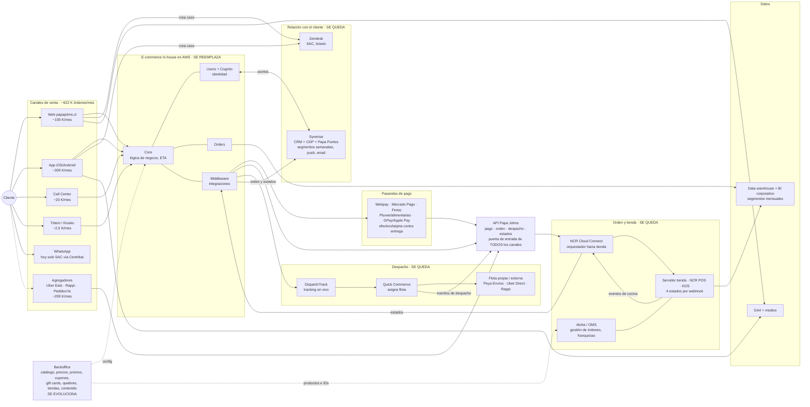
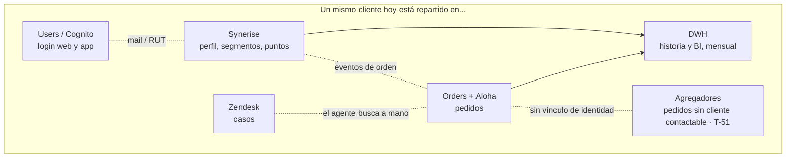
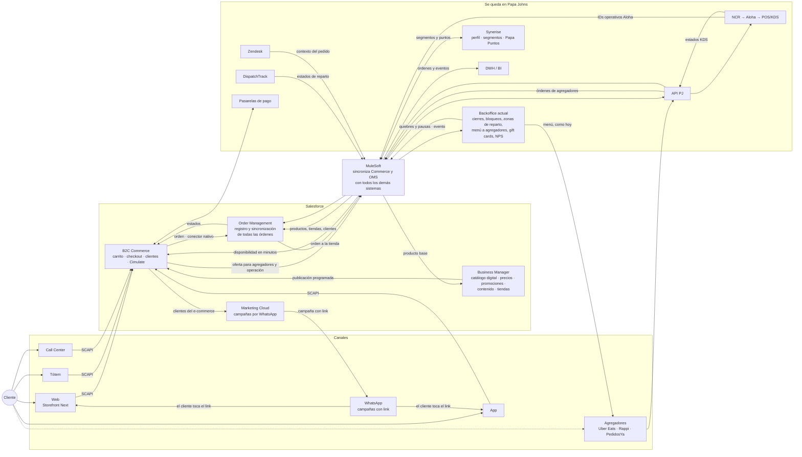
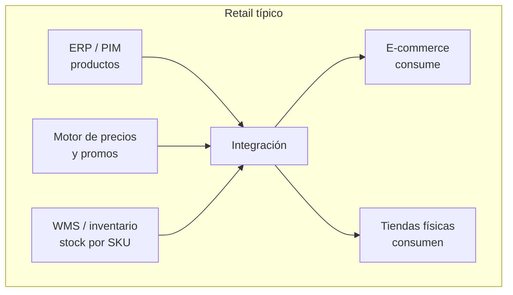
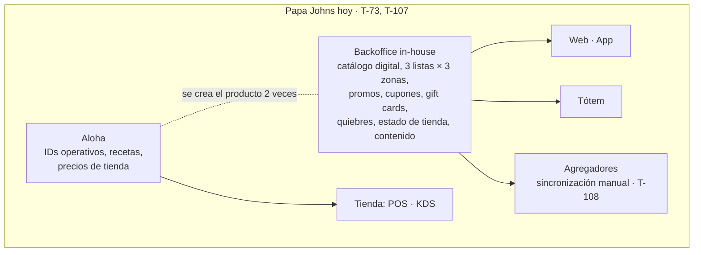
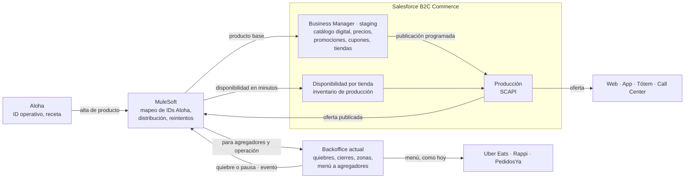
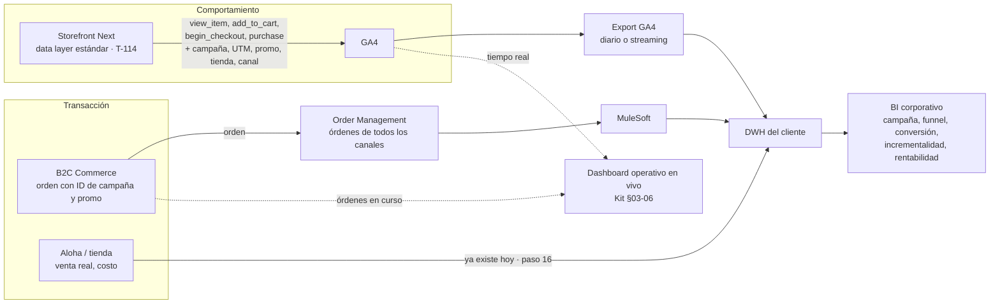

# Papa Johns Chile · Vista unificada: AS-IS, TO-BE y qué productos de Salesforce

- **Estado:** v3.3, 28-oct-2026. Propuesta de fase 1 (una sola), base de las diapositivas y de la estimación.
- **Sobre el lock-in:** el cliente lo pide solo para los **datos de clientes** (T-25: «Los datos son propiedad de Papa Johns… perfil/activación en CDP-Synerise y persistencia analítica en el repositorio corporativo/DWH, evitando lock-in») y pide evitar una **dependencia tecnológica excesiva** del equipo (T-110: «operación/evolución conjunta entre partner y equipo interno»). No hay un requisito general de plataforma sin lock-in en el kit, la volumetría ni el video.
- **Fuentes:** kit del cliente ([datos/cliente/kit-pj/README.md](../datos/cliente/kit-pj/README.md): §05 Ecosistema, §06 Flujo digital, Flujo Online Ordering, Arquitectura cloud), respuestas del cliente a Salesforce ([01-respuestas-salesforce.md](../datos/cliente/preventa/01-respuestas-salesforce.md), IDs `T-n`/`A-n`), volumetría ([03-volumetria-xlsx.md](../datos/cliente/preventa/03-volumetria-xlsx.md)) y la sección 10 del Word «Qué se quiere del nuevo e-commerce».
- **Propuesta (24-oct-2026):** B2C Commerce, Order Management, Marketing Cloud y MuleSoft, sumando sin reemplazar lo que Papa Johns ya tiene; el futuro del backoffice se evalúa en el camino (§3 a §5). Las alternativas evaluadas están en el [anexo](anexo-alternativas-evaluadas.md).

- **Matriz de trazabilidad:** cada requisito del cliente con cómo se resuelve, el producto, el tipo y el esfuerzo está en [matriz-trazabilidad.md](matriz-trazabilidad.md).
- **Glosario:** **QSR** = *Quick Service Restaurant*, restaurante de servicio rápido o comida rápida (Papa Johns, Domino's, McDonald's). Es como se llama a este rubro en la industria y en Salesforce.

---

## 1. Primero: ¿qué significa «vista unificada» para el cliente?

El cliente nunca pide una «vista 360 en Salesforce». Pide cuatro unificaciones distintas, y cada una tiene un dueño que el cliente ya eligió:

| # | Lo que pide | Dónde lo dice | Dónde quiere que viva |
|---|---|---|---|
| U1 | **SAC con una sola pantalla**: pedido, pago, estado, cupones, puntos e incidencias | T-19 («El objetivo es que SAC tenga una vista unificada…») | Zendesk se queda (T-65: basta un mock en la POC) |
| U2 | **Una sola identidad del cliente** entre Web, App, Call Center, Tótem y WhatsApp, sin perfiles duplicados | T-4 (mail y RUT), T-16 | Perfil y audiencias en **Synerise** (T-46) |
| U3 | **Una sola fuente de catálogo, precios y promos** para los 6 canales, sin doble carga Aloha + Backoffice | T-22, T-73, T-108, D12-03 | La nueva plataforma (MDM o capa equivalente) |
| U4 | **Comportamiento digital + transacción** juntos para medir campañas | T-18, T-6, T-25 | **DWH/BI corporativo**, sin lock-in |

Y además: **todas las órdenes de todos los canales centralizadas** (T-68 b), pero entregadas a **su OMS existente**, que se mantiene incluso para franquicias (T-61, T-128).

> **Lectura clave:** la «vista unificada» del cliente es *de datos y de operación*, no *de plataforma*. Está dispuesto a unificar la capa de comercio (lo que reemplaza) pero dijo explícitamente que mantiene Aloha/OMS, Synerise, Zendesk y logística (T-66), y que los datos de clientes son suyos: perfil y activación en Synerise, historia en su DWH (T-25).

---

## 2. AS-IS: el ecosistema actual

### 2.1 Diagrama de contexto

### 2.2 Sistemas, propósito y qué dijo el cliente de cada uno

| Sistema | Propósito | Qué dijo el cliente | Producto Salesforce que se le superpone |
|---|---|---|---|
| Web y App propias | Venta directa (2/3 de la venta propia es App) | Web se reemplaza; la App **no está decidida** (T-131) | B2C Commerce (SCAPI) |
| E-commerce AWS (Core, Users, Orders, Middleware) + Cognito | Carrito, checkout, usuarios, ETA, integraciones | **Se reemplaza** (T-66); autenticación «ad hoc» a la nueva experiencia (T-21) | B2C Commerce + SLAS; MuleSoft para el Middleware |
| Backoffice | Catálogo, precios por tienda/canal/zona, promos, cupones CSV, gift cards, quiebres, contenido | **Se evoluciona** (T-66); quieren MDM y CMS/DAM (T-22, T-91) | Business Manager toma la oferta digital y el contenido (Page Designer y content assets por canal); el backoffice sigue con lo operativo (§3.1). No es un DAM: supuestos S6 a S8 (§11) |
| API Papa Johns | Puerta única de todos los canales (incluye agregadores) hacia pago, orden, despacho y estados | Se mantiene; la nueva plataforma le **entrega** la orden (T-11, T-32, T-60) | MuleSoft / OMS (parcialmente) |
| NCR Cloud Connect · Aloha/OMS · POS · KDS | Ejecución en tienda; Aloha es su OMS, también de franquicias | **Se mantiene** (T-61, T-128) | Order Management (solo como registro, no reemplaza tienda) |
| DispatchTrack · Quick Commerce · flotas | Última milla y tracking | **Se mantiene**; el despacho lo crea el OMS (T-128) | Ninguno nativo |
| Synerise | CRM, CDP, segmentos, push/email, Papa Puntos, consentimiento | **Convive como CDP/CRM y fuente de audiencias** (T-46); Loyalty no es prioridad (T-38) | Data Cloud, Marketing Cloud, Loyalty Management. En la propuesta, Marketing Cloud solo envía campañas por WhatsApp (§4) |
| Zendesk (+ Centribal para WhatsApp) | SAC | Se mantiene; en la POC basta un mock (T-65) | Service Cloud (no entra en la fase 1) |
| DWH + BI · GA4 | Analítica ejecutiva | **El BI sigue siendo la fuente ejecutiva** (T-6); datos de PJ, sin lock-in (T-25) | Data Cloud / Tableau / CRM Analytics |

### 2.3 Dónde se rompe hoy la vista unificada

Los dolores que el cliente sí nombra: doble carga de producto (T-73), sincronización manual de catálogo, precios y quiebres (T-108), nuevos canales que exigen mucha integración (T-20), segmentos que se refrescan **semanal** (T-5) cuando la personalización pide tiempo real (T-7, T-63 «por confirmar»), y SAC sin una pantalla única (T-19).

---

## 3. Propuesta: Commerce, Order Management, Marketing Cloud y MuleSoft

**Decisión del 24-oct-2026: una sola propuesta, fase 1.** Salesforce entra con cuatro productos que **suman sin reemplazar** lo que Papa Johns ya tiene: Aloha/NCR, la API PJ, Synerise, Zendesk, DispatchTrack y el DWH se quedan. **Business Manager toma parte de lo que hoy hace el backoffice** (la oferta digital), y Papa Johns sigue usando su backoffice para el resto. El futuro del backoffice se evalúa en el camino (§5).

| Producto | Rol en la fase 1 |
|---|---|
| **B2C Commerce** | La tienda de Web, App, Tótem y Call Center: carrito, checkout y clientes, con búsqueda con IA (Cimulate). Su **Business Manager** administra catálogo digital, precios, promociones, contenido y tiendas |
| **Order Management** | Registra y sincroniza **todas las órdenes**, de todos los canales, y consolida sus estados. Aloha sigue ejecutando la orden en la tienda |
| **Marketing Cloud** | Campañas por **WhatsApp con un link** a la web o la app, para los clientes del e-commerce (§4) |
| **MuleSoft** | Sincroniza Commerce y OMS con **todos los demás sistemas** |

**Agregadores: la etapa 4 de MuleSoft.** Mientras se lanzan los canales propios no se toca lo que funciona: los pedidos siguen entrando por la API PJ, que ya está certificada con Uber Eats, Rappi y PedidosYa, y MuleSoft los copia a OMS; el backoffice sigue publicando el menú con la oferta que le entrega MuleSoft. **En la etapa 4 (Agregadores), después de Vender, Operar y Medir, MuleSoft habla directo con cada agregador** por una sola API, SYS-08, con un adaptador por agregador: publica el menú, los precios y los quiebres por sus APIs (I17), recibe los pedidos por webhook, los registra en OMS y los entrega a la tienda por la misma ruta que los canales propios (I24). Así se automatiza el mayor trabajo manual de hoy (T-108) y todas las órdenes llegan a la cocina por un solo camino ([alcance de MuleSoft §3.6](mulesoft/alcance-mulesoft.md), supuesto S25).

### 3.1 Qué opera Business Manager y qué sigue en el backoffice de hoy

Revisión función por función del backoffice que mostró Papa Johns ([video del 21-oct](../datos/cliente/backoffice-video.md)) contra lo que hace Business Manager.

**Leyenda:** ✅ estándar de Business Manager · 🟡 en Business Manager con configuración, atributos propios o lógica en el storefront · 🔴 se podría forzar en Business Manager, pero no debe ir ahí · ⛔ no hay forma: no es información de Commerce

#### Pasa a Business Manager

| Función del backoffice | BM | Cómo se resuelve |
|---|---|---|
| Pizzas, complementos e ingredientes | ✅ | Productos con variantes (tamaño, masa) y opciones; los ingredientes, como opciones o productos |
| Arma tu pizza: ingredientes gratis, mínimo y máximo, límite de carnes, categorías | 🟡 | Atributos propios en el producto; la regla se aplica en el storefront |
| Ofertas y combos: listado, vigencia con fecha y hora, clonar, ocultar | ✅ | Campañas y promociones; copiar y desactivar son estándar |
| Combos por pasos con precio delta, grupos opcionales y pizza de reemplazo | 🟡 | Bundles o product sets con atributos propios; el armado y el reemplazo, en el storefront |
| Promoción por días de la semana y franja horaria | ✅ | Recurrencia estándar en la asignación de la promoción: días de la semana y una franja horaria. **Probado en el sandbox** (24-oct). Para dos franjas en el mismo día, una segunda asignación |
| Máximo 6 promociones destacadas, por prioridad | ✅ | Orden de la categoría y reglas de ordenamiento |
| Temporizador, textos «para domicilio», SEO, Id agrupador | 🟡 | Atributos propios; el front los muestra |
| Imágenes por canal (web, app, delivery, tótem, PapaPuntos) | ✅ | Tipos de vista de imagen del producto; la de PedidosYa viaja al backoffice para agregadores |
| Card B (experimento de tarjeta) | 🟡 | Las pruebas A/B de Business Manager comparan promociones, slots de contenido y reglas de orden, no textos de una tarjeta, y su uso con Storefront Next no está documentado. Se resuelve con un atributo «versión B» y experimentos por Shopper Context (supuesto S14) |
| Precios por canal, zona y modalidad (3 listas × 3 zonas) | ✅ | Listas de precios elegidas por contexto (Shopper Context) |
| Promoción y lista de precios por tienda o grupo de tiendas | ✅ | Asignaciones con calificador de tienda (`storeId`) o grupos de clientes dinámicos, activados por Shopper Context según la tienda elegida. Las asignaciones se cargan por importación |
| Cupones, cupón de cortesía y cargas masivas (250 K) | ✅ | Cupones con códigos generados por el sistema o importados |
| Cupón por abandono de sitio | 🟡 | Campaña con cupón; el disparo, en el front |
| Banners y contenido por canal | ✅ | Page Designer en la web; content assets para la app y el tótem |
| Menú por tipología de tienda (chica, mall, regular) y menú del tótem | 🟡 | Surtido por tienda con listas de inventario y categorías por canal |
| Tiendas: datos, teléfono, dirección, lat/long, SEO, Google My Business, IDs de integración | ✅ | Objeto Store con atributos propios |
| Tiendas: modo de pedido, tiempos base de entrega y retiro, horarios con varias franjas, espacios públicos | 🟡 | Atributos propios en Store; se cargan por importación |
| Medios de pago: orden de presentación | ✅ | Orden de los métodos de pago |
| Medios de pago activos por tienda; «3 visibles primero» | 🟡 | Atributo de tienda y lógica del checkout |
| Montos mínimos y máximos, pedido anticipado (48 h), delivery gratis, tope de entrega | 🟡 | Preferencias de sitio propias y lógica del checkout |
| Costo de delivery fijo o por tramos de monto, por grupo de tiendas | ✅ | Método de envío con tabla de costos por monto del pedido, restringido a un grupo de clientes dinámico que Shopper Context activa según el grupo de la tienda. **Probado en el sandbox** (24-oct); el front solo informa el grupo de la tienda |
| Configuración de la app (forzar actualización, modal de cupones) | 🟡 | Preferencias de sitio o content asset que lee la app |
| Clientes | ✅ | Clientes de Commerce (migración de 2,5 M) |
| Administradores | ✅ | Usuarios y roles de Business Manager, por sitio y módulo |

#### Sigue en el backoffice de Papa Johns

| Función del backoffice | BM | Por qué no va en Business Manager |
|---|---|---|
| **Cerrar tienda o pausar una modalidad** en el turno | 🔴 | Cambia en minutos y lo hace Operación; en Business Manager se mezcla con la herramienta donde se editan precios. Viaja como evento a Commerce (I5) |
| **Bloqueo de productos por tienda** (incluido «todo el XL en todas las especialidades») | 🔴 | Lo operan 176 tiendas y gerentes; Business Manager no tiene permisos por tienda. Viaja como evento al inventario de producción en ≤ 60 s (I5) |
| **Permisos por tienda** (el gerente ve solo sus tiendas; solo algunos perfiles cierran) | ⛔ | Los roles de Business Manager son por sitio y módulo, no por registro |
| **Zonas de reparto y de exclusión** (polígonos en Google Maps) | ⛔ | Business Manager no tiene editor de mapas ni polígonos; la tienda solo guarda lat/long. La cobertura la resuelve el servicio que hoy responde a «qué tienda atiende esta dirección» |
| Cierres agendados y excepciones de tiempos | 🔴 | Es operación del día a día; se puede guardar en atributos, pero sin herramienta para editarlos |
| **Tiempos dinámicos y ETA** | ⛔ | Es un cálculo con datos de cocina y reparto, fuera de Commerce |
| **Panel de vendibilidad por tienda** («13 elementos bloqueados», «grupo requerido no disponible») | ⛔ | No existe en Business Manager; requiere cruzar bloqueos, menús y promociones |
| **Menús para PedidosYa, Uber Eats y Just Eat** | ⛔ | Los agregadores no consumen Commerce. Hasta la etapa 4 de MuleSoft el backoffice los sigue publicando con la oferta que le entrega MuleSoft; desde la etapa 4 los publica MuleSoft por la API de cada agregador (SYS-08, I17) |
| **Proveedores de última milla** por tienda y por grupo (PedidosYa Envíos, Uber Direct, DispatchTrack, FarEye) | ⛔ | El despacho lo crea su OMS de tienda (T-128) |
| **Gift cards** | ✅ | Business Manager tiene gift certificates, pero se mantienen en el backoffice en la fase 1; Commerce las consulta y redime (I3) |
| **Códigos de invitación con Papa Puntos** | ⛔ | Los puntos viven en Synerise |
| **Notificaciones móviles (push)** | ⛔ | Las envía Synerise |
| **Dashboard NPS** | ⛔ | Encuestas y análisis fuera de Commerce |
| **Órdenes de todos los canales** | ⛔ | Business Manager solo ve las órdenes de Commerce; el registro de todas es OMS |
| **Desactivar servicios** (API Core, usuarios, órdenes) | ⛔ | Son las APIs propias de Papa Johns |
| **Grupos de tiendas** como herramienta de operación (asignar tiendas, cambiar reglas en bloque) | 🔴 | En Commerce el grupo existe como calificador para precios, promociones y delivery, pero la pertenencia de cada tienda al grupo se administra en el backoffice y llega por MuleSoft |

**En resumen:** Business Manager toma todo lo **comercial y de contenido** (qué se vende, a qué precio, con qué promoción y cómo se ve). El backoffice de Papa Johns sigue con todo lo **operativo y de turno** (qué tienda está abierta, qué está bloqueado, dónde se reparte y quién puede hacerlo). La frontera es la misma que la de «backoffice en Core» ([§3](backoffice/backoffice-en-core.md)).

### 3.2 Cómo queda cada unificación (§1)

| # | Cómo se resuelve | Producto |
|---|---|---|
| U1 SAC | La app lateral de Zendesk consulta **un solo sistema**, OMS: orden, pago y estados de todos los canales; los puntos, desde Synerise | OMS + MuleSoft |
| U2 Identidad | SLAS con mail y RUT como llave; OMS guarda al cliente que compra; **Synerise sigue siendo el perfil maestro** | Commerce + OMS + MuleSoft |
| U3 Oferta | Business Manager es el maestro de la oferta digital; Aloha conserva los IDs operativos; MuleSoft concilia y entrega la oferta al backoffice para agregadores (desde la etapa 4, directo a cada agregador) | Commerce + MuleSoft |
| U4 Analítica | OMS tiene las órdenes de todos los canales y MuleSoft las lleva al DWH junto con los eventos de Commerce | OMS + MuleSoft |
| Órdenes centralizadas (T-68 b) | Todas las órdenes en OMS, entregadas a su OMS de tienda, que se mantiene (T-61, T-128) | OMS + MuleSoft |

**Opcional · App móvil:** La **app móvil (Android e iOS)** se ofrece como **servicio opcional**. Si Papa Johns mantiene su app actual, su equipo deberá adaptarla para consumir las APIs de Commerce, los contenidos y los links de las campañas, y requerirá soporte de nuestro equipo durante la integración.

**Detalle:** [alcance de OMS](oms/alcance-oms.md) y [alcance de MuleSoft](mulesoft/alcance-mulesoft.md).

---

## 4. Marketing Cloud: campañas por WhatsApp con link

Marketing Cloud entra como semilla: **campañas por WhatsApp con un link** que lleva a la web o la app, donde el cliente compra. No hay conversación en el canal.

| Campaña | Ejemplo | El link lleva a |
|---|---|---|
| **Reactivación** | «Te extrañamos 🍕 20 % en tu pizza de siempre» | La promoción en la web o la app |
| **Lanzamiento** | «Nueva Arma tu Combo, solo esta semana» | La landing de la campaña |
| **Recompra** | «¿Repetimos tu pedido del viernes?» | «Repetir pedido» |

**Cómo funciona:**

1. Los clientes del e-commerce (migrados y registrados en Commerce) se sincronizan con Marketing Cloud por una **exportación programada** desde Commerce.
2. Marketing arma la audiencia en Marketing Cloud y envía la **plantilla de WhatsApp con un botón** que abre un **link universal**: la app si está instalada; si no, la web.
3. El link lleva el **código de campaña**, para medir los pedidos que origina.

**Qué se mide:** entregados, leídos, clics y pedidos originados por campaña.

**Meta del cliente que atiende:** contactar al 5 % de los activos y al 3 % de los dormidos (T-2).

---

## 5. El futuro del backoffice

En la fase 1 el backoffice actual sigue operando lo que no pasa a Business Manager (§3.1). En el camino se evalúa, junto con Papa Johns, cuál es el mejor futuro para el backoffice:

| Opción | Qué significa |
|---|---|
| **1 · Mantener el backoffice actual** | Sigue operando quiebres, agregadores, gift cards y reportes, integrado por MuleSoft |
| **2 · Backoffice nuevo en Salesforce, complementario a Business Manager** | Solo lo que Business Manager no hace: quiebres, operación de tiendas, menú a agregadores, aprobaciones y auditoría |
| **3 · Backoffice nuevo en Salesforce que incluya todo** | Una sola consola comercial y operativa, también para lo que hoy hace Business Manager |

En las tres opciones las APIs de MuleSoft se mantienen: cambia el origen de los datos y nada más se toca. El análisis técnico está en [backoffice en Core](backoffice/backoffice-en-core.md).

---

## 6. Alternativas evaluadas

Antes de esta propuesta se evaluaron tres alternativas: **A** (solo Commerce integrado), **C1** (Commerce + OMS + MuleSoft con WhatsApp conversacional) y **C2** (plataforma Salesforce completa). Se conservan en el [anexo de alternativas evaluadas](anexo-alternativas-evaluadas.md).

---

## 7. Datos maestros: ¿quién manda sobre catálogo, precios, promos y disponibilidad?

### 7.1 Retail típico vs. Papa Johns hoy

En retail, el maestro está **aguas arriba** del e-commerce: ERP, PIM, motor de precios y WMS alimentan por igual a la web y a las tiendas. El e-commerce **consume**.

En Papa Johns **no hay ERP ni PIM aguas arriba del menú digital**. El maestro está partido en dos, y una de las mitades es parte del sistema que se reemplaza:

Tres diferencias con el retail que cambian el diseño:

| | Retail | Papa Johns | Evidencia |
|---|---|---|---|
| Inventario | Stock por SKU en un WMS | **No hay inventario**: se cocina a pedido. La «disponibilidad» es un quiebre que Operación bloquea a mano por tienda, y se reactiva a mano | T-100, T-101, T-102, T-103, T-104 |
| Maestro comercial | ERP/PIM aguas arriba | **El Backoffice digital es el maestro comercial**, y es parte de lo que se cambia | T-66, T-107, Kit §04 |
| Variabilidad | Precio por canal, a veces por tienda | Precio y oferta por **tienda × canal × modalidad × zona × día/horario** | T-74, T-83, T-94, T-96, T-116 |

### 7.2 ¿Qué está pidiendo realmente el cliente?

**No pide cambiar solo la web.** Pide:

1. **Reemplazar la capa de e-commerce** (Core, Users, Orders y Middleware en AWS) y **evolucionar el Backoffice** (T-66).
2. Que ese Backoffice nuevo sea **«una sola fuente comercial para todo el ecosistema: Catálogo → reglas → tiendas → canales → operación»** (Kit §04), con MDM «o una capa equivalente de fuente de verdad y sincronización omnicanal» (T-22).
3. **Que sirva a los 6 canales**: publicar la oferta y recibir las órdenes (T-68, D12-03).
4. **Que Aloha se quede** como sistema operativo de tienda, con sus IDs y recetas (T-61, T-73, T-121).
5. Gobierno, aprobación, programación, auditoría y rollback, con roles por equipo (Kit §04-09, T-88).

Es decir: **cambia el dueño de los datos comerciales**, no solo la tienda online. Hoy el dueño es un Backoffice hecho a medida. En la propuesta, la oferta digital pasa a Business Manager y lo operativo sigue en el backoffice (§3.1).

**Lo que no pide:** reemplazar Aloha ni crear un sistema de inventario. Pide «automatizar la dependencia ingrediente → producto» **cuando exista una fuente confiable de stock** (T-103), y esa fuente hoy no existe. **La propuesta automatiza la dependencia con el disparador que sí existe:** Operación marca el ingrediente en quiebre y MuleSoft, con las recetas de Aloha, bloquea en ≤ 60 s solo lo afectado en esa tienda (alcance de MuleSoft, I18).

### 7.3 Tres formas de resolverlo

| | 1 · Commerce es el maestro | 2 · MuleSoft concentra y cada uno sigue donde está | 3 · Maestro por dominio + MuleSoft distribuye (recomendada) |
|---|---|---|---|
| Idea | Comercial y Operación administran todo en Business Manager; MuleSoft lo publica a los demás canales y lo mapea a Aloha | Cada equipo sigue cargando en Aloha y en el Backoffice; MuleSoft junta y carga en Commerce | Cada tipo de dato tiene **un** dueño (ver 7.4); Commerce es el maestro de la **oferta digital**; MuleSoft la distribuye y concilia IDs con Aloha |
| Resuelve la doble carga (T-73) | Sí | **No**: se sigue creando en 2 sistemas, solo se automatiza el traspaso | Sí, el producto nace una vez y se enriquece una vez |
| Resuelve la sincronización (T-108) | Sí | Sí | Sí |
| Gobierno y fuente clara (T-107) | Sí, pero toda en Commerce | **No**: el maestro sigue repartido | Sí |
| Riesgo | Commerce pasa a ser MDM de canales que no vende (agregadores, tienda). Business Manager no está hecho para que Operación bloquee quiebres en tiempo real en 6 canales | Mantiene vivo el Backoffice que se quería evolucionar; dos herramientas para el equipo comercial | Requiere acordar la matriz de dueños en discovery |
| Para el partner | Proyecto grande de Commerce | Proyecto de integración | Commerce + integración, con un diseño defendible |

**Decisión (24-oct): opción 3.** Business Manager es el dueño de la oferta digital, Aloha de los IDs operativos y el backoffice actual de lo operativo (quiebres, cierres, zonas, agregadores). **MuleSoft transporta y orquesta; no es maestro de ningún dato** (§3.1).

### 7.4 Matriz de dueños de la propuesta

| Dato | Dueño (dónde nace) | Quién lo opera | Consumidores | Frecuencia y forma |
|---|---|---|---|---|
| Producto operativo: ID Aloha, receta, PLU | **Aloha** | TI / Operación | Business Manager y OMS (vía MuleSoft) | Por evento al crear o cambiar; poco frecuente |
| Producto digital: nombre, foto, descripción, variantes, mitades, combos, orden del menú | **Business Manager** (+ Page Designer) | Comercial / Marketing | Web, App, Tótem, Call Center (SCAPI); OMS y backoffice para agregadores (MuleSoft) | Publicación programada de *staging* a producción |
| Listas de precios (OLO, tótem, agregadores × 3 zonas) | **Business Manager** (price books) | Comercial | Todos los canales; Aloha recibe el precio en la orden | Programado con fecha de vigencia |
| Promociones y cupones | **Business Manager** (campañas, promociones, códigos) | Comercial | Canales propios; Aloha recibe el código de descuento (T-121) | Programado, con recurrencia por día y franja; cupones por carga masiva |
| Datos de tienda, horarios y medios de pago | **Business Manager** (Stores) | Operación / TI | Todos los canales | Diario; por importación |
| Quiebres, cierres y pausas | **Backoffice actual** | Tienda / Operación | Commerce (inventario de producción) y agregadores | **Evento**, visible en ≤ 60 s |
| Zonas de reparto y cobertura | **Backoffice actual** | Servicio al cliente / Operación | Commerce consulta qué tienda atiende una dirección | Cuando cambia una zona |
| Menú de agregadores, gift cards | **Backoffice actual** | Comercial / Operación | Uber Eats, Rappi, PedidosYa; checkout (gift cards) | Como hoy, con la oferta que entrega MuleSoft. Desde la etapa 4 de MuleSoft, el menú lo publica MuleSoft por API (SYS-08, I17) |
| Perfil, segmentos y puntos | **Synerise** | Marketing / CRM | Commerce (vía MuleSoft, con caché) | Semanal (T-5) |

**Por qué la frecuencia importa en B2C Commerce:** catálogo, precios, promociones y contenido se editan en *staging* y se **publican** a producción. Eso sirve para cambios programados (menús, campañas, listas de precios), no para un quiebre que tiene que verse en minutos. Por eso los quiebres y el estado de tienda van por otro camino, por evento directo a producción. La duración de la publicación con el volumen del cliente se mide en el sandbox (P19).

### 7.5 ¿Qué dice la experiencia del mercado?

- **En QSR el menú suele nacer en el POS** (aquí, Aloha) o en una herramienta de gestión de menú, y se distribuye a los agregadores con un middleware de integración. Rara vez el maestro es la plataforma de e-commerce. Es un **patrón de industria**, no un dato del cliente.
- **Papa Johns quiere lo contrario:** que la nueva plataforma sea la fuente comercial (Kit §04). Es razonable porque su Backoffice ya cumple ese rol y Aloha no tiene el enriquecimiento digital.
- **Conclusión, y lo que hace la propuesta:** Commerce es el **maestro de la oferta digital**, no el MDM de toda la compañía. Lo operativo queda en Aloha y en el backoffice, y la disponibilidad viaja por evento. Si el cliente quiere más adelante un MDM corporativo (por ejemplo, para tiendas físicas o franquicias), se suma sin rehacer Commerce.

### 7.6 Por qué MuleSoft

| A favor de MuleSoft | En contra |
|---|---|
| El cliente pide una capa desacoplada (T-12) y servicios reutilizables para canales nuevos (T-20) | **La API PJ ya es el concentrador**: todo el tráfico de los canales pasa por ella (T-11, T-60). MuleSoft se superpone en parte |
| Conectores con Salesforce, monitoreo, reintentos e idempotencia (T-14) | El cliente está en **AWS** (API Gateway, Lambda); una capa nativa de AWS puede ser más barata y conocida por su TI |
| Distribuir el menú a 3 agregadores con formatos distintos | Nueva competencia técnica para el equipo del cliente |
| Base para crecer (Data Cloud, Service, OMS) | No resuelve el gobierno del dato: eso es diseño, no herramienta |

**Decisión (24-oct):** la propuesta usa MuleSoft (16 APIs, [alcance](mulesoft/alcance-mulesoft.md)). La alternativa, extender la API PJ o usar servicios de AWS, queda documentada en el alcance de MuleSoft §5 por si el cliente la pide.

---

## 8. Temas transversales

Respuestas a las preguntas de la jefatura del 23-oct, actualizadas con la propuesta del 24-oct.

### 8.1 ¿Se requiere una solución de Ratings & Reviews?

**Sí, el kit lo pide; la Q&A no lo menciona** (nadie lo preguntó). Aparece en el Kit §00, pilar 04 («Reviews, señales de popularidad…») y en el Kit §07, PDP enriquecida («señales de popularidad, recomendaciones, reviews»), con Target como referente.

- **B2C Commerce no trae reseñas nativas.** Se integran con un tercero (Bazaarvoice, PowerReviews, Yotpo u otro de AppExchange) o se construyen a medida (objetos propios más moderación).
- **Propuesta para costear:**
  1. Señales de popularidad («la más pedida», «pedida N veces esta semana») calculadas con los datos de órdenes. Es desarrollo nuestro, sin licencia adicional.
  2. Calificación después del pedido, aprovechando la encuesta NPS que ya existe en su flujo (Flujo Online Ordering, paso 12).
  3. Reseñas de terceros como opción: la licencia la paga el cliente y la integración nos toca a nosotros.
- **En la demo:** reseñas con datos de ejemplo (D36).
- **Supuesto S15 (§11):** en la fase 1 van las señales de popularidad y la calificación después del pedido; las reseñas de terceros son opcionales.

### 8.2 Productos de Salesforce en la propuesta

El cliente no pidió productos de Salesforce: el kit no los nombra y dejó a Synerise como CDP/CRM (T-46). La propuesta entra con productos que **suman sin reemplazar**:

| Producto | En la propuesta | Para qué |
|---|---|---|
| B2C Commerce (con Cimulate, Einstein, Page Designer y SLAS) | **Sí** | Tienda de los canales propios y maestro de la oferta digital (§3.1) |
| Order Management | **Sí** | Registra y sincroniza las órdenes de todos los canales ([alcance](oms/alcance-oms.md)) |
| Marketing Cloud | **Sí** | Campañas por WhatsApp con link a la web o la app (§4) |
| MuleSoft | **Sí** | Integración con todo lo que se queda (§7.6) |
| Service Cloud + Agentforce | Más adelante | Venta conversacional por WhatsApp (T-48) |
| Data 360 | Más adelante | Si Synerise no entrega segmentos en tiempo real (T-63) |
| Loyalty Management | Más adelante | Si Papa Puntos sale de Synerise |
| Omnichannel Inventory | Más adelante | Si aparece una fuente de stock confiable (T-103) |

### 8.3 ¿El Commerce debe atender al Call Center?

**Sí, como backend; la pantalla del agente es opcional.** En T-68 el cliente pide, para Call Center, tótem y agregadores: «a) publicar oferta centralizada y b) recibir/centralizar órdenes. El frontend puede variar por canal; debe reutilizar los mismos servicios y reglas».

- El Call Center (~20 K órdenes al mes) usa el mismo catálogo, precios, promociones, carrito y creación de orden de Commerce, vía SCAPI.
- Hay dos caminos para estimar:
  - **(a)** Su pantalla actual consume SCAPI con un usuario de servicio. Es integración.
  - **(b)** Construimos la pantalla del agente para tomar pedidos a nombre del cliente. Es desarrollo: SLAS tiene el flujo «Trusted Agent on Behalf», pero Storefront Next no lo soporta (documentación oficial, P14).
- Además, SAC necesita ver el contexto del pedido (T-19): eso es la app en Zendesk (sección 3, U1).
- **Supuesto S16 (§11):** el call center mantiene su herramienta y la conecta a Commerce por SCAPI (camino a); la pantalla nueva (b) es opcional. El cobro de sus pedidos sigue como hoy. **Pendiente:** identificar su software, que se mencionó en la reunión del 23-oct (no transcrita).

### 8.4 Order Management en la propuesta

**OMS registra y sincroniza las órdenes de todos los canales; Aloha las sigue ejecutando en la tienda.** Así se respeta lo que dijo el cliente:

- La orden **se inyecta a su OMS de tienda**, que se mantiene incluso para franquicias (T-61): OMS se la entrega a la API PJ por MuleSoft (T-32).
- **El despacho se crea desde su OMS** (T-128): OMS solo consolida los estados de cocina y reparto.
- **Gana algo que hoy no existe:** una orden de la web y una de Rappi en el mismo registro, y SAC consulta un solo sistema (U1).

Cancelaciones, reembolsos, reversa de puntos y la consola de Operación quedan para una fase futura sobre el mismo OMS ([alcance de OMS §3.1](oms/alcance-oms.md)); mientras tanto siguen en los procesos actuales y OMS registra el estado.

**En la demo:** OMS con instancia real.

### 8.5 ¿Cómo logramos medir campañas como «Arma tu Combo» (T-18)?

**Respuesta del cliente:** «Sí. Necesitamos unir comportamiento digital y transacción para medir campaña, funnel, conversión, incrementalidad y rentabilidad en el DWH/BI.»

Esa respuesta no exige tiempo real en el DWH. El BI ejecutivo es semanal y mensual (Kit §09), y el BI corporativo sigue siendo la fuente ejecutiva (T-6). Lo «en vivo» es el **dashboard operativo** del Kit §03, área 06, que es otra pieza.

**Cómo se unen:** el número de orden de Commerce va como `transaction_id` en el evento `purchase` de GA4. La campaña se identifica con el ID de promoción o campaña de Commerce («Arma tu Combo») y con los UTM, y el cliente con un ID con hash. Con eso, el DWH cruza sesión → carrito → orden → venta en tienda.

**Qué entra en nuestro alcance** (para costear):
1. Especificación del data layer y etiquetado de GA4 en el storefront (eventos de e-commerce con campaña, promo, tienda, canal y modalidad).
2. Exportación de las órdenes de todos los canales desde OMS al DWH, por MuleSoft.
3. Diccionario de datos y llaves de cruce.
4. Dashboard operativo en vivo sobre su BI y los reportes de Commerce, OMS y GA4 (supuesto S20); Tableau o CRM Analytics como opcional.

**Qué no entra:** modelar el DWH y los informes ejecutivos, que es trabajo de su equipo de BI (T-6). La **incrementalidad** necesita un grupo de control (holdout o prueba A/B), que se diseña junto con Marketing.

**Alternativa de Salesforce:** Data Cloud tiene conectores para Commerce y la web, pero **choca con que el cliente quiere el perfil en Synerise y el DWH como repositorio analítico** (T-25). No hace falta para lograr esto.

### 8.6 Qué más necesitamos y aún no habíamos visto

Revisión del mapa de capacidades del kit y de la Q&A, buscando lo que **B2C Commerce no trae** o que **no estaba en nuestro análisis**. Cada fila es una herramienta de terceros, un desarrollo nuestro o una pregunta abierta, y todas afectan el costeo.

| # | Capacidad | Fuente | ¿Lo cubre Commerce? | Qué hace falta | Licencia | Nuestro esfuerzo |
|---|---|---|---|---|---|---|
| 1 | **Ratings & Reviews** | Kit §00-04, §07 | No | Señales de popularidad y calificación después del pedido; reseñas de terceros opcionales (8.1, S15) | Cliente, si es tercero | Medio |
| 2 | **Zonas de cobertura: qué tienda atiende una dirección** | D7-02, D12-05 (Must) | Solo localizador por distancia; no polígonos de reparto | Se reutiliza la cobertura del backoffice y la API PJ, vía MuleSoft (S17) | — | Medio |
| 3 | **Costo de despacho y ETA en tiempo real** | D5-04, D6-02, T-98 | Costo por tramos y por grupo de tiendas sí (probado en el sandbox); ETA no | El ETA lo calcula el sistema actual y Commerce lo muestra (S18) | — | Medio |
| 4 | **Boleta o factura electrónica (SII)** | D10-02 menciona «boleta»; nuestro checkout pide RUT | No | La emite Aloha/POS, como hoy (S19) | Cliente | Bajo |
| 5 | **Consentimiento y cookies** (Ley 21.719 de datos personales) | D5-05, D8-04, D13-01 (Must), T-24 | Parcial | Plataforma de consentimiento (CMP) del cliente para cookies; registro de aceptación por compra; opt-in de WhatsApp en Commerce (S11) | Cliente (CMP) | Medio |
| 6 | **A/B testing y feature flags** | T-50 (2 al mes), T-67, T-114 | Parcial | Marco de experimentos con Shopper Context (S14); herramienta de terceros opcional | Cliente, si es tercero | Medio |
| 7 | **Deep links Web ↔ App** con el contexto de la campaña | Kit §01-2, §03-01 | No | Links universales sobre el dominio de la web (S13) | — | Bajo a medio; depende de la App |
| 8 | **App móvil** | T-131: no decidido | Solo el backend (SCAPI) | App nueva como servicio opcional; si no se contrata, su equipo adapta la actual con nuestro soporte (S4) | — | Alto si se contrata |
| 9 | **Centro de ayuda y chat embebido** | D10-01 (Must), D1-05 | No | Probablemente Zendesk Guide y el widget de Zendesk/Centribal: integración | Cliente (ya lo tiene) | Bajo |
| 10 | **Nutrición y alérgenos por configuración** | D3-04, T-81 | No el cálculo dinámico | Desarrollo; los datos por ingrediente están por validar | — | Medio |
| 11 | **Venta de alcohol** | T-90 | No | Validación de edad y reglas de horario, tienda y modalidad | — | Bajo a medio |
| 12 | **Saturación de tienda y capacidad** | D7-04, T-130 | No | Pausar una tienda o alargar su ETA según señales de logística y de tienda | — | Medio |
| 13 | **Antifraude** | No aparece en el kit ni en la Q&A | No | Lo cubren las pasarelas de pago (S21) | — | Bajo |
| 14 | **Observabilidad y pruebas de carga** | 99,95 %, picos 7×, P95 < 1 s | Logs de la plataforma | Monitoreo (APM), pruebas de carga coordinadas con Salesforce, CI/CD (T-67) | Cliente o Avatar | Medio |
| 15 | **Migraciones** | T-40, T-113 | — | Usuarios desde Cognito, 24 meses de órdenes, URLs con 301 | — | Medio |
| 16 | **Gift cards** | D5-03, T-120 | Parcial (gift certificates nativos) | Siguen en el backoffice; el checkout las consulta y redime (§3.1, I3) | — | Bajo a medio |

**Lo más importante para el costeo:** la **App** (8) si se contrata, las **zonas de cobertura** (2) y el **ETA** (3), que se resuelven reutilizando lo que el cliente ya tiene.

### 8.7 Segunda pasada: lo que pide el kit fuera del catálogo

Cruce del customer journey (Kit §01), las expectativas (§03), los 20 casos «¿Qué pasa si…?» (§08) y los KPI (§09) contra la propuesta (§3). Esto **se suma** a la tabla 8.6.

**A. Procesos que la propuesta no automatiza en la fase 1**

| # | Capacidad | Fuente | Cómo queda | Impacto en el costo |
|---|---|---|---|---|
| A1 | **Notificaciones transaccionales**: confirmación por correo, estado del pedido por SMS o push | Flujo Online Ordering (push desde el KDS), journey 9 | Las sigue enviando Synerise con los eventos de Commerce y los estados de OMS por MuleSoft (S22) | Bajo a medio |
| A2 | **Carrito abandonado y recuperación** con el carrito revalidado | Relato del kit, caso 4 | Synerise con los eventos de carrito de Commerce y un enlace que restaura el carrito (S22) | Medio |
| A3 | **Conciliación de pagos**: pago aprobado sin orden confirmada | Caso 10 | Proceso automático que compara la pasarela con las órdenes de OMS y recupera o anula | Medio a alto |
| A4 | **Cancelación y reversa de pago y puntos** | D6-04 (Must), T-54 | Siguen en los procesos actuales y OMS registra el estado; la automatización en OMS es fase futura | Bajo en la fase 1 |

**B. Lo que pide el kit y ningún producto que proponemos trae**

| # | Capacidad | Fuente | Qué hace falta | Impacto en el costo |
|---|---|---|---|---|
| B1 | **Dashboard en vivo con alertas, umbrales y vistas por perfil** (dirección, negocio, marketing, operaciones, SAC, TI) | §03-06: es una de las 6 áreas de la propuesta | Tableau/CRM Analytics o un desarrollo sobre el stack del cliente. **Hoy no está costeado** | **Alto** |
| B2 | **Plan de medición y atribución**: fórmula, fuente, línea base y meta de ~50 indicadores; CAC y ROAS consolidados antes del go-live | §03-01, §09, T-9 | Servicio de consultoría analítica, no software. Es un **entregable** de la propuesta | Medio (horas de consultoría) |
| B3 | **Gobierno de cambios**: previsualizar, aprobar, programar, historial y reversa por rol | §03-03, §04-09 | Business Manager trae roles, programación y replicación; un flujo de **aprobación** y la reversa por cambio hay que construirlos: Business Manager no trae flujo de aprobación (P18) | Medio |
| B4 | **Promos bancarias por BIN** con éxito > 99 % | T-119, KPI §09-04, caso 12 | Consultar el BIN antes del pago y aplicar la promoción; las promociones de Commerce no lo hacen solas | Medio |
| B5 | **Orquestación de 7 o más medios de pago** (S24) (Webpay, Mercado Pago, Fintoc, Pluxee/alimentarias, Rutpay, GPay/Apple Pay, efectivo y tarjeta contra entrega) | D5-02 (Must), caso 12 | Una integración por medio, más las reglas de qué medio aplica por canal, tienda y modalidad. Evaluar un orquestador de pagos de terceros | **Alto** |
| B6 | **Sala de espera y degradación en peak**: colas, *throttling*, mensajes de contingencia, checkout que sigue si falla loyalty o despacho | Casos 17 y 20 | Sala de espera virtual (tercero) y cortacircuitos en MuleSoft | Medio |
| B7 | **Pedido programado** con franjas válidas por tienda, canal y producto | D6-03, caso 19 | Commerce no trae agendamiento: desarrollo | Medio |
| B8 | **Comedor como tercera modalidad**, con capacidad del comedor | Journey 4 | Fuera de la fase 1 (S23) | — |
| B9 | **Imagen dinámica según la configuración** (la pizza se ve con lo que eligió) | T-85, Kit §07 «Food first» | Composición por capas o un servicio de imágenes; el mínimo aceptado es una foto por variante | Medio si se hace; bajo con el mínimo |
| B10 | **Seguridad de cuentas y bots**: robo de credenciales, captcha, protección del checkout | D13-03 (Must) | El WAF de la plataforma cubre una parte; validar qué más hace falta | Bajo a medio |
| B11 | **Casos de SAC automáticos** creados desde los canales | Flujo Online Ordering, paso 13 | Integración que crea el ticket en Zendesk con el contexto del pedido | Bajo |

**C. Servicios que debemos costear y no son funcionalidad**

| # | Qué | Fuente |
|---|---|---|
| C1 | **Operación posterior al go-live**: soporte gestionado, evolutivos, resolución de incidencias críticas en < 2 h, modelo híbrido | T-71, KPI §09-06 |
| C2 | **Gobierno del proyecto**: comité mensual, roadmap trimestral, plan de acción por KPI | KPI §09-08 |
| C3 | **Diseño UX/UI world-class** y design system digital, no solo ejecutar diseños | T-109, Kit §07 |
| C4 | **Fotografía y video** para que el sitio «provoque hambre» | Kit §00, §07; pendiente C6 y C7 del checklist |

**Lo más caro de esta pasada:** B1 (dashboard en vivo), B5 (medios de pago) y C1 (operación). Las tres tienen que aparecer en la propuesta económica, aunque sea como supuesto o exclusión explícita.

Los vacíos de estas dos tablas se cierran con los supuestos S15 a S24 (§11).

---

## 9. Preguntas para Salesforce

**Enfoque:** somos el implementador y nuestro contacto en Salesforce es comercial. **A Salesforce solo van preguntas comerciales**: alineamiento con la propuesta, referencias y ambientes para la demo. Lo técnico lo investigamos en la documentación o lo probamos en el sandbox (§9.2 y §9.3). Licencias y precios los resuelve Salesforce y no forman parte de nuestra propuesta.

### 9.1 Preguntas (redactadas para leerlas tal cual)

Cada pregunta trae su contexto, para usarla sin mostrar este documento.

**Contexto para abrir:** Papa Johns Chile quiere reemplazar su e-commerce, hoy un desarrollo propio en AWS, por una plataforma headless. Mueve unas 622 mil órdenes al mes entre web, app, agregadores, call center y tótems. Dijo que mantiene Aloha/NCR como sistema de órdenes en tienda, Synerise como CRM, CDP y programa de puntos, Zendesk para servicio al cliente, y su API propia como puerta de entrada de todos los canales. Pide una propuesta para el 29 de octubre, y una demo.

**P1. Alcance de productos.** Nuestra propuesta para la fase 1 es B2C Commerce headless (Storefront Next) con Cimulate, donde Business Manager toma la oferta digital del backoffice actual; Order Management para registrar y sincronizar las órdenes de todos los canales (sin reemplazar Aloha); Marketing Cloud para campañas por WhatsApp con link a la web y la app; y MuleSoft como capa de integración. Suma sin reemplazar Synerise, Zendesk ni Aloha. ¿Están alineados con este enfoque?

**P3. Referencias.** El cliente pidió referencias de clientes, idealmente con visita. ¿Tienen implementaciones de B2C Commerce en restaurantes de comida rápida o delivery en Latinoamérica, propias o de partners, que podamos citar o visitar? Si no hay en ese rubro, ¿cuál es la más cercana: retail con retiro en tienda, supermercados, o sitios con picos fuertes de demanda?

**P17. Commerce como maestro de la oferta.** Hoy el cliente crea cada producto dos veces: en Aloha (IDs operativos y recetas) y en un backoffice propio (catálogo digital, precios por canal y zona, promociones y cupones). Quiere una sola fuente comercial que publique a web, app, tótem, call center y a Uber Eats, Rappi y PedidosYa. ¿Tienen clientes de comida rápida donde B2C Commerce cumpla ese rol de maestro de la oferta, incluso para canales que no venden en Commerce? ¿O el patrón que recomiendan es que el maestro sea el sistema de caja o una herramienta de menú, y que Commerce solo la consuma?

**P30. Cimulate.** Queremos proponer Cimulate en la fase 1 para búsqueda y descubrimiento en lenguaje natural. ¿Nos pueden dar un ambiente para la demo?

**P31. WhatsApp: campañas.** Marketing Cloud envía campañas por WhatsApp con un botón que lleva a la web o la app. ¿Podemos usar la instancia de Marketing Cloud que ya tenemos, con WhatsApp, para la demo?

### 9.2 Dudas técnicas que resolvemos nosotros (sandbox o discovery)

- **P12.** ⭐ Con Shopper Context eligiendo la lista de precios por tienda y modalidad: ¿cuántas variantes de caché son aceptables con 9 listas por 100 a 300 tiendas? ¿Cómo se recalcula el carrito si el cliente cambia de tienda o de modalidad?
- **P19.** ¿Cuánto dura una publicación completa de staging a producción con un catálogo de este tamaño?
- **P20.** ¿Cuál es la latencia de punta a punta de la API de inventario (escritura → visible en SCAPI)? ¿Tiene un límite de llamadas no publicado?
- **P21.** ¿MuleSoft tiene algún activo privado o de partners para Uber Eats, Rappi o PedidosYa? *(Investigada: no tiene conectores; se integran por HTTP, [alcance de MuleSoft §3.6](mulesoft/alcance-mulesoft.md).)*
- **P28.** ¿Qué endpoint de SCAPI permite buscar órdenes por correo o por cliente con credenciales de servidor (para la app de Zendesk)?
- **P14.** ¿Cómo crea pedidos el call center a nombre del cliente sobre SCAPI? SLAS tiene «Trusted Agent on Behalf», pero Storefront Next todavía no lo soporta; con el supuesto S16 su herramienta consume SCAPI con un usuario de servicio.

### 9.3 Respondidas con la documentación o el sandbox

P5 (madurez de Storefront Next), P6 (aceleradores QSR: no hay), P18 (aprobación y rollback: no hay flujo de aprobación) y P22 (aceleradores de MuleSoft: solo referencia, sobre OCAPI). El detalle y las fuentes están en el [anexo de preguntas investigadas](anexo-preguntas-investigadas.md).

**Investigado el 24-oct:**

- **Marketing Cloud Next requiere Data 360** (ex Data Cloud): la guía de aprovisionamiento lo pone como requisito. Por eso la propuesta usa Marketing Cloud Engagement (S12).
- **Plantillas de WhatsApp con botón CTA** en Marketing Cloud Engagement: requieren Unified Messaging. Con Unified Messaging, si más adelante se suma Service Cloud, campañas y servicio pueden compartir el número.
- **P16, A/B:** las pruebas A/B de Business Manager cubren promociones, slots de contenido y reglas de orden; su uso con Storefront Next no está documentado. Se resuelve con experimentos por Shopper Context (S14).
- **Probado en el sandbox (24-oct):** la recurrencia de promociones por día de la semana y franja horaria, y el delivery por tramos restringido a un grupo de tiendas, son configuración estándar (§3.1).
- **Salesforce CMS** se conecta con Page Designer: se agrega un canal de B2C Commerce al workspace del CMS y un componente de Page Designer se mapea al contenido. No encontramos documentado historial de versiones por activo ni video optimizado: se mantienen los supuestos S6 a S8 (§11).
- **Sin documentar, queda como supuesto:** Cimulate funciona en español en el sitio.

### 9.4 No se preguntan en esta etapa

| P | Pregunta | Cómo la cubrimos |
|---|---|---|
| P4 | Cuántos sandboxes de Commerce y qué ambientes (dev, staging, producción, carga) vienen con la edición que coti… | Grupo de instancias estándar (desarrollo, staging, producción) más sandboxes bajo demanda; la cantidad la fija el contrato. Las pruebas de carga se coordinan en la implementación. |
| P7 | Hay integraciones certificadas o cartuchos headless para los pagos de Chile (Webpay, Mercado Pago, Fintoc, Plu… | Se reutiliza la experiencia de Avatar con Webpay y Mercado Pago; Fintoc, Pluxee, Rutpay y el pago contra entrega son desarrollo. |
| P8 | Qué soporte técnico de Salesforce tenemos durante la implementación (arquitecto de Salesforce, revisiones de a… | El soporte depende del plan de éxito que compre el cliente; no lo incluimos en nuestro costo. |
| P9 | Salesforce puede extender o proveer los sandboxes de la POC 2 semanas después de la demo (T-59) | La extensión de los sandboxes de la POC y el acompañamiento en la demo se coordinan aparte, más cerca de la demo. |
| P10 | Escala: picos de 7×, 70 % de las órdenes entre 18:00 y 21:00. ¿Qué garantiza la plataforma (SLA, latencia de S… | Proponemos nuestro propio SLA P50/P95/P99 (T-36) como supuesto, con cifras a confirmar con Salesforce antes de firmar. |
| P11 | Pizza por mitades cobrando la mitad más cara (T-77), combos configurables (T-82) e ingredientes con porción do… | Mitades y combos armables son desarrollo sobre variantes, opciones y bundles. |
| P13 | Identidad: hoy Cognito con mail y RUT. ¿Cómo se migran los usuarios a SLAS sin forzar el cambio de contraseña | Migración en el primer login o acceso con código por correo; la federación con Cognito se valida en discovery. |
| P15 | La App (iOS/Android) consumiendo SCAPI: ¿hay SDK móvil o referencias | La App consume SCAPI por REST; la app nueva es un servicio opcional (S4). |
| P24 | Order Management: si el cliente mantiene Aloha y la API PJ, ¿qué construiríamos en OMS y con qué conector entr… | *(24-oct: superada; OMS entra en la propuesta.)* Lo responde el [alcance de OMS](oms/alcance-oms.md). |
| P25 | Para la demo tenemos OMS real: ¿nos recomiendan mostrarlo, o puede jugar en contra con un cliente que dijo «mi… | *(24-oct: superada.)* OMS se muestra en vivo como parte de la propuesta (§3). |
| P23 | MuleSoft o alternativa (extender la API PJ o AWS): ¿Salesforce respalda la oferta igual? | Decidido el 24-oct: la propuesta usa MuleSoft; la alternativa queda en el alcance de MuleSoft §5. |
| P26 | Data Cloud: ¿puede ingerir de Synerise o del DWH del cliente (zero copy con Redshift u otro) sin migrar | Data Cloud no entra en la fase 1; se reevalúa si Synerise no entrega segmentos en tiempo real (T-63). |
| P27 | Personalización sin Data Cloud: ¿Einstein y los grupos de clientes de Commerce alcanzan para Sofía, Diego y Va… | La personalización se resuelve con grupos de clientes, Page Designer y Einstein ([anexo](anexo-preguntas-investigadas.md), P27). |

---

## 10. Preguntas investigadas

Las 29 preguntas evaluadas para Salesforce, con su respuesta propuesta, la investigación en la documentación y la decisión de cada una, están en el [anexo de preguntas investigadas](anexo-preguntas-investigadas.md).

---

## 11. Supuestos sobre el cliente

Ya no hay ronda de preguntas con el cliente: la propuesta está en evaluación. Cada vacío se cierra con un supuesto explícito, elegido por ser el más alineado con el RFP y el más barato de cumplir. Lo demás queda como opcional cotizado. Si un supuesto no se cumple, la columna de la derecha dice qué cambia.

| # | Supuesto | Base | Si no se cumple |
|---|---|---|---|
| S1 | La «vista unificada» (T-19) es, en la fase 1, para **atención al cliente y operación**: pedido, pago, estado, cupones, puntos e incidencias en un registro (OMS). Synerise sigue siendo el CDP | T-19, T-46 | Si la quieren también para marketing, se suma Data 360 más adelante |
| S2 | **Synerise y Zendesk se quedan** durante todo el proyecto. Se reevalúan cuando venzan sus contratos | T-66, T-46, A-1 («Fuera de alcance») | Si quieren reemplazarlos, cada uno es un proyecto de migración aparte |
| S3 | La nueva plataforma **publica la oferta a todos los canales y recibe las órdenes de todos**, agregadores y call center incluidos (OMS como registro único) | T-68, alcance de OMS | Si solo quieren canales propios, baja el costo de OMS por orden y de MuleSoft |
| S4 | **La app móvil nueva (Android e iOS) es un servicio opcional.** Si Papa Johns no lo contrata, su equipo adapta la app actual para consumir SCAPI, los content assets y los links universales de las campañas, con soporte de nuestro equipo | T-131 (sin decidir) | El soporte al equipo de la app se estima aparte; no forma parte de la presentación |
| S5 | **Synerise no segmenta en tiempo real**: entrega atributos con el refresco semanal que informó el cliente, y la personalización usa grupos de clientes de Commerce con esos atributos | T-5 (semanal), T-63 («por confirmar») | Si expone segmentos en tiempo real, se integra por API sin cambiar la solución |
| S6 | **El CMS es B2C Commerce**: Page Designer y content assets por canal (Web, App y Tótem vía Shopper Experience API), con la biblioteca de contenido como repositorio central de imágenes y textos. **No se incluye un producto DAM**; si el cliente lo quiere, la integración de un DAM externo con Page Designer se cotiza como opcional | T-91 («incorpore/integre un CMS/DAM»), T-111, volumetría | Si exigen DAM, se suma su licencia (del cliente) y la integración |
| S7 | **Versionamiento** de activos: convención de nombres por versión en la biblioteca, programación por fechas y replicación de staging a producción (se puede deshacer la última). No hay historial de versiones por imagen | Volumetría «activos digitales - imágenes» | Lo cubre un DAM externo (S6) |
| S8 | **Video**: se aloja en una plataforma de video con CDN provista por el cliente (YouTube, Vimeo o similar) y se inserta en Page Designer. Commerce no transcodifica ni hace streaming adaptativo | Volumetría «activos digitales - videos» | Lo cubre un DAM o una plataforma de video (S6) |
| S9 | Volumen de contenido: **3 a 4 banners por semana, distintos para Web, App y Tótem**; la cantidad de imágenes y videos se dimensiona en discovery dentro de los límites estándar de Commerce | Volumetría «activos digitales - banners» (llenado); imágenes y videos sin cifra | Si el inventario es mucho mayor, se revisa la carga inicial de contenido |
| S10 | **WhatsApp es solo de salida**: campañas con link desde un número dedicado a Marketing Cloud. Centribal sigue con su número para el SAC | Decisión del 24-oct | Si se quiere conversar o vender en el canal, se suma Service Cloud + Agentforce más adelante |
| S11 | **Marketing Cloud solo tiene a los clientes del e-commerce** (migrados y registrados en Commerce), sincronizados por exportación programada. **Se asume que tienen opt-in de WhatsApp.** Las audiencias de Synerise no se sincronizan en la fase 1 | Decisión del 24-oct | Si hay que usar las audiencias y el consentimiento de Synerise, se suma una integración por MuleSoft |
| S12 | **Marketing Cloud Engagement**: envía plantillas de WhatsApp con botón CTA (requiere Unified Messaging) | §9.3 | — |
| S13 | **Los CTA usan links universales** (iOS Universal Links y Android App Links) sobre el dominio de la web: abren la app si está instalada y, si no, la web. La app actual debe soportarlos | Los deep links propios de WhatsApp solo están documentados para Android | Si la app no los soporta, es un desarrollo en la app; mientras tanto, el link abre la web |
| S14 | **Los experimentos A/B se resuelven con segmentación por Shopper Context**: el front asigna al cliente una versión (A o B) y la envía como calificador; un grupo de clientes dinámico activa la versión B en promociones, precios, contenido de Page Designer y textos alternativos (como la Card B). La versión queda en el data layer de GA4 y en la orden, para medir conversión y ticket. Es un desarrollo único; cada experimento posterior es configuración | KPI del kit (> 2 pruebas al mes), T-50, T-67, T-114. El A/B nativo de Business Manager no cubre textos de tarjeta y no está documentado con Storefront Next | Si Papa Johns requiere editor visual y motor estadístico, se integra una herramienta de experimentación de terceros (Optimizely, VWO, AB Tasty u otra) como opcional |
| S15 | **Reseñas:** en la fase 1 van las señales de popularidad («la más pedida») y la calificación después del pedido; las reseñas de terceros son opcionales | Kit §00-04, §07 | Si las quieren en la fase 1, se integra un proveedor (licencia del cliente) |
| S16 | **Call center:** mantiene su herramienta y la conecta a Commerce por SCAPI con un usuario de servicio; el cobro de sus pedidos sigue como hoy | T-68 | Si quieren una pantalla nueva para el agente, es desarrollo aparte |
| S17 | **Cobertura:** qué tienda atiende una dirección lo sigue resolviendo la lógica actual (backoffice y API PJ), que Commerce consulta vía MuleSoft | D7-02, video [25:02] | Si hay que rehacerla, es un motor de zonas con Google Maps (alto) |
| S18 | **ETA:** lo calcula el sistema actual (API PJ o DispatchTrack) y Commerce lo muestra | T-123, T-124 sin respuesta | Si no existe una fuente, se construye un cálculo propio |
| S19 | **Boleta electrónica:** la emite Aloha/POS, como hoy | D10-02 | Si la debe emitir el e-commerce, es una integración con un emisor |
| S20 | **Dashboard operativo en vivo:** sobre su BI actual y los reportes de Commerce, OMS y GA4 | Kit §03-06, T-6 | Si esperan una herramienta nueva, se suma Tableau o CRM Analytics |
| S21 | **Antifraude:** lo cubren las pasarelas de pago. **Cookies:** la plataforma de consentimiento la provee el cliente y la integramos | D13-01 | Si hace falta una herramienta antifraude, se integra un tercero |
| S22 | **Notificaciones transaccionales y carrito abandonado:** las sigue enviando Synerise (push y email), con los eventos de Commerce y los estados de OMS que entrega MuleSoft | Flujo Online Ordering, journey 9, caso 4 | Si Synerise no las cubre, se suma un proveedor transaccional |
| S23 | **Comedor** como tercera modalidad queda fuera de la fase 1 | Journey 4 | Se suma en una etapa posterior |
| S24 | **Medios de pago del MVP:** los que hoy acepta la web; los nuevos (Rutpay, GPay, Apple Pay) en etapas posteriores | D5-02, video | Si todos deben estar en el MVP, sube el esfuerzo de integración de pagos |
| S25 | **Agregadores en la etapa 4 de MuleSoft:** MuleSoft publica el menú y recibe los pedidos de Uber Eats, Rappi y PedidosYa. Papa Johns documenta qué hace hoy Core con esos pedidos y gestiona la aprobación y las certificaciones de cada agregador | T-33, T-108, E4 | Si no se dan, los pedidos siguen por la API PJ y el menú lo publica el backoffice |

---

## Historial

| Fecha | Cambio |
|---|---|
| 28-oct-2026 | v3.3: quiebre por ingrediente con la receta de Aloha (I18) dentro de la propuesta |
| 28-oct-2026 | v3.2: la «etapa 2» de agregadores pasa a ser la etapa 4 de MuleSoft (Agregadores), con una sola API, SYS-08: 16 APIs |
| 27-oct-2026 | v3.1: agregadores en la etapa 2 por MuleSoft (menú, quiebres y pedidos; I17 e I24): párrafo en §3, notas en §3.1, §3.2 y §7.4, P21 investigada y supuesto S25 |
| 24-oct-2026 | v3.0: revisión completa con la propuesta vigente. §7 matriz de dueños final (Business Manager, Aloha, backoffice) y «Por qué MuleSoft»; §8 pasa a temas transversales, con productos de la propuesta, OMS en la propuesta y supuestos en vez de preguntas al cliente; §9 solo preguntas comerciales (P23 decidida, P14 a discovery, P16 respondida); §10 pasa al anexo de preguntas investigadas; supuestos S15 a S24 |
| 24-oct-2026 | v2.5: supuesto S14, experimentos A/B con segmentación por Shopper Context y medición en GA4; herramienta de terceros como opcional |
| 24-oct-2026 | v2.4: pruebas en el sandbox PapaJohnsCL: la recurrencia por día y franja de las promociones y el delivery por tramos restringido a un grupo de tiendas son estándar de Business Manager; Card B no es un caso de A/B nativo |
| 24-oct-2026 | v2.3: §3.1 revisa función por función el backoffice del video contra Business Manager (estándar, con configuración, no debe ir, no hay forma) |
| 24-oct-2026 | v2.2: la app móvil (Android e iOS) se ofrece como servicio opcional, con disclaimer si no se contrata (§3, S4) |
| 24-oct-2026 | v2.1: ajustes de la reunión con la jefatura (24-oct, 11:56): Business Manager toma la oferta digital (catálogo, precios, promociones, contenido, tiendas) y el backoffice actual opera el resto (§3.1); Marketing Cloud solo envía campañas por WhatsApp con link a clientes del e-commerce, con opt-in asumido (§4); §5 presenta tres opciones para el futuro del backoffice; S1, S10 a S12 |
| 24-oct-2026 | v2.0: **una sola propuesta** (decisión con la jefatura): Commerce + OMS (registra y sincroniza órdenes) + Marketing Cloud (campañas y notificaciones por WhatsApp con links) + MuleSoft; backoffice nuevo como evolución. §3 propuesta, §4 WhatsApp, §5 evolución, §6 alternativas (A, C1 y C2 pasan al anexo). P1, P31 y supuestos S1, S2, S10 a S13 actualizados |
| 24-oct-2026 | v1.20: se quitan licencias, precios, ediciones y cotizaciones de Salesforce (los resuelve Salesforce): P2 y P32 fuera, P30 y P31 solo piden ambientes para la demo, sin fila de licencias en §6 |
| 24-oct-2026 | v1.19: TO-BE A incluye el Backoffice: la parte comercial pasa a Business Manager; queda un Backoffice reducido para quiebres y pausas, y como origen de la migración; Aloha entrega los IDs operativos |
| 24-oct-2026 | v1.18: diagrama C1 con los flujos de datos de Marketing Cloud (personalización por Marketing Cloud Connect, salida de campaña, resultados y bajas de vuelta a Synerise); §4.1 explica cómo llegan los datos (I19 a I22 del alcance de MuleSoft) |
| 24-oct-2026 | v1.17: por decisión de la jefatura, WhatsApp entra en C1 como canal de campañas y venta: Marketing Cloud Engagement + Service Cloud con Digital Engagement + Agentforce, con Unified Messaging. Nuevo caso de uso §4.1. Diagramas C1, C2 y fases; §6; P1, P31 y P32; §9.3; S1, S2 y supuestos S10 a S13 |
| 24-oct-2026 | v1.16: en C1, Agentforce indica que requiere Service Cloud + Digital Engagement; la derivación a una persona pasa a ser un ticket en Zendesk vía MuleSoft |
| 24-oct-2026 | v1.15: a Salesforce solo van preguntas comerciales (el contacto es de ventas). P30 a P32 quedan comerciales; lo técnico se investigó y está en §9.3 |
| 24-oct-2026 | v1.14: ya no hay preguntas al cliente. §11 pasa a «Supuestos sobre el cliente» (S1 a S9), con CMS en Commerce, sin DAM, versiones por convención y video externo. §2.2 apunta a esos supuestos |
| 24-oct-2026 | v1.13: Cimulate y un caso básico de Agentforce («¿dónde está mi pedido?» por WhatsApp) entran en C1; Marketing Cloud Next + Agentforce en C2 (diagramas §4 y §5, comparación §6). Preguntas nuevas P30 a P32. **Todas las preguntas pasan al final:** Datos maestros queda en §7, Respuestas a la jefatura en §8, Preguntas para Salesforce en §9, Preguntas con respuesta propuesta en §10 y Lo que hay que validar con el cliente en §11. Las entradas anteriores del historial usan la numeración vieja |
| 24-oct-2026 | v1.12: C se divide en **C1** (Commerce + OMS + MuleSoft, fase 1, recomendado; reemplaza a B) y **C2** (backoffice nuevo en Core, Data Cloud, Service + Agentforce, MC, Loyalty, OCI, por olas); §6 compara A, C1 y C2; §10.4 marcada como superada |
| 24-oct-2026 | v1.11: el lock-in se acota a lo que dice el cliente (T-25 datos de clientes, T-110 autonomía del equipo); se corrigen la lectura clave, los pros de A, los contras de C, la comparación (§6), el riesgo de la opción 1 (§9.3) y la alternativa de Data Cloud (§10.5) |
| 23-oct-2026 | v1.10: preguntas de la reunión redactadas con su contexto para leerlas sin el documento |
| 23-oct-2026 | v1.9: P14 entra a la reunión si hay tiempo |
| 23-oct-2026 | v1.8: en la reunión con Salesforce solo se hacen P1, P2, P3, P17 y P23; las 8 dudas puntuales pasan a discovery |
| 23-oct-2026 | v1.7: 12 preguntas respondidas con la documentación oficial (sección 11, con fuentes); la lista para la reunión queda en 5 preguntas de fondo y 8 dudas puntuales (sección 7) |
| 23-oct-2026 | v1.6: lista depurada por el usuario: 17 preguntas para Salesforce (sección 7) y 12 que no se preguntan en esta etapa, con su supuesto (7.7 y 11) |
| 23-oct-2026 | v1.5: sección 11, las 29 preguntas con respuesta propuesta, confianza, sugerencia y casillas para decidir si las cierra el implementador o Salesforce; enlace a la matriz |
| 23-oct-2026 | v1.4: 10.7, segunda pasada contra el journey, el §03, los 20 casos y los KPI: capacidades sin dueño tras sacar MC/OMS, capacidades sin producto y servicios por costear |
| 23-oct-2026 | v1.3: sección 10 con las respuestas a las preguntas de la jefatura (reseñas, Marketing Cloud, Call Center, OMS, medición de campañas) y la revisión de capacidades no cubiertas (10.6); glosario QSR |
| 23-oct-2026 | v1.2: preguntas de la sección 7 reescritas con enfoque de implementador (esfuerzo, construcción y qué entrega la plataforma); se quitan las de licencias y se explica por qué |
| 23-oct-2026 | v1.1: sección 9 sobre datos maestros (retail vs. Papa Johns, qué pide el cliente, tres opciones, matriz de dueños con frecuencias, patrón de mercado, MuleSoft) y bloque de preguntas 31 a 40 |
| 23-oct-2026 | v1: significado de la vista unificada, AS-IS con propósito por sistema, TO-BE A (lo que pide el cliente) y C (todo Salesforce), recomendación B por fases, preguntas para Salesforce y para el cliente |
